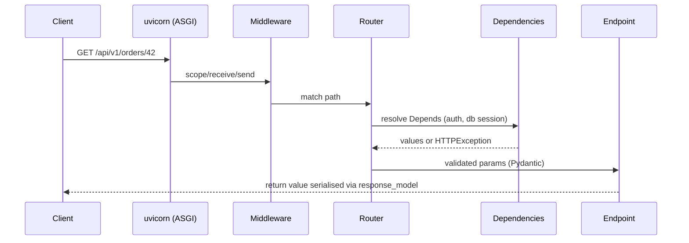

# Lesson 0.1: The Day-One Protocol

| Field | Value |
|---|---|
| Priority | P0 - you start on Monday; every later lesson assumes you can get into an unfamiliar codebase without help. |
| Mode | Exercises 1-3 and the Section 8 challenge: Mode A (closed-book). The Section 9 project: Mode B (docs only; no AI-written design or code). Mode C is allowed only for the optional extension, and you own correctness. |
| Time budget | 10-14 hours over 2-3 sittings. Do the practice repositories before Monday; do the real dossier during your first week. |
| Prerequisites | Comfortable with a shell, `git clone`, Python virtual environments, and reading Python and PHP. No earlier lesson required. |
| Minimum versions | Python 3.12 (for `repo_map.py`), Git 2.28+, PHP 8.2 (reading only), any recent pytest. Framework facts are labelled with a version where checked; anything unchecked is flagged for you to check. The FastAPI and pydantic-settings facts in this lesson were run against FastAPI 0.162, Pydantic 2.14, pydantic-settings and Starlette's test client on Python 3.13. |
| Deliverable | (1) A repository dossier for one real repository (yours on Monday, or a public practice repository beforehand). (2) `repo_map.py`, a standard-library-only, read-only orientation tool, with a passing test suite. |

Attempt first. [Open the reference solutions](../solutions/0.1-day-one-protocol-solutions.md) only after a serious attempt

Assumption notice. I do not know your employer's stack. This lesson assumes only what you told me: Python/FastAPI, PHP/Moodle, SQL databases, and automated tests are involved. Every other assumption is labelled `ASSUMPTION` and comes with a way to test it. When the codebase contradicts this lesson, the codebase wins.

---

## 1. Engineering problem

It is Monday, 09:40. You have a laptop, a repository URL, and a ticket: "Report page shows the wrong total for users with two enrolments." Your teammate is in a meeting until 11:00.

**Way one.** You open an editor and search for `calculate_total`. You guess a value for a missing environment variable (it points at a shared service you should not have touched), rewrite the function, reformat the file, and open a pull request at 15:00. In review you learn that `calculate_total` is used only by the export job, the report page reads a SQL view, and the project documents a one-command setup you never saw.

**Way two.** You spend the first hour changing nothing. You find how the team says to set up (README, `Makefile`, CI configuration), follow it exactly, and write down where it failed. You run the tests so you know what "green" means here. You follow the request from the URL to the data, find the three tests covering that area, write a failing test that reproduces the wrong total, make the smallest change that fixes it, and verify at three levels. At 11:00 you ask one precise question the repository could not answer. Your pull request is 12 lines.

The difference is a protocol, not talent. Improvisation fails in predictable ways: setup deviates silently; no baseline, so pre-existing failures get blamed on you; the wrong module is changed because you searched by name instead of following execution; configuration is guessed; existing tests are missed; the bug is "fixed" without ever being reproduced; the change is larger than the problem; verification covers only the happy path; questions come too early (before reading) or too late (after three days). This lesson gives you the procedure, a tool for the mechanical part, and a document (the dossier) that makes your understanding checkable.

---

## 2. Learning objectives

By the end you will be able to:

1. Set up an unfamiliar Python or PHP project using only its documented workflow, and produce a deviation log (exact error, resolution) for every step that failed.
2. Run the app and tests on a clean checkout and record a baseline (command, passed/failed/skipped counts, wall time, known-flaky tests) before any change.
3. Trace one request end to end through a FastAPI app and through a Moodle plugin page, naming each file and function, and say where authentication, validation, and database access occur.
4. Build a configuration inventory (environment variables, config files, defaults) without the author's help, classifying each item required, optional, or dangerous-to-guess.
5. Find, run, and assess the tests that cover a module.
6. Reproduce a bug as a failing test or scripted command, make and justify the smallest safe change, and verify at three levels.
7. Implement `repo_map.py`, a stdlib-only, read-only orientation tool, with at least 10 tests including adversarial cases (symlinks, undecodable bytes, ignored directories).

---

## 3. First-principles explanation

### 3.1 The protocol

An unfamiliar codebase can be observed but not interrogated. The protocol orders steps so that cheap, read-only, high-information ones come first and state-changing ones last:

```
 READ (no risk)             RUN (low risk)                   CHANGE (real risk)
 1 documented workflow      3 set up exactly as documented   7 reproduce as failing test
 2 CI config + history      4 run app + tests -> baseline    8 smallest safe change
                            5 trace one request              9 verify at three levels
                            6 find config + tests
```

Each step yields one artefact for the dossier: source list; real commands; deviation log; baseline record; trace table; config inventory and test map; failing test; diff; verification record.

Follow the documented workflow even if you dislike it. It is the only setup the team can support; if you deviate, every problem is yours alone and every bug may be an artefact of your environment. Improving a bad README is a legitimate contribution later, with evidence.

Where to look for "how is this run", most to least trustworthy (a heuristic, not a guarantee): (1) CI configuration (`.github/workflows/*.yml`, `.gitlab-ci.yml`, `Jenkinsfile`), because it runs constantly and cannot silently rot for long; (2) task runners (`Makefile`, `tox.ini`, `composer.json` scripts); (3) `Dockerfile` and compose files; (4) README, CONTRIBUTING, `docs/`; (5) history of those files (`git log -p --follow -- Makefile`); (6) people, after the above.

### 3.2 Running and baselining

Run the suite before changing anything and record it:

```
command:   pytest -q            environment: Python 3.12.x, .venv
result:    412 passed, 3 skipped, 2 failed in 94.3s
failing before my change: test_export.py::test_large_file (needs S3), test_mail.py::test_smtp (needs network)
second run identical? yes/no
```

A baseline turns "the tests fail" from an accusation into a dated fact, and tells you the feedback-loop length. pytest selection flags (check `pytest --version`): `--collect-only -q` lists tests; `path::test_name` runs one; `-k "total and not export"` filters by name; `--lf` reruns last failures; `-x` stops at first failure. PHPUnit: `vendor/bin/phpunit path/to/test.php`, `--filter`, `--testsuite`, `--list-tests`. Moodle PHPUnit needs its own test database and initialisation (`php admin/tool/phpunit/cli/init.php`); In Moodle 5.1+ the web-served code lives under `public/`, so the path becomes `php public/admin/tool/phpunit/cli/init.php` (Moodle's own error message shows this form); confirm the procedure on moodledev.io for your version.

### 3.3 Tracing a FastAPI request



Procedure from a URL: (1) find the process entry (`uvicorn app.main:app` means variable `app` in `app/main.py`; look in Makefile, Dockerfile `CMD`, compose); (2) `grep -rn "FastAPI(" .` for the app and its middleware/handlers; (3) `grep -rn "include_router" .`; the final path is the `include_router` prefix + the `APIRouter(prefix=...)` + the decorator path, which is why grepping the whole URL fails (Section 6); (4) find the decorator and note `response_model`, `status_code`, `dependencies`; (5) list every `Depends(...)`, which run before the body and carry auth and sessions; (6) follow into service/repository code if the project has it; (7) find the models or SQL touched.

Runtime confirmation, in a LOCAL configuration only (importing the app runs module-level code, which may connect to databases):

```python
from app.main import app
for r in app.routes:
    print(getattr(r, "methods", None), r.path, getattr(r, "name", ""))
```

`/openapi.json` (if the team has not disabled it) also lists registered routes. Grep gives source truth; this gives runtime truth; disagreement means conditional registration, feature flags, or dead code.

### 3.4 Tracing a Moodle request

In the classic layout a plugin page such as `/local/hello/index.php` is a PHP file executed directly by the web server; there is no single front controller. `ASSUMPTION:` Moodle 4.x. Moodle 5.1 moved most of the codebase, including all plugins, into a `public/` directory (moodledev.io, 5.1 developer update; checked). `ls` your repository root for `public/` and read the matching docs at moodledev.io before trusting any path below.

```php
<?php
require_once(__DIR__ . '/../../config.php');    // boot: $CFG, $DB, $PAGE, $OUTPUT, $USER, session
require_login();                                  // authentication
$context = context_system::instance();
require_capability('local/hello:view', $context); // authorisation (throws if missing)
$id = required_param('id', PARAM_INT);            // typed, cleaned input
$record = $DB->get_record('local_hello', ['id' => $id], '*', MUST_EXIST); // DML API
$PAGE->set_url(new moodle_url('/local/hello/index.php', ['id' => $id]));
$PAGE->set_context($context);
$PAGE->set_title(get_string('pluginname', 'local_hello'));
echo $OUTPUT->header();
echo $OUTPUT->render_from_template('local_hello/card', ['name' => s($record->name)]);
echo $OUTPUT->footer();
```

Procedure: (1) URL to file (plugin type directory, plugin name, script); (2) `version.php` gives `$plugin->component` (e.g. `local_hello`), `version`, `requires`; the component prefixes strings, capabilities, tables, and namespaces; (3) `config.php` at the Moodle root holds DB credentials, `$CFG->wwwroot`, `$CFG->dataroot`, and boots via `lib/setup.php`; (4) guards: `require_login`, `require_capability`, `require_sesskey`; capabilities are declared in `db/access.php`; (5) input: `required_param`/`optional_param` with `PARAM_*` types, moodleform classes; (6) data: `$DB->...`; tables declared in `db/install.xml`, changed in `db/upgrade.php`; (7) output: `$OUTPUT`, `templates/`, `lang/en/<component>.php`, `classes/output/`.

Other entry paths may host the bug instead of a page: AJAX/external functions (`db/services.php`), scheduled and ad hoc tasks (`db/tasks.php`, `classes/task/`), event observers (`db/events.php`), CLI scripts (`admin/cli/`). A plugin's `db/` listing tells you which exist (`db/services.php`, `db/tasks.php`, `db/events.php` are listed in the moodledev.io Common files reference; checked).

### 3.5 Configuration discovery

Behaviour changes without code changes; configuration is the usual cause of "works on my machine" and the usual place secrets leak. Python/FastAPI sources: `os.environ["X"]` (KeyError if unset), `os.environ.get`, `os.getenv`; a settings class (`pydantic-settings` `BaseSettings`, or a project `config.py`; read the field-to-variable naming, `env_prefix` and `model_config` in the project, do not assume. Checked with pydantic-settings on Pydantic 2.14: with no prefix a field `database_url` is read from `DATABASE_URL` case-insensitively, so `database_url=lower` also works; with `env_prefix="APP_"` only `APP_DATABASE_URL` is read and a bare `DATABASE_URL` is ignored); `.env`, `.env.example`, compose `environment:`/`env_file:`, CI `env:`; `docker compose config` prints the resolved file (may contain secrets; do not paste it). Moodle: `config.php` (not committed; `config-dist.php` is the template); admin settings stored in the database (`get_config()`/`$CFG->name`; grep cannot show their values; use the admin UI or `php admin/cli/cfg.php`; options include `--name`, `--component`, `--set`, `--json`, see `--help`); Docker-based dev setups that read `getenv()` in `config.php`.

| Class | Meaning | Handling |
|---|---|---|
| Required | App will not start/serve without it | Record where to get a safe local value |
| Optional | Has a default | Record the default |
| Dangerous | A wrong value touches real systems: payment keys, production DB, SMTP, S3, webhooks | Never guess; ask; use a local stub |

Record names and sources, never secret values.

### 3.6 Smallest safe change

The smallest diff that makes the failing test pass, matches the surrounding conventions, and has an enumerable blast radius. No reformatting, renames, or "while I was here" edits; note other bugs separately. Know the callers (`grep`, editor find-usages; in PHP also string callbacks and templates). CI's formatter and linter are authoritative; never reformat a whole file unless the project does. One logical change per commit (Lesson 0.2). If the smallest fix is ugly, make it, say so in the PR, and propose redesign as a separate conversation (Lesson 0.4); do not redesign someone else's module in week one.

### 3.7 Failure modes of the protocol

Over-reading (cap steps 1-2 at about an hour; running teaches faster); confusing source truth with runtime truth; stale local state (recreate the venv or database once and compare); environment leakage (your shell has `DATABASE_URL` from another project: check `env | sort`). Ask after you have read, searched, and written down what you tried (format in Lesson 0.4); as a rule of thumb, 30-60 minutes on day one, shorter once the team states its preference. Ask for team norms on day one.

---

## 4. Worked example

You are given a small FastAPI service. This worked example is a **walkthrough on code I wrote for this lesson**. It was executed with FastAPI 0.162, Pydantic 2.14, Starlette's `TestClient` (needs `httpx`) on Python 3.13, and the status codes below were observed; run it yourself (`pip install fastapi httpx`) rather than trusting the table.

Repository layout:

```
orders-svc/
  README.md
  Makefile
  .github/workflows/ci.yml
  app/__init__.py
  app/main.py
  app/api/orders.py
  app/deps.py
  app/store.py
  tests/test_orders.py
```

`Makefile` (what you find first):

```make
dev:
	uvicorn app.main:app --reload --port 8000
test:
	pytest -q
```

`app/main.py`:

```python
import os
from fastapi import FastAPI
from app.api import orders

app = FastAPI(title="orders-svc")
app.include_router(orders.router, prefix="/api/v1")

@app.get("/health")
def health() -> dict[str, str]:
    return {"status": "ok", "env": os.environ.get("APP_ENV", "dev")}
```

`app/api/orders.py`:

```python
from fastapi import APIRouter, Depends, HTTPException
from app.deps import require_token
from app import store

router = APIRouter(prefix="/orders", dependencies=[Depends(require_token)])

@router.get("/{order_id}")
def get_order(order_id: int) -> dict:
    order = store.find(order_id)
    if order is None:
        raise HTTPException(status_code=404, detail="order not found")
    return {"id": order["id"], "total": store.total(order)}
```

`app/deps.py`:

```python
import os
from fastapi import Header, HTTPException

def require_token(x_api_token: str = Header(...)) -> None:
    if x_api_token != os.environ["API_TOKEN"]:
        raise HTTPException(status_code=401, detail="bad token")
```

`app/store.py`:

```python
ORDERS = {42: {"id": 42, "lines": [(2, 1999), (1, 500)], "discount": 0}}

def find(order_id: int) -> dict | None:
    return ORDERS.get(order_id)

def total(order: dict) -> int:
    return sum(q * p for q, p in order["lines"]) - order["discount"]
```

### Steps 1-2: Read, set up, baseline

The `Makefile` gives `make dev` and `make test`. Suppose `ci.yml` runs `pip install -r requirements.txt` then `pytest -q` with `API_TOKEN: test-token` in `env:`. Record: *CI sets API_TOKEN; README does not mention it.* You found a documentation gap in two minutes without running anything. Then:

```
python3 -m venv .venv && source .venv/bin/activate
pip install -r requirements.txt
API_TOKEN=test-token make test
```

A venv keeps system Python out of it. Prefixing the variable on the command line scopes it to one command, so it cannot linger in your shell and mask a later missing-variable problem. Record (format illustration, not real output): `Deviation 1: make test without API_TOKEN -> KeyError 'API_TOKEN' at app/deps.py:5. Resolution: set as CI does. Baseline: 6 passed, Python 3.12.`

### Step 3: Trace `GET /api/v1/orders/42`

| Step | Evidence | What happens |
|---|---|---|
| Entry | `Makefile: uvicorn app.main:app` | Module `app/main.py`, object `app` |
| App | `main.py:5` `FastAPI(...)` | No middleware, no custom handlers |
| Router attach | `main.py:6` `include_router(..., prefix="/api/v1")` | Adds `/api/v1` |
| Router prefix | `orders.py:5` `APIRouter(prefix="/orders")` | Adds `/orders` |
| Route | `orders.py:7` `@router.get("/{order_id}")` | Full path `/api/v1/orders/{order_id}` |
| Router dependency | `orders.py:5` `dependencies=[Depends(require_token)]` | Runs before the endpoint body; reads header `X-API-Token`; compares with env `API_TOKEN`; 401 on mismatch. A missing header is a 422, not a 401 (checked) |
| Validation | `order_id: int` | Non-integer path value gives 422 before the function body runs. If the token is also wrong, the dependency's 401 wins over the `order_id` 422 (checked, FastAPI 0.162); a missing token plus a bad `order_id` reports both errors in one 422 |
| Logic | `orders.py:9-13` | `store.find` then 404 or `store.total` |
| Data | `store.py` | In-memory dict (no database in this toy) |

Header naming: FastAPI converts the parameter `x_api_token` to the header `x-api-token` (underscores become hyphens) by default; HTTP header names are case-insensitive. This is documented FastAPI behaviour ("Header Parameters" page of fastapi.tiangolo.com) and was confirmed by running the app: a request sending `X-API-Token` succeeds, while one sending the literal name `x_api_token` is answered with 422 `missing` at `['header', 'x-api-token']`. Header names containing underscores are also commonly dropped by proxies, so send hyphens.

### Step 4: Runtime confirmation, config inventory, tests

```
API_TOKEN=local-token uvicorn app.main:app --port 8000 &
curl -s -i localhost:8000/api/v1/orders/42                                  # expect 422 (header missing)
curl -s -i -H "X-API-Token: wrong" localhost:8000/api/v1/orders/42          # expect 401
curl -s -i -H "X-API-Token: local-token" localhost:8000/api/v1/orders/42    # expect 200 {"id":42,"total":4498}
curl -s -i -H "X-API-Token: local-token" localhost:8000/api/v1/orders/abc   # expect 422
```

Each probe proves a different layer (dependency parameter validation, dependency logic, full path, path validation). Derive expected values by hand first: `2*1999 + 1*500 - 0 = 4498`. An expectation copied from the program's own output proves nothing.

Config inventory: `API_TOKEN` (`deps.py:5`, required; missing means a `KeyError` at request time, not at startup, which is worth reporting) and `APP_ENV` (`main.py:9`, optional, default `"dev"`). Test map: `grep -rln orders tests/` and `pytest --collect-only -q`. Suppose none tests a discount larger than the subtotal.

### Step 5: Reproduce, smallest change, verify

Ticket: "Total can be negative." Hypothesis from reading `store.total`: no lower bound. Reproduce first as a test (this must FAIL before the fix):

```python
def test_total_is_never_negative():
    order = {"id": 1, "lines": [(1, 100)], "discount": 250}
    assert store.total(order) == 0
```

Smallest change:

```python
def total(order: dict) -> int:
    return max(0, sum(q * p for q, p in order["lines"]) - order["discount"])
```

What I did not do: rename `total`, add a `Decimal` migration for money, validate `discount` at input, or introduce a pricing class. Each of those may be right, and each is a design conversation (the ticket may even want a validation error instead of clamping; **that is an ambiguity to confirm with the ticket owner, see Lesson 0.4**).

Verification at three levels: the new test passes; `make test` passes and the count equals baseline plus one; the probe `curl` against an order with a large discount returns total 0.

### The day-one checklist (print this)

```
BEFORE TOUCHING CODE
[ ] Read README, CONTRIBUTING, Makefile/task runner, CI config. List the source of each command.
[ ] Ask (once, early): branch naming, commit style, PR process, who reviews, how to get env/secrets, who is the first contact.
[ ] git log --oneline -20; git shortlog -sn -- <area>; note who touches this area.
SETUP
[ ] Follow documented setup in a clean venv/container. Log every deviation (exact error, fix).
[ ] Run the application; hit one health/home route.
[ ] Run the full test suite; record command, counts, duration, known failures. Run twice.
UNDERSTAND
[ ] Trace one request/page end to end (table with file:line).
[ ] Config inventory (name, source, class). No secret values written down.
[ ] Test map for the area you will touch; run just those.
CHANGE
[ ] Reproduce the bug as a failing test or script. Save the failing output.
[ ] Smallest change; no drive-by edits; match local style.
[ ] Verify: narrow test, wider suite vs baseline, manual check.
[ ] Review your own diff (git diff) line by line before anyone else does.
REPORT
[ ] PR description (Lesson 0.4). End-of-day message: done / next / blocked.
```

---

## 5. Production perspective

- **Correctness:** baselines and reproduce-first are correctness practices; a fix without a failing test has not been shown to fix anything.
- **Security:** do not run unknown scripts against shared or production data; do not commit `.env` (`git check-ignore -v .env` tells you if it is ignored; check `git status` before every commit); never paste secrets into chat, tickets, or AI tools. If the only documented path points at a shared environment, ask first.
- **Observability:** find where logs go and how to raise verbosity locally (uvicorn has `--log-level`; application loggers are configured by the project: `grep -rn logging`). Moodle debugging is controlled by `$CFG->debug` and `$CFG->debugdisplay` (`$CFG->debug` and `$CFG->debugdisplay` appear in Moodle's `config-dist.php`; checked); never enable debug display on a shared production site.
- **Operations:** `git log --since="3 months ago" --name-only --format= | sort | uniq -c | sort -rn | head -20` approximates where work and risk concentrate; exclude lockfiles and generated files, which dominate.
- **Maintainability:** offer README corrections back after verifying them and confirming the team wants them.

**What a senior engineer does differently:** starts from CI; logs deviations as they happen; confirms the code path from the URL down instead of trusting the first grep hit; asks one question that states what they tried, expected, and saw; treats existing convention as the default even when they would choose differently; keeps the first PR small on purpose to learn the review process cheaply.

| Beginner mistake | Symptom | Diagnosis |
|---|---|---|
| Installing into system Python | "Other project broke"; CI differs | `which python`; `python -c "import sys; print(sys.prefix)"` |
| Wrong interpreter version | Syntax/type-hint errors | Compare `python --version` with CI or `requires-python` |
| Stale database or state | Passes locally, fails in CI | Recreate once; compare |
| Editing a different copy | Change has no effect | Print the imported module's `__file__`; `pip show -f pkg` |
| Env var inherited from shell | Differs from colleague | `env \| grep -i NAME`; rerun with `env -i` plus needed vars |
| Moodle change invisible | Old output persists | Caches; `php admin/cli/purge_caches.php` (`admin/cli/purge_caches.php` exists in Moodle core; checked) |

---

## 6. Failure laboratory

### The flawed investigation

A new engineer is asked to find the handler for `GET /api/v2/reports/summary` and records the following in their dossier. They searched with `grep -rn "/api/v2/reports/summary" .` and found only this match, in a test file:

```
tests/test_reports.py:12:    r = client.get("/api/v2/reports/summary")
```

They conclude: "No handler exists; the test must be calling a removed endpoint, so it must be failing or mocked." They write this in the dossier as fact. The relevant source files are:

```python
# app/main.py
app = FastAPI()
app.include_router(reports.router, prefix="/api")

# app/api/reports.py
router = APIRouter(prefix="/v2/reports")

@router.get("/summary")
def summary(): ...
```

**Predict before reading further.** (a) Why did the grep find no handler? (b) Is the engineer's conclusion about the test correct? (c) Which two other commands find the handler within a minute? (d) What is the process error, as opposed to the technical one?

### Reveal (read after predicting)

(a) The URL never appears in one piece in the source. FastAPI joins the `include_router` prefix (`/api`), the router prefix (`/v2/reports`), and the decorator path (`/summary`).

(b) No. The handler exists; the engineer reported absence of evidence as evidence of absence.

(c) `grep -rn '"/summary"' app/` finds the decorator; `grep -rn "include_router" app/` finds the attach point. Or read the assembled path from `/openapi.json` or a printed `app.routes`.

(d) A negative finding was recorded as fact after one search method. Diagnosis procedure for "I cannot find X": (1) search for parts, not wholes (last segment, function name, string key); (2) search in more than one representation: source, runtime route listing, tests, history (`git log -S"summary" --oneline`); (3) check indirection: prefixes, `app.mount`, routes registered in loops, string dispatch, and in Moodle callbacks resolved by naming convention (`<component>_extend_navigation`), the class autoloader, and `db/events.php`; (4) label the finding **present** (file:line), **absent** (two independent methods agree), or **unknown** (what you tried).

---

## 7. Retrieval practice

Closed-book; answers are in the solutions file.

1. Rank README, CI workflow, Makefile, and a colleague's chat message by trustworthiness for "how are tests run". Justify first and last.
2. `include_router(r, prefix="/api")`, `APIRouter(prefix="/v1")`, `@router.get("/items/{id}")`. Full path? If `id: int` and the request has `id=abc`, what status results and before what?
3. Where does a Moodle plugin declare capabilities, and what runtime call checks them? How does `require_login()` differ from `require_capability()`?
4. `pytest -q` shows `412 passed, 3 skipped, 2 failed`. What three things must you know before saying your change caused the failures?
5. `os.environ["X"]` versus `os.environ.get("X")` when X is unset; why does it matter to a config inventory?
6. `router = APIRouter(dependencies=[Depends(auth)])` with `@router.get("/x") def x(): ...`. Does `auth` run for `GET /x`?
7. Name four Moodle entry paths other than a page script and the `db/` file registering each where one exists.
8. What does `git log --name-only --format= | sort | uniq -c | sort -rn | head` approximate? Name two kinds of file that distort it.
9. A 3-line fix shows 340 changed lines in `git diff --stat`. Give three causes and the action for each.
10. Why prefer `API_TOKEN=x make test` over `export API_TOKEN=x` while exploring?
11. A grep for `/api/v2/orders` returns nothing. Give three other ways to find the handler.
12. Define blast radius and give two techniques to estimate it.

---

## 8. Independent implementation challenge

**Mode A (closed-book, no AI).** Time box: 90 minutes.

Implement `infer_test_commands(root: Path) -> list[Candidate]` in a module `test_command.py` (Python 3.12+, stdlib only), where `Candidate` is a frozen dataclass with `command: str`, `evidence: str`, and `confidence: str` (`"documented"` or `"inferred"`).

Behaviour:

- `"documented"` means a human or CI declared it: a `Makefile` with a `test:` target yields `make test`; each CI workflow file under `.github/workflows/` whose lines contain a `pytest`, `phpunit`, or `tox` command yields that command text (trimmed), with the workflow filename as evidence. Ignore installation lines (`pip install ...`).
- `"inferred"` means a configuration file suggests it: pytest configuration (`pytest.ini` or a `[tool.pytest` section in `pyproject.toml`) yields `pytest`; `phpunit.xml` or `phpunit.xml.dist` yields `vendor/bin/phpunit`; `tox.ini` yields `tox`.
- Documented candidates come first, then inferred. Duplicate `command` strings are removed, keeping the first. Missing files and unreadable or non-UTF-8 files must not raise.
- Never execute anything; read files only.

Constraints: at least 4 unittest tests using `tempfile`, including one test of ordering/deduplication, one for a Makefile with no `test` target, and one for an undecodable file. State in a comment one case where your heuristic would give a misleading answer.

Done when: your tests pass, and you can explain to a reviewer why "documented" outranks "inferred".

---

## 9. Project

**Mode B.** Two parts submitted together: a dossier for a real repository, and `repo_map.py`.

| Field | Content |
|---|---|
| 1. Problem statement | Produce a dossier that lets another engineer reproduce your setup, understand one feature's structure, and verify one change, plus a tool automating the mechanical part of orientation. |
| 2. Context | Monday: your employer's repository. Before Monday, practise on public repositories. `ASSUMPTION:` Moodle core (developer docs at moodledev.io; source at `github.com/moodle/moodle`, checked) and a small FastAPI application with tests (the FastAPI framework repository is a framework, not an app: look for a template or example app). Keep employer material inside company-approved storage and out of anything public. |
| 3. Requirements | `DOSSIER.md` (2-4 pages): sources read; setup as executed and deviation log; baseline (two runs); trace table with file:line for one request or page (FastAPI or Moodle, per the repo) plus a short trace of the other kind on a practice repo; config inventory with classes; test map for one area; one bug reproduced as a failing test or script, fixed with a diff and verified at three levels; open questions ordered by how blocking they are. Tool: `repo_map.py` + `test_repo_map.py`. |
| 4. Constraints | Stdlib only (tests use `unittest`), Python 3.12+. Tool is read-only, never imports or executes scanned code, never follows symlinks, tolerates non-UTF-8 and files over 1 MB, skips dependency/build directories by default. No secret values anywhere: names only. |
| 5. Acceptance criteria | `python3 -m unittest` passes with at least 10 tests. The report shows: counts by extension; marker files (build, test, container, CI); FastAPI app/router objects and decorator routes with file:line; environment variable names with file:line; Moodle plugin components and versions from `version.php`; Moodle `db/` files; test files; `--json` output that `json.loads` parses. Two runs give identical output. Five sampled dossier trace claims each open at the cited line. |
| 6. Edge cases | Empty directory; path is a file; symlink loop and symlink outside the root; BOM or invalid UTF-8; huge file; Windows line endings; core `version.php` that is not a plugin; multi-line decorators and dynamically registered routes (document as undetectable); `os.environ` with a non-literal key. |
| 7. Quality requirements | Type hints; functions small enough to hold in your head; no global mutable state; each heuristic documented with an example of where it is wrong; deterministic ordering; error messages that say what to do. |
| 8. Deliverables | `DOSSIER.md`; `repo_map.py`; `test_repo_map.py`; a LIMITATIONS section with at least 4 known inaccuracies; `repo_map_output.md` from one practice repo; a failure log entry (format in Lesson 0.3). |
| 9. Difficulty | Foundation to Intermediate; the tool is Foundation, the discipline of the dossier is the difficulty. |
| 10. Estimated effort | Dossier on a practice repo 3-5 h; tool and tests 3-5 h; debugging and polish 1-3 h. Total 7-13 h. |
| 11. Progressive hints | L1: build and test `iter_files` before any scanner; most bugs live there. L2: `os.walk(followlinks=False)`, prune `dirnames` in place, check `is_symlink()` on files too; keep scanners pure functions from `(path, text)` to data. L3: one regular expression per decorator line capturing object, verb, and path literal (test single quotes, double quotes, inner spaces); one pattern per env access style, and beware that a loose `getenv(` also matches inside `os.getenv(`, giving duplicates. L4: extract `$plugin->component/version/requires` from `version.php` by regex; no `component` means not a plugin; sort directory and file names at each level for determinism. |
| 12. Evaluation rubric (100) | Tool meets acceptance criteria 20; tests (edge and adversarial cases; hand mutation check shows they fail when code is broken) 15; safety properties 10; dossier setup, deviations, baseline 10; trace accuracy (five sampled claims) 15; config inventory 8; test map, reproduction, smallest change, verification 12; limitations honestly documented 5; code quality and determinism 5. |
| 13. Extension challenge | Add `--since GIT_REF` using `subprocess.run` with a list argument (no shell) and `git diff --name-only`, handling a non-git directory. Or parse Moodle `db/access.php` for `captype` and `contextlevel`, documenting what regex cannot do with PHP arrays. |
| 14. Reflection questions | Which trace claims were wrong the first time, and how did you find out? Which heuristic would mislead a newcomer most, and where is it disclosed? What did the tool find that reading would have taken an hour to find, and what did it miss entirely? What would you ask a teammate that no tool could answer? |

---

## 10. Engineering review

- [ ] Every command in the dossier was run by me; outputs summarised, not predicted.
- [ ] Every trace row has a file:line I re-opened after writing it; claims are labelled present/absent/unknown.
- [ ] No secrets; the reproduction fails for the right reason (I read the message); the diff contains only the fix.
- [ ] Tool: matches manual grep on three claims; never writes in the target; no exec/eval/import of scanned code; bad bytes, big files, and permission errors do not crash it; two runs are byte-identical; each heuristic has a positive and a negative test; breaking a safety check by hand makes a test fail; no dependency or feature beyond the spec.

Explain your decisions in 2-3 sentences each: why regex rather than `ast` for Python (and what you lose: `ast` is stdlib but fails on syntax errors and does not help with PHP); why prune during the walk rather than filter afterwards; why scanners return data and rendering is separate; what the worst misleading output is and where you warn the user.

---

## 11. Mastery gate

Pass = 80/100 and no critical failure. Critical failures: (1) a secret value in any deliverable or commit; (2) the tool executes, imports, or writes inside the scanned repository, or follows a symlink out of it; (3) a trace claim that is wrong and was never verified; (4) a bug "reproduction" that does not fail before the fix; (5) tests that do not exercise the code (break one heuristic and confirm a test fails).

Evidence: `python3 -m unittest` transcript; `repo_map_output.md`; the dossier; failing-then-passing output.

Defence (15 minutes, closed-book): in a repository you have not seen, trace a request using only grep, find, and an editor, narrating the next step at each decision.

If failed: clone a different public repository; within 60 minutes produce a one-page trace table with file:line evidence and a baseline record for one route or page. The reviewer samples three claims. Repeat until all three hold.

---

## 12. Reflection and accountability

```
What I learned:
What I initially misunderstood:
What took the most effort:
Bugs and how I diagnosed them (symptom -> hypothesis -> evidence -> cause):
What I'd change:
What remains unclear:
```

**Ledger update:** status -> Introduced (read) / Practised (challenge done) / Demonstrated (project passes the gate and you defend it without the lesson).

**Failure log entry:** record one failure from this lesson in the 9-field format of Lesson 0.3 (candidates: a setup deviation, a wrong trace claim, a regex that missed a case, a test that passed for the wrong reason).

---

## References

- FastAPI docs, "Bigger Applications - Multiple Files" and "Dependencies" (fastapi.tiangolo.com): how `include_router`, `APIRouter(prefix=...)`, and router-level `dependencies` compose.
- Moodle Developer Resources (moodledev.io), plugin files and plugin types: authoritative `db/` files, `version.php` fields, and the layout of your Moodle version.
- pytest docs, "How to invoke pytest" (docs.pytest.org): selection flags used in Section 3.2.
- Python docs for `os.walk`, `pathlib`, `re`, `unittest` (docs.python.org): `followlinks` and in-place pruning of `dirnames`.
- Pro Git, "Viewing the Commit History" (git-scm.com/book): `git log` options for history mining.

## Further depth (optional)

Rebuild the Python scanner with the `ast` module and compare which false positives disappear and which failure modes (syntax errors, version-specific grammar) appear; measure rather than assume. Read "Working Effectively with Legacy Code" (Feathers) on characterisation tests (check edition details before citing); the baseline is the simplest form.
