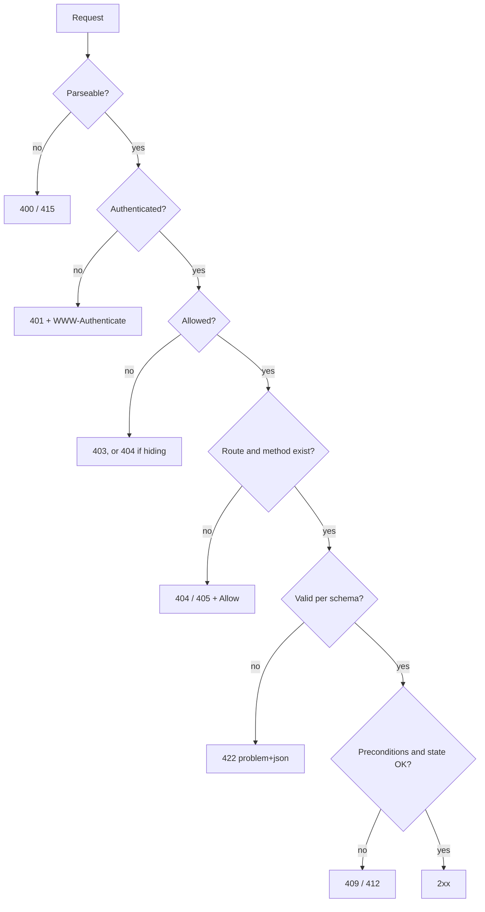

# Lesson 2.1: HTTP, REST and API Contracts

| Field | Value |
|---|---|
| Priority | P0. Every backend task you are given on Monday is an HTTP contract first and code second. |
| Mode | Retrieval and Section 6: A. Section 4 labs: B (curl, docs only). Section 8: B. Project: B (Mode C allowed for drafting OpenAPI boilerplate only; you own correctness). |
| Time budget | 7-9 hours (reading 2h, labs 2h, challenge 1.5h, project 3h) |
| Prerequisites | Lessons 0.1, 1.2 (context managers, exceptions), 1.3 (venv, typing). Ability to run `curl`. |
| Minimum versions | Python 3.12 (stdlib server lab), curl 7.x or newer. HTTP semantics: RFC 9110. No third-party packages needed in this lesson. |
| Deliverable | An API contract (OpenAPI 3.1 file plus a written error and pagination policy) for a small "Library Loans" service, a stdlib server that conforms to it, and a `curl` conformance script. |

Attempt first. Solutions: `../solutions/2.1-http-rest-contracts-solutions.md`

---

## 1. Engineering problem

A mobile team and a billing service both call your endpoint `POST /payments`. A client on a flaky network times out after 10 seconds and retries. The server had actually processed the first request. The customer is charged twice. Your code was correct; the contract was not: nobody had decided whether `POST /payments` is safe to retry, what the client should send to make it safe, or which status code means "I already did this".

Other failures from the same family:

- An endpoint returns `200` with `{"error": "not found"}`. Monitoring counts it as a success, the client library does not raise, the retry layer does not retry, and the on-call engineer sees a green dashboard during an outage.
- A "small" change renames `fullName` to `full_name`. Three consumers break at 02:00 because the contract lived only in the developer's head.
- A list endpoint returns every row. It works with 200 rows in staging and takes a service down with 4 million rows in production.
- A proxy caches a per-user response because nobody set `Cache-Control: private`, and user A sees user B's data.

HTTP is a mature protocol with precise semantics for these cases. An engineer who uses those semantics deliberately produces APIs that other people (and other machines: proxies, caches, retry libraries, API gateways) can reason about without reading your code. This lesson is the vocabulary and the discipline. Lesson 2.2 then shows how FastAPI expresses it.

## 2. Learning objectives

After this lesson, with no notes, you can:

1. Classify any HTTP method as safe and/or idempotent, and given a retry scenario, choose a method and design for it with a justification that names the RFC 9110 definitions.
2. Select the correct status code (and required headers such as `Location`, `Allow`, `WWW-Authenticate`, `Retry-After`) for 15 given situations, and defend the choice between near neighbours (400/422, 401/403, 404/410, 409/412).
3. Implement conditional GET (`ETag` / `If-None-Match`) and conditional update (`If-Match` returning `412`) on a stdlib HTTP server, and demonstrate both with curl.
4. Design an error format conforming to RFC 9457 (`application/problem+json`) with extension members for field-level validation errors, and apply it uniformly.
5. Write an OpenAPI 3.1 document for a resource with list (paginated), create, read, replace, partial update and delete operations, including error responses.
6. Choose between offset and cursor pagination for a stated workload, and specify the contract (parameters, response envelope, ordering guarantees, maximum page size).
7. Classify a proposed API change as backward-compatible or breaking, and state a versioning approach with its costs.

## 3. First-principles explanation

### 3.1 What HTTP actually is

HTTP is a stateless, request/response application protocol. A request has a method, a target, headers and an optional body. A response has a status code, headers and an optional body. "Stateless" means each request carries everything the server needs to process it; session state, if any, is rebuilt from a token or cookie in the request, not remembered by the connection. This is what lets you put ten server instances behind a load balancer and what lets intermediaries (CDNs, reverse proxies, gateways) participate.

Intermediaries are the key reason semantics matter. A proxy does not know your business logic. It knows: "this is a GET, so I may cache it if headers allow", "this is a PUT, so if it fails I may retry it", "this response is 503 with `Retry-After`, so I back off". If your API lies (a GET that deletes a row), every intermediary becomes a bug amplifier.

HTTP/1.1 is a text protocol: a request line (`POST /items HTTP/1.1`), headers, a blank line, then the body. HTTP/2 and HTTP/3 change framing and multiplexing but not the semantics. Authoritative semantics are in RFC 9110 (HTTP Semantics), caching in RFC 9111, HTTP/1.1 message syntax in RFC 9112.

### 3.2 Methods, safety and idempotency

Definitions come from RFC 9110 section 9 and describe the *intended effect on server state*, not your implementation:

- **Safe**: the client neither requests nor expects a state change (GET, HEAD, OPTIONS, TRACE).
- **Idempotent**: N identical requests have the same intended effect on the server as one (the safe methods, plus PUT and DELETE). POST and PATCH are not idempotent by default.

| Method | Safe | Idempotent | Typical use |
|---|---|---|---|
| GET / HEAD | yes | yes | Read a representation / headers only |
| OPTIONS | yes | yes | Capabilities, CORS preflight |
| POST | no | no | Create under a collection; run an action |
| PUT | no | yes | Replace the target with the supplied full representation |
| PATCH | no | no | Partial modification (RFC 5789) |
| DELETE | no | yes | Remove the resource |

Two subtleties that matter in incident reviews:

1. **Idempotent does not mean same response.** `DELETE /items/2` returns `204` the first time and, by design choice, `404` or `204` afterwards. The guarantee is on server *state* (item 2 absent). Returning `204` on repeats makes client retry logic trivial; `404` reveals that the first call succeeded. Both are defensible; document one. This lesson's server returns `204`.
2. **Idempotency is a property of the semantics you implement, not the verb you pick.** A `PUT` that appends to a list violates the contract and breaks retry libraries. You can make a POST retry-safe with an idempotency key (implementation in Lesson 2.6). `Idempotency-Key` is the subject of an IETF HTTP API working group Internet-Draft (`draft-ietf-httpapi-idempotency-key-header`, revision -08 and still an Active Internet-Draft, not an RFC, when checked on datatracker.ietf.org in October 2026); treat it as a convention, not a standard, and re-check before citing.

PUT sends the **complete** new representation, so omitted fields mean "absent". PATCH sends a **description of changes**: JSON Merge Patch (RFC 7396; `null` deletes a member, so it cannot express "set to null") or JSON Patch (RFC 6902; an array of `{"op", "path", "value"}` operations). Many APIs use a looser convention, "an object containing the fields to change". That is fine if you document what absent versus `null` means; Lesson 2.2 shows how Pydantic distinguishes them.

### 3.3 Status codes: the contract with machines

The class tells a generic client what to do; the specific code tells a specific client why.

- **2xx.** `200` body returned. `201 Created` new resource, with `Location`. `202 Accepted` queued, not done (Lesson 2.6). `204 No Content` success without body or `Content-Type`.
- **3xx.** `304 Not Modified` (conditional GET matched; no body; carries validators). `307/308` redirects that preserve method and body; `301/302` historically let clients turn POST into GET.
- **4xx, the client must change something.**
  - `400` unparseable request (broken JSON). `401` *authentication* missing or invalid, must include `WWW-Authenticate`. `403` known but not allowed; re-authenticating will not help. `404` no such resource (or you choose not to reveal it; a legitimate security decision, document it). `405` route exists, method does not; must include `Allow`.
  - `406` cannot satisfy `Accept`; `415` cannot read the request `Content-Type`. `409` well-formed but conflicts with current state (duplicate key, state-machine violation). `410` deliberately and permanently gone. `412` an `If-Match` condition was false: the standard optimistic-lock failure. `428` (RFC 6585): you require the precondition header and it was absent.
  - `422 Unprocessable Content` (older RFCs: "Entity"): syntactically valid, semantically invalid. FastAPI uses it for validation errors. Teams argue 400 vs 422; consistency matters more. This book uses 422 for schema/validation failures and 400 for unparseable requests.
  - `429` rate limited (RFC 6585), with `Retry-After`.
- **5xx, the server failed.** `500` unexpected; `502/504` bad or slow upstream; `503` overloaded or in maintenance, with `Retry-After`.

Retry middleware typically retries idempotent requests on 502/503/504 and connection errors, and never retries 4xx. A `200` carrying an error object defeats every one of those mechanisms; a `500` for a client validation bug pages you at 3 am for the wrong reason.



The order of checks is itself a design decision: authenticating before validating avoids leaking schema details to anonymous callers.

### 3.4 Headers that matter

`Content-Type`, `Accept`, `Content-Length`; `Location` (201, redirects); `Allow` (405, OPTIONS); `Authorization` / `WWW-Authenticate` (Lesson 2.5); `Retry-After`; `Link` (RFC 8288, often `rel="next"`); and the caching family below.

**Content negotiation.** `Accept` states what the client wants; the server picks a representation or answers `406`. Most JSON APIs support one media type. Negotiation matters for `text/csv` exports or vendor types (`application/vnd.example.v2+json`). If a response varies by a request header, say so with `Vary` or caches will serve the wrong variant.

**Caching and validators (RFC 9111).** A strong `ETag` is an opaque string such as `"e660dde0638d1a0b"` (quotes are part of the value). The client later sends `If-None-Match: "e660..."`; if unchanged the server returns `304` with no body. Key `Cache-Control` directives:

- `no-store`: never store (sensitive data). `no-cache`: may store, must revalidate before every reuse (the name is a famous trap).
- `private`: end-user cache only; use for anything user-specific. `public`, `max-age=N`, `s-maxage`, `must-revalidate`, `immutable`.

Default stance for authenticated JSON: `private, no-cache` or `no-store` unless you have decided otherwise. Without explicit directives, caches may apply heuristic freshness (RFC 9111 section 4.2.2) from `Last-Modified`.

**Conditional update.** `If-Match: "<etag>"` on PUT/PATCH/DELETE means "only if the resource still has this version"; mismatch gives `412`. This is optimistic concurrency at the HTTP layer (the database counterpart is Lesson 2.4) and prevents lost updates for clients that read, edit for a minute, and write back.

### 3.5 JSON and representations

JSON (RFC 8259) is UTF-8 text with objects, arrays, strings, numbers, booleans, null. Contract-level rules that save you later:

- **Numbers**: JSON has no integer type and many consumers (JavaScript) parse numbers as IEEE-754 doubles, exact only up to 2^53. IDs above that, and money, need care. Represent money as integer minor units (`price_cents`) or as a decimal string; never a float. Large IDs: strings.
- **Time**: RFC 3339 / ISO 8601 with an explicit offset, usually UTC: `2026-10-26T14:18:10Z`. Never local time without a zone.
- **Absent vs null**: decide and document. They are different states in PATCH.
- **Envelopes and enums**: lists return a top-level object, never a bare array; enums are documented strings and clients must tolerate unknown values if you intend to add some.

### 3.6 REST, honestly

REST is an architectural style (Fielding) with constraints: client-server, stateless, cacheable, uniform interface (including hypermedia), layered. Almost no production JSON API follows the hypermedia part. What people call "REST" is usually *resource-oriented HTTP+JSON*: nouns as URLs, verbs as methods, status codes for outcomes. That is a good target; do not argue purity in code review.

Rules of thumb: plural nouns for collections (`/loans`), ids in the path, filters and paging in the query string, hierarchy only where a child cannot exist without its parent. For non-CRUD actions choose by failure semantics: a resource (`POST /loans/17/returns` creating a record), a state change (`PATCH /loans/17`), or an RPC-style sub-resource (`POST /loans/17/return`). Alternatives (GraphQL, gRPC, plain RPC over POST) trade uniform semantics and cacheability for client-chosen fields, typing or simplicity; default to resource-oriented HTTP until a measured requirement says otherwise (Lesson 4.1).

### 3.7 Contracts, OpenAPI, versioning

A contract states paths, methods, parameters, bodies, responses (including errors), auth, and semantics. **OpenAPI** (3.1 aligns its schema dialect with JSON Schema 2020-12) is the standard format; FastAPI generates one at `/openapi.json` (Lesson 2.2). *Code-first* is easy but risks accidental change; *contract-first* is slower and safer for multi-team APIs. Either way, diff the contract in CI. Use whatever diff tool your team has (for example `oasdiff`, an actively maintained open-source tool; read its CLI help for the exact command).

Backward-compatible (generally): new optional request field, new response field (if clients ignore unknowns), new endpoint, new enum value (only if clients tolerate unknowns). Breaking: removing or renaming a field, changing type or meaning, making an optional input required, tightening validation, changing status codes, changing default sort or page size.

Versioning: URI (`/v1`: visible, simple routing), header or media type (clean URLs, harder to test), or additive-only evolution with deprecation signals (`Deprecation` header: RFC 9745; `Sunset` header: RFC 8594; both checked at rfc-editor.org). Opinion: for a small-consumer API, additive evolution plus one `/v1` prefix is cheapest; add `/v2` only when a break is unavoidable and run both for a stated window.

### 3.8 Consistent errors: RFC 9457 problem details

RFC 9457 (which obsoletes RFC 7807) defines `application/problem+json` with members:

- `type`: URI identifying the problem type (default `about:blank`, meaning "use the HTTP status as the meaning").
- `title`: short human summary, stable per type.
- `status`: the HTTP status (advisory copy).
- `detail`: human explanation specific to this occurrence.
- `instance`: URI identifying this occurrence.
- Extension members are allowed, e.g. an `errors` array for field-level validation failures.

```json
{
  "type": "https://api.example.test/problems/validation",
  "title": "Validation failed",
  "status": 422,
  "instance": "/loans",
  "errors": [{"loc": ["body", "due_on"], "msg": "must be in the future", "type": "value_error"}]
}
```

Rules: clients branch on `type` (or `status`), never on `detail`; never put stack traces, SQL or internal hostnames in `detail`; give every 5xx a correlation id (request id) that also appears in server logs (Lesson 2.7). One format for every error, including framework-generated ones (404 for unknown routes, 405, 422, unhandled exceptions), is the whole point.

### 3.9 Pagination contracts

Every list endpoint that can grow must paginate by contract from day one; adding it later is a breaking change (clients that assumed "all rows" silently see a truncated set).

- **Offset/limit** (`?limit=20&offset=40`): simple, random access, supports "page 7 of 30". Costs: deep offsets scan and discard rows (O(offset) work in most databases), and results shift under concurrent inserts and deletes (duplicates or skipped rows between pages).
- **Cursor/keyset** (`?limit=20&after=<opaque>`): the cursor encodes the sort key of the last row seen; the next page is "rows after that key". Stable under inserts, constant-cost per page with a suitable index; no random access, no cheap total count. Lesson 2.4 implements it.

Contract elements to specify: parameter names, default and **maximum** `limit` (enforced, 422 if exceeded or clamp, say which), the **total ordering** (must be deterministic: add a unique tiebreaker such as `id`), the envelope (`items`, `next_cursor` or `total`), and what happens at the end (empty `items` and `next_cursor: null`). Treat cursors as opaque and signed or at least validated; a client must not construct them.

## 4. Worked example

We build the tiny server, then probe it with curl, as an engineer would when verifying a contract by hand. The code below is verified to run under Python 3.12+ (tested on 3.13). It is deliberately *not* a framework: seeing the raw mechanism makes FastAPI's behaviour in Lesson 2.2 legible.

### 4.1 The server (`tinyserver.py`)

```python
"""Tiny stdlib HTTP server for Lesson 2.1 labs. Python 3.12+. Not for production."""
import hashlib
import json
import re
from http.server import BaseHTTPRequestHandler, ThreadingHTTPServer

ITEMS: dict[int, dict] = {
    1: {"id": 1, "name": "pen", "price_cents": 150},
    2: {"id": 2, "name": "book", "price_cents": 1200},
    3: {"id": 3, "name": "lamp", "price_cents": 4500},
}
NEXT_ID = 4
ITEM_RE = re.compile(r"^/items/(\d+)$")


def etag_of(body: bytes) -> str:
    return '"' + hashlib.sha256(body).hexdigest()[:16] + '"'


class Handler(BaseHTTPRequestHandler):
    protocol_version = "HTTP/1.1"

    def _send(self, status: int, payload=None, headers=None, ctype="application/json"):
        body = b"" if payload is None else json.dumps(payload).encode()
        self.send_response(status)
        if payload is not None:
            self.send_header("Content-Type", ctype)
        self.send_header("Content-Length", str(len(body)))
        for k, v in (headers or {}).items():
            self.send_header(k, v)
        self.end_headers()
        if self.command != "HEAD":
            self.wfile.write(body)

    def _problem(self, status: int, title: str, detail: str, headers=None):
        self._send(
            status,
            {"type": "about:blank", "title": title, "status": status,
             "detail": detail, "instance": self.path},
            headers, ctype="application/problem+json",
        )

    def _body_json(self):
        length = int(self.headers.get("Content-Length", "0"))
        raw = self.rfile.read(length)
        try:
            return json.loads(raw)
        except json.JSONDecodeError:
            return None

    def do_GET(self):
        if self.path.split("?")[0] == "/items":
            rows = sorted(ITEMS.values(), key=lambda r: r["id"])
            return self._send(200, {"items": rows})
        m = ITEM_RE.match(self.path)
        if not m:
            return self._problem(404, "Not Found", "No such route")
        item = ITEMS.get(int(m.group(1)))
        if item is None:
            return self._problem(404, "Not Found", "No such item")
        body = json.dumps(item).encode()
        tag = etag_of(body)
        hdrs = {"ETag": tag, "Cache-Control": "private, max-age=0, must-revalidate"}
        if self.headers.get("If-None-Match") == tag:
            return self._send(304, None, hdrs)
        return self._send(200, item, hdrs)

    do_HEAD = do_GET

    def do_POST(self):
        global NEXT_ID
        if self.path != "/items":
            return self._problem(404, "Not Found", "No such route")
        data = self._body_json()
        if not isinstance(data, dict) or "name" not in data or "price_cents" not in data:
            return self._problem(422, "Invalid body", "name and price_cents are required")
        item = {"id": NEXT_ID, "name": data["name"], "price_cents": data["price_cents"]}
        ITEMS[NEXT_ID] = item
        NEXT_ID += 1
        return self._send(201, item, {"Location": f"/items/{item['id']}"})

    def do_PUT(self):
        m = ITEM_RE.match(self.path)
        if not m:
            return self._problem(404, "Not Found", "No such route")
        data = self._body_json()
        if not isinstance(data, dict) or "name" not in data or "price_cents" not in data:
            return self._problem(422, "Invalid body", "name and price_cents are required")
        iid = int(m.group(1))
        created = iid not in ITEMS
        ITEMS[iid] = {"id": iid, "name": data["name"], "price_cents": data["price_cents"]}
        return self._send(201 if created else 200, ITEMS[iid])

    def do_DELETE(self):
        m = ITEM_RE.match(self.path)
        if not m:
            return self._problem(404, "Not Found", "No such route")
        ITEMS.pop(int(m.group(1)), None)   # idempotent: same end state each time
        return self._send(204)

    def do_PATCH(self):
        return self._problem(405, "Method Not Allowed", "PATCH is not supported",
                             {"Allow": "GET, HEAD, POST, PUT, DELETE"})


if __name__ == "__main__":
    ThreadingHTTPServer(("127.0.0.1", 8081), Handler).serve_forever()
```

Design choices: an explicit `Content-Length` on every response (even `0`) is required for HTTP/1.1 keep-alive; `_problem` centralises the error format so it cannot drift; `do_HEAD = do_GET` works because `_send` skips the body but still reports its length; PUT returns `201` on create and `200` on replace; DELETE of a missing item returns `204` (same end state); the ETag is a hash of the serialized representation, so it changes exactly when the representation does.

### 4.2 Probing with curl

Start the server (`python tinyserver.py`) and use a second terminal. Flags: `-i` includes response headers, `-I` sends HEAD, `-X` sets the method, `-H` adds a header, `-d` sends a body (curl defaults the Content-Type to `application/x-www-form-urlencoded` for `-d`, so set it explicitly when it matters).

```bash
# 1. Read, observe the validators
curl -i localhost:8081/items/1
# 2. Conditional GET: copy the ETag you received
curl -i -H 'If-None-Match: "PASTE-ETAG-HERE"' localhost:8081/items/1     # expect 304, empty body
# 3. Create: expect 201 and a Location header
curl -i -X POST -H 'Content-Type: application/json' \
     -d '{"name":"mug","price_cents":900}' localhost:8081/items
# 4. Invalid body: expect 422 with Content-Type application/problem+json
curl -i -X POST -d '{"name":"x"}' localhost:8081/items
# 5. Idempotency of DELETE: run twice, compare status and final state
curl -i -X DELETE localhost:8081/items/2 ; curl -i -X DELETE localhost:8081/items/2
# 6. Method not allowed: expect 405 and an Allow header
curl -i -X PATCH localhost:8081/items/1
# 7. HEAD: headers only, Content-Length matches what GET would send
curl -I localhost:8081/items/1
```

Reading the output is the skill. For each response, answer in writing: status, which headers a cache or client library will act on, and whether repeating the request changes server state.

### 4.3 A contract excerpt (OpenAPI 3.1)

Hand-written for the same resource; this is what you review in a PR before implementing. The naive alternative to the server above (`200` for everything, `int(path)` crashing on `/items/abc`, an `{"error": ...}` body) lacks every property below: status carries outcome, route matching is strict, every response has `Content-Type` and `Content-Length`, errors share one shape, GET participates in caching.

```yaml
openapi: 3.1.0
info: {title: Items API, version: 1.0.0}
paths:
  /items/{item_id}:
    parameters:
      - {name: item_id, in: path, required: true, schema: {type: integer, minimum: 1}}
    get:
      summary: Read one item
      responses:
        "200":
          description: The item
          headers:
            ETag: {schema: {type: string}}
          content:
            application/json: {schema: {$ref: "#/components/schemas/Item"}}
        "304": {description: Not modified (If-None-Match matched)}
        "404":
          description: No such item
          content:
            application/problem+json: {schema: {$ref: "#/components/schemas/Problem"}  # RFC 9457 shape, defined once in components}
components:
  schemas:
    Item:
      type: object
      required: [id, name, price_cents]
      properties:
        id: {type: integer}
        name: {type: string, minLength: 1}
        price_cents: {type: integer, minimum: 0}
```

## 5. Production perspective

**Correctness.** Define retry behaviour per endpoint in the contract: "safe to retry", "safe with Idempotency-Key", "never retry". Document repeat-call responses for DELETE. Pagination ordering must be total.

**Security.** `401` / `403` / `404` is an information-disclosure decision; for resources whose existence is sensitive, answer `404` to unauthorised callers. Never reflect raw exception text in `detail`. Use `private` or `no-store` on user-specific responses. Cap body and page size (a missing `limit` cap is a denial-of-service lever). Answer `415` rather than guessing a content type. State-changing GETs are a vulnerability class (CSRF, prefetch). Cursors must not let a client read another tenant's rows; check authorisation on every request.

**Failure handling.** Clients have three buckets: do-not-retry (most 4xx), retry-with-backoff (429, 502, 503, 504, network errors; idempotent or keyed requests only), investigate (500). Your status codes feed those buckets fleet-wide.

**Observability.** Alert on 5xx rate; chart 4xx by `type` (a 422 spike on one field after a deploy is a client or contract regression). Log method, route template (not raw URL; bounded cardinality), status, latency, request id.

**Maintainability.** Commit the OpenAPI file or a generated snapshot; fail CI on unreviewed diffs; deprecate with notice.

**What a senior engineer does differently.** Writes the contract and error cases before the handler. Asks "what happens on retry?" and "what happens when this table is 100x larger?" for every endpoint. Treats the error body as part of the API. Refuses a list endpoint without a limit cap, and pushes back on `200` with an error body even when a frontend developer asks for it "to make parsing easier".

**Common beginner mistakes** (symptom; diagnosis): `200` with error JSON (flat error dashboard during an outage; read the status line with `curl -i`). Bare array responses (cannot add paging; inspect top-level JSON type). Float money (`0.1 + 0.2` on invoices; grep the schema). Missing `Content-Length` (client hangs; `curl -v`). Unbounded lists (latency grows with data; call with no params against production-sized data). Different error shapes for "no route" and "no row" (compare bodies of each failure path).

## 6. Failure laboratory

**Scenario.** A teammate adds a "cancel order" feature to a service that sits behind a CDN and a link-checking monitor:

```python
def do_GET(self):
    m = re.match(r"^/orders/(\d+)/cancel$", self.path)
    if m:
        ORDERS[int(m.group(1))]["status"] = "cancelled"
        return self._send(200, {"ok": True})
    ...
```

and the order list endpoint returns:

```python
return self._send(200, ORDERS_LIST, {"Cache-Control": "public, max-age=3600"})
```

where `ORDERS_LIST` is built from the *authenticated user's* orders.

**Before reading further, write down:** (a) at least two distinct incidents this will cause in production, (b) which components cause each, (c) the exact curl command that demonstrates each against a local server, and (d) the minimal fix for each.

### Reveal (read after predicting)

1. **State-changing GET.** Safe methods may be called by anything: prefetchers, crawlers, uptime monitors, email security scanners that follow every link, browsers that preload. Orders get cancelled without any human decision. Also an attacker can make a victim's browser issue the GET via an image tag (CSRF). Demonstrate: `curl -i localhost:8081/orders/5/cancel` twice, then `curl localhost:8081/orders/5`. Fix: make cancellation a `POST /orders/5/cancel` (or `PATCH` status), idempotent in effect (cancelling an already cancelled order returns the same final state), requiring authentication and CSRF protection if cookie-authenticated.
2. **Shared caching of private data.** `Cache-Control: public, max-age=3600` allows the CDN to store the response and serve it to *any* caller on that URL for an hour. If the URL does not include the user identity, user B receives user A's orders. Demonstrate with a caching proxy, or by reading the headers with `curl -i` and reasoning from RFC 9111. Fix: `Cache-Control: private, no-cache` (or `no-store`), and `Vary: Authorization` if shared caching of per-user variants is ever deliberately wanted.

Systematic diagnosis for any "weird HTTP behaviour": (1) reproduce with `curl -i`/`-v`, bypassing every client library; (2) read status line, then headers (`Content-Type`, `Cache-Control`, `Vary`, `ETag`, `Location`, `Allow`), then body; (3) ask who else (proxy, CDN, retry layer) acts on this method and response; (4) bisect hop by hop (client, gateway/CDN, load balancer, app) and diff headers; (5) turn the failing curl into a regression test (TestClient in Lesson 2.2).

## 7. Retrieval practice

Answer closed-book (Mode A). Answers are in the solutions file.

1. Define "safe" and "idempotent" per RFC 9110. Give one method that is idempotent but not safe, and one that is neither.
2. A client sends `DELETE /items/9` twice. The first returns 204, the second 404. Is the endpoint idempotent? Justify precisely.
3. Why does a retry library normally refuse to automatically retry `POST` after a read timeout, and what mechanism lets you make it retry-safe?
4. Pick the status code and any mandatory headers: (a) missing bearer token, (b) valid token, user lacks permission, (c) PUT with stale `If-Match`, (d) unique-email violation on signup, (e) `limit=100000` when the maximum is 100, (f) `DELETE /items` on a route that only supports GET and POST.
5. What is the difference between `Cache-Control: no-cache` and `no-store`?
6. Code reading: the response `HTTP/1.1 201 Created` has no `Location` header. What is missing and what does a client lose?
7. Predict the response status and body presence: `GET /items/1` with `If-None-Match` equal to the current ETag.
8. Why is `{"items": [...], "next_cursor": null}` a better list response than `[...]`?
9. List three changes to a response schema that are backward compatible and three that are breaking.
10. Name the five members defined by RFC 9457 and say which one clients should branch on.
11. A list endpoint uses `?offset=&limit=` ordered by `created_at`. Describe two distinct ways a client can see wrong data while paging, and what contract change fixes each.
12. Why is "PUT creates a resource at a client-chosen URI" idempotent while "POST /items" is not?

## 8. Independent implementation challenge

**Mode B (docs only; no AI design or code).** Extend `tinyserver.py` (copy it; do not modify the original) into `loans_server.py` implementing a `/loans` resource, without any third-party packages:

- `GET /loans?limit=&after=` returns `{"items": [...], "next_cursor": str | null}`, ordered by `id` ascending, default limit 10, maximum 50. Out-of-range or non-integer limit gives `422` problem+json with an `errors` extension member naming the parameter. The cursor is opaque (base64 of JSON) and an invalid cursor gives `422`.
- `POST /loans` with `{"book_id": int, "member": str}` creates a loan, returns `201`, `Location`, body. Reject missing fields, wrong types (including `bool` where int is required, since `True` is an `int` in Python), and unknown fields.
- `GET /loans/{id}` returns an `ETag`; supports `If-None-Match` (304).
- `PUT /loans/{id}` replaces a loan and **requires** `If-Match`: missing gives `428`, stale gives `412`, matching succeeds with a new ETag. Both errors are problem+json.
- Unknown route: `404`. Known route, wrong method: `405` with a correct `Allow` for *that* route.
- Wrong request `Content-Type` on POST/PUT (anything other than `application/json`) gives `415`.
- A single `_problem` function produces every error. A malformed JSON body gives `400`.

Constraints: Python 3.12, stdlib only, under 250 lines. Deliver `conformance.sh` (curl with `-s -o /dev/null -w '%{http_code}'`) asserting each rule and exiting non-zero on the first mismatch.

## 9. Project

**Project: Library Loans API Contract and Conforming Stub**

| Field | Content |
|---|---|
| Problem statement | A college library needs a small HTTP API for books, members and loans for three consumers (kiosk app, staff web UI, nightly overdue-notice job) written by different people. Produce the contract and a stdlib stub proving it is implementable and testable. |
| Context | Reused in Lesson 2.2 (FastAPI implementation) and 2.3 (schema). Consumers will not read your code. A Moodle-style system may later list loans per course. |
| Requirements | 1. `openapi.yaml` (3.1) covering `/books`, `/members`, `/loans` (collection and item); justify omitted verbs. 2. `API-POLICY.md` (max 2 pages): RFC 9457 error format with `type` URIs, status table per operation, pagination choice per list, caching per endpoint, idempotency/retry per endpoint, versioning and deprecation, naming. 3. `loans_server.py` stub implementing at least `/loans` and `/books` list+read with canned data. 4. `conformance.sh` with at least 25 assertions covering every documented status code of implemented endpoints. 5. `BREAKING-DRILL.md`: 8 proposed changes, each classified with reasoning. |
| Constraints | stdlib only for the stub; spec must validate (record the validator used); no state-changing GETs; money as integer minor units; RFC 3339 UTC times; every list paginated with enforced maximum. |
| Acceptance criteria | Spec validates. Every status the stub can emit is declared in the spec and vice versa. `conformance.sh` passes from a clean start and demonstrably fails when you break one rule on purpose. Policy and spec agree. |
| Edge cases | Return a book already returned; loan for a nonexistent member (404 or 422: decide); concurrent PUT with the same ETag; deleting a member with active loans (409); `limit=0`, `-1`, `abc`; empty collection; cursor from a deleted row; very long strings; unknown JSON fields; duplicate POST from a retry (specify `Idempotency-Key` behaviour in the contract even if the stub is naive). |
| Quality requirements | Reviewable in 20 minutes. One error shape everywhere. Descriptions on every operation and parameter. A retry statement for every endpoint. Stub has type hints and passes `python -m py_compile`. |
| Deliverables | `openapi.yaml`, `API-POLICY.md`, `loans_server.py`, `conformance.sh`, `BREAKING-DRILL.md`, 10-line `README.md`. |
| Difficulty | Intermediate |
| Estimated effort | 4-6 hours including debugging the conformance script. |
| Progressive hints | 1: Write the status-code table first (rows operations, columns outcomes); spec and stub fall out of it. 2: For "member does not exist" on loan creation, ask whether the *URL* is wrong (404) or the *body value* is wrong (422). 3: Put cursor encode/decode in two small functions and test them alone before wiring. 4: In the script, define `expect() { want=$1; shift; got=$(curl -s -o /dev/null -w '%{http_code}' "$@"); [ "$got" = "$want" ] \|\| { echo "FAIL $want vs $got: $*"; exit 1; }; }`. |
| Evaluation rubric (100) | Contract correctness and completeness 25; status and header precision 20; error format consistency 15; pagination, caching and retry policies justified by workload 15; conformance script detects regressions 15; breaking-change drill 5; documentation clarity and brevity 5. |
| Extension challenge | Automatically diff the status codes declared in the spec against those observed by the conformance run; fail on any undeclared status. |
| Reflection questions | Which policy decision would be most expensive to reverse after launch? What did the stub reveal that spec review missed? Where did you want to return 200 with an error, and what was the real need behind it? |

## 10. Engineering review

Self-review checklist:

- [ ] Each endpoint's method semantics are defensible (safe? idempotent? why?); no GET changes state.
- [ ] Every status in the spec is produced by the stub and vice versa.
- [ ] All errors, including routing-layer 404/405/415/400, use the same problem+json shape.
- [ ] `Allow` on every 405; `Location` on every 201; `WWW-Authenticate` on every 401.
- [ ] Lists: enforced max limit, total order with tiebreaker, end-of-list behaviour specified.
- [ ] Caching deliberate; nothing user-specific is `public`. No float money; times carry zones.
- [ ] The conformance script fails when I deliberately break a rule.

Explain your design decisions (3-5 sentences each): offset or cursor per list; 404 or 422 for a nonexistent foreign reference; repeat-DELETE status; why your versioning approach is the cheapest that works for three consumers; which part of the contract you are least sure about.

## 11. Mastery gate

Pass = 80/100 on the project rubric and no critical failure. Evidence: the five deliverables; a terminal transcript of `conformance.sh` passing, then failing after a deliberate break; Mode A answers to Section 7 questions 1-6 scoring at least 5/6.

Critical failures: a state-changing GET anywhere; any error path returning 2xx or an undeclared body shape; a list with no enforced maximum page size; user-specific data marked `public` or lacking a caching policy; spec and implementation disagreeing on a status code that the conformance script does not catch.

If failed: close the lesson and write from memory a 12-row table (situation, method, status, mandatory headers) for an invented "bookmarks" API. Implement three rows in under 40 lines of stdlib server code and prove each with a curl transcript.

## 12. Reflection and accountability

Fill in: what I learned (testable statements); what I initially misunderstood; what took the most effort; bugs and how I diagnosed them (symptom, hypothesis, evidence, fix); what I would change if consumers doubled; what remains unclear.

Ledger update: status -> `Introduced` after reading; `Practised` after the challenge; `Demonstrated` after the project passes the gate; `Mastered` only after reproducing conditional GET and 405/Allow handling from a blank file 14 days later.

Failure log entry: one concrete mistake (for example "returned 200 on validation failure"), the signal that exposed it, the check that would have caught it earlier, and the regression assertion you added.

## References

- RFC 9110, HTTP Semantics (https://www.rfc-editor.org/rfc/rfc9110): authoritative method, status code and conditional request semantics. Read sections 9 (methods), 15 (status codes), 13 (preconditions).
- RFC 9111, HTTP Caching (https://www.rfc-editor.org/rfc/rfc9111): `Cache-Control` directives and freshness rules.
- RFC 9457, Problem Details for HTTP APIs (https://www.rfc-editor.org/rfc/rfc9457): the error format; short, read all of it.
- OpenAPI Specification 3.1 (https://spec.openapis.org/oas/v3.1.0): structure of paths, parameters, responses, components.
- MDN Web Docs, HTTP (https://developer.mozilla.org/en-US/docs/Web/HTTP): readable explanations of headers and status codes with examples.
- RFC 6585 (https://www.rfc-editor.org/rfc/rfc6585): definitions of 428 and 429.
