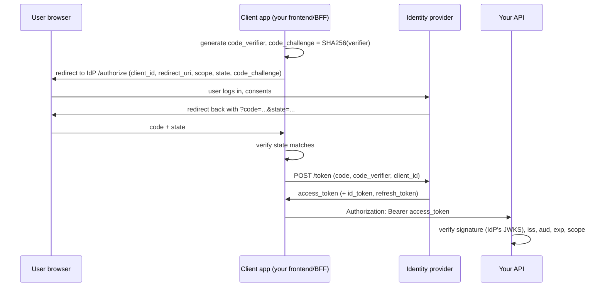

# Lesson 2.5: AuthN, AuthZ, Passwords, JWT/OAuth Basics, Secrets

| Field | Value |
|---|---|
| Priority | P0. Every backend you will touch has users and data that belong to someone; broken access control is the most common serious defect class in web APIs. |
| Mode | Exercises 8.1, 9 (project): Mode B (docs-only, no AI design/code). Retrieval practice: Mode A. Failure lab: Mode A for the prediction, Mode B for diagnosis. |
| Time budget | 10-14 hours (reading 2h, worked example 2h, lab 1h, challenge 2h, project 4-6h) |
| Prerequisites | 1.3 (config, packaging), 1.4 (pytest), 2.1 (HTTP, status codes), 2.2 (FastAPI DI, Pydantic), 2.3-2.4 (SQL, transactions) |
| Minimum versions | Python 3.12, FastAPI 0.115+ (examples checked on 0.162.0), Pydantic v2, SQLAlchemy 2.x, PyJWT 2.x (checked on 2.15.1), pwdlib 0.3.1 with argon2 extra, pytest 8+ |
| Deliverable | A small FastAPI service with registration, login, short-lived access tokens, ownership-enforced resources, role-gated admin routes, a rate limiter on login, and a test suite proving the negative cases (A01-A14 in section 9) |

Attempt first. Solutions: `../solutions/2.5-authn-authz-passwords-secrets-solutions.md`

**Scope rule for this lesson.** All security work here is defensive and is run against the application you wrote, on your machine. You do not probe systems you do not own.

---

## 1. Engineering problem

Your team ships a notes API. A week after launch a customer writes: "I changed the number in the URL and saw somebody else's note." The endpoint was:

```python
@app.get("/notes/{note_id}")
def read_note(note_id: int, user: CurrentUser, db: DbSession):
    return db.get(Note, note_id)      # authenticated, yes. authorized? no.
```

The user was authenticated (the token was valid). Nobody asked whether *this* user may see *this* row. That is **broken object-level authorization** (BOLA, also called IDOR), and it is the top item in the OWASP API Security Top 10 (2023 edition, API1; VERIFY the current edition at owasp.org/API-Security).

Typical failures in this area:

- Passwords stored as `sha256(password)`: a database leak becomes mass account takeover.
- A JWT library call that trusts the `alg` header, letting a forged `alg: none` token through.
- A 30-day token with no revocation: a stolen laptop means a month of access.
- A `role` claim read from the token and trusted.
- `SECRET_KEY = "changeme"` committed to git and reused across environments.
- A login endpoint with no throttling, so credential stuffing runs at network speed.

By the end you will be able to design the minimum safe version of all of this, test the negative cases, and explain to a reviewer why each line exists.

---

## 2. Learning objectives

After this lesson and its exercises you can:

1. Implement password registration and login using Argon2id (through `pwdlib`), with a timing-equalized failure path, and write tests proving that wrong password and unknown user return the same response.
2. Issue and verify a short-lived JWT access token with PyJWT using a pinned algorithm list and required claims (`exp`, `sub`, `iss`, `aud`), and write tests that reject `alg: none`, an expired token, a wrong audience and a tampered payload.
3. Implement an ownership check as a reusable dependency/function so that no endpoint loads a row by ID without scoping to the caller, and write a two-user test that fails if the check is removed.
4. Implement role-based gating as a FastAPI dependency and justify, in two sentences, why roles alone do not solve BOLA.
5. Implement an in-process token-bucket rate limiter, apply it to login keyed by client identity, and state three reasons it is insufficient for a multi-instance deployment.
6. Load all secrets from environment configuration with fail-fast validation, and write a repository check that fails CI if a secret-looking string is committed.
7. Explain, without notes, the OAuth 2.0 authorization code flow with PKCE and what OIDC adds (the ID token), and say which parts your backend implements versus delegates to an identity provider.

---

## 3. First-principles explanation

### 3.1 Authentication vs authorization

- **Authentication (AuthN)**: establishing *who is making this request*. Output: an identity (user id, maybe a client id).
- **Authorization (AuthZ)**: deciding *whether that identity may perform this action on this resource*. Output: allow or deny.

They fail independently. A system can authenticate perfectly and authorize nothing (the notes bug above). HTTP status mapping (builds on 2.1): **401** means "I do not know who you are / credentials invalid"; **403** means "I know who you are, and you may not". There is a third option that is often better for object access: **404**, so you do not confirm that an object you cannot see exists. Choose deliberately and document it (this is a convention, not a protocol rule).

### 3.2 Sessions vs tokens

**Server-side session.** Login creates a random session id stored in a server-side store (database, Redis); the client holds only an opaque cookie. Every request looks the session up.

- Pros: instant revocation (delete the row), small client state, nothing sensitive in the client.
- Cons: a lookup per request, a shared store for multiple instances, cookie-based auth needs CSRF defenses.

**Self-contained token (JWT).** The server signs a claim set; the client presents it; any instance verifies the signature without a lookup.

- Pros: stateless verification, convenient across services.
- Cons: **cannot be revoked before expiry** unless you add state back; claims go stale (a user demoted five minutes ago still carries `role: admin` until the token expires); every mistake in verification is a vulnerability.

Opinion: for a first-party web app talking to its own backend, server-side sessions are simpler and safer; JWTs earn their cost when independent services must verify identity without a central store, or when an external provider issues the tokens. A common compromise: **short-lived access token (5-15 minutes) + longer-lived refresh token stored server-side** so that revocation is possible at refresh time.

### 3.3 Password storage

Threat model: the attacker has your database (backup leak, SQL injection, insider). They can test guesses offline at their own speed. Your only defense is to make each guess *expensive* and *unique*.

Why not a fast hash (MD5, SHA-1, SHA-256, SHA-512)? They are designed to be fast. A GPU rig tests enormous numbers per second, and without a per-user salt identical passwords produce identical hashes, enabling precomputed tables and showing who shares a password. Adding a salt fixes the second problem but not the first. You need a **password hashing function** that is deliberately slow and memory-hard:

- **Argon2id**: winner of the Password Hashing Competition; the usual recommendation today (OWASP Password Storage Cheat Sheet lists Argon2id first; VERIFY current parameters there).
- **bcrypt**: older, still acceptable, widely deployed; truncates input at 72 bytes (a known gotcha).
- **scrypt / PBKDF2**: acceptable in constrained or FIPS contexts; PBKDF2 needs very high iteration counts.

A stored hash string is self describing: `$argon2id$v=19$m=65536,t=3,p=4$<salt>$<hash>`. The salt and parameters live inside it, so you can raise parameters later and re-hash on next successful login (`check_needs_rehash`-style logic; in `pwdlib` this is `verify_and_update`). Never invent your own scheme, never encrypt passwords (encryption is reversible), never store them recoverably. Password *reset* flows exist because passwords are not recoverable.

Skip composition rules. Enforce a minimum length (NIST SP 800-63B: at least 8; many teams choose 12+; VERIFY), reject known-breached passwords where feasible, and cap the maximum (e.g. 128) to bound hashing cost (unbounded input is a CPU denial-of-service vector).

### 3.4 JWT internals

A JWT is three base64url segments: `header.payload.signature`.

```
header   = {"alg":"HS256","typ":"JWT"}
payload  = {"sub":"u1","exp":1760000000,"iss":"elite-api","aud":"elite-web", ...}
signature = HMAC_SHA256(secret, base64url(header) + "." + base64url(payload))
```

The payload is **encoded, not encrypted**. Anyone holding the token can read it. Never put secrets or sensitive personal data in it.

**HS256** (symmetric): the same secret signs and verifies; fine when one service does both. **RS256/ES256/EdDSA** (asymmetric): a private key signs, a public key verifies; required when verifiers must not be able to mint tokens (other services, third-party tokens).

Pitfalls, each with its mitigation:

| Pitfall | What happens | Mitigation |
|---|---|---|
| `alg: none` | Library accepts an unsigned token | Always pass an explicit `algorithms=[...]` list on decode |
| Algorithm confusion | A service expects RS256; attacker sends HS256 signed using the *public key* as the HMAC secret | Pin the algorithm list to the one you issue; never derive the algorithm from the token header |
| No `exp` check | Token valid forever | Require `exp` (`options={"require": [...]}`) and keep it short |
| No `aud`/`iss` check | A token minted for service A accepted by B | Verify both |
| Role in token trusted | Stale or forged privileges | Load role from your DB per request, or accept staleness knowingly |
| No revocation | Stolen token usable until expiry | Short TTL, refresh tokens in DB, optional deny-list keyed by `jti` |
| Token in `localStorage` | Any XSS exfiltrates it | Prefer `HttpOnly; Secure; SameSite` cookies for browser clients (trade-off: CSRF defenses needed) |
| Weak HMAC secret | Offline brute force of the signature | At least 32 random bytes; from a secret store |

### 3.5 OAuth 2.0 and OIDC at the level you need

- **OAuth 2.0** is a *delegated authorization* framework: a user lets application A access their resources at provider B without giving A their password. It is **not** an authentication protocol by itself.
- **OpenID Connect (OIDC)** is a thin identity layer on top: it adds an **ID token** (a JWT describing the authenticated user), a `userinfo` endpoint and discovery metadata (`/.well-known/openid-configuration`).

The flow a web app should use is **Authorization Code with PKCE**:



What your **backend** typically does: it is the *resource server*. It verifies bearer access tokens from the identity provider: fetch the provider's public keys (JWKS), cache them, verify signature/`iss`/`aud`/`exp`, then map `sub` to a local user and check scopes/permissions. It does **not** implement the provider. The `state` parameter defends against CSRF on the redirect; PKCE defends against authorization-code interception. Do not build your own identity provider unless that is the product. The old "implicit" flow and the "password" grant are deprecated for new work (OAuth 2.1 drafts remove them; VERIFY status of the OAuth 2.1 draft at oauth.net).

Note: FastAPI's `OAuth2PasswordBearer`/`OAuth2PasswordRequestForm` implement the *shape* of the password-grant request so Swagger UI's Authorize button works for your own first-party login. That does not make your API an OAuth provider.

### 3.6 Authorization models

- **RBAC (role-based)**: users have roles; roles grant permissions. Good for coarse capabilities: "admins may delete users", "editors may publish".
- **Ownership / relationship checks**: "this note belongs to this user", "this user is a member of this project". These are *per-object* decisions.
- **ABAC / policy engines**: decisions from attributes (department, time, resource tags). Reach for these when rules are numerous and cross-cutting.

RBAC does **not** prevent BOLA. A user with role `user` hitting `/notes/17` needs an *ownership* decision, and "admin may read everything" must be an explicit, tested branch, not an accident. The robust pattern: **every query that loads a user-visible object is scoped by the caller**, either in a single data-access function (`get_note_for(user, id)`) or in the query itself (`WHERE id = :id AND owner_id = :uid`). Scoping in the query is stronger, because the unauthorized row is never loaded.

### 3.7 Secrets management

A secret is anything that grants access: signing keys, DB passwords, API keys, OAuth client secrets. Rules:

1. Never in source control. Rotation after any accidental commit; deleting the commit is not enough (it lives in clones and caches).
2. Injected via environment or a secret store (cloud secret manager, Vault, Kubernetes secrets with encryption at rest) at deploy time.
3. Distinct per environment.
4. Validated at startup: the process refuses to boot if a required secret is missing or obviously weak. (Builds on 1.3 configuration.)
5. Rotatable: design verification to accept a *set* of keys (a `kid` header and a key map) so rotation does not log everyone out.
6. Never logged. Redact `Authorization` headers and password fields.

### 3.8 Rate limiting basics

A **token bucket** holds up to `capacity` tokens and refills at `rate` per second; each request consumes one; with none left, respond `429 Too Many Requests` with `Retry-After`. For login, key by client IP *and* target username (IP-only is bypassed by distributed sources; username-only lets an attacker lock out a victim; prefer slowing over locking). In-process limiters are per-instance (N instances means roughly N times the limit) and reset on restart; production limiting lives at the gateway or in a shared store such as Redis. Behind a proxy, take the client IP from a forwarded header only when the request came from your own proxy.

---

## 4. Worked example

We build a minimal but correct core: hashing, token issue/verify, current-user dependency, role gate, ownership check. The store is a dict so the security logic is visible; the project replaces it with SQLAlchemy.

### 4.1 Naive version (do not ship)

```python
def register(username, password):
    USERS[username] = {"pw": hashlib.sha256(password.encode()).hexdigest(), "role": "user"}
def login(username, password):
    u = USERS.get(username)
    if u and u["pw"] == hashlib.sha256(password.encode()).hexdigest():   # fast hash, == compare
        return jwt.encode({"sub": username, "role": u["role"]}, "changeme")  # no exp, role baked in, secret in code
def current_user(token):
    return jwt.decode(token, options={"verify_signature": False})        # "easier to test"
@app.get("/notes/{id}")
def read(id: int, user=Depends(current_user)):
    return NOTES[id]                                                      # BOLA
```

### 4.2 Improved version

File `app25.py` (Python 3.12+; `pip install fastapi "pwdlib[argon2]" pyjwt python-multipart`; `python-multipart` is required by FastAPI to parse the OAuth2 form). I ran this code and its tests under FastAPI 0.162.0, PyJWT 2.15.1, pwdlib 0.3.1.

```python
from __future__ import annotations
import os, time, uuid
from typing import Annotated
import jwt
from fastapi import Depends, FastAPI, HTTPException, status
from fastapi.security import OAuth2PasswordBearer, OAuth2PasswordRequestForm
from pwdlib import PasswordHash

JWT_SECRET = os.environ["JWT_SECRET"]          # KeyError at import = fail fast
JWT_ALG = "HS256"
ACCESS_TTL = 15 * 60

hasher = PasswordHash.recommended()            # Argon2id by default
DUMMY_HASH = hasher.hash("not-a-real-password")   # equalizes timing for unknown users

USERS: dict[str, dict] = {}
NOTES: dict[int, dict] = {}

def create_token(user_id: str, role: str) -> str:
    now = int(time.time())
    claims = {"sub": user_id, "role": role, "iat": now, "exp": now + ACCESS_TTL,
              "jti": uuid.uuid4().hex, "iss": "elite-api", "aud": "elite-web"}
    return jwt.encode(claims, JWT_SECRET, algorithm=JWT_ALG)

oauth2 = OAuth2PasswordBearer(tokenUrl="/token")

def current_user(token: Annotated[str, Depends(oauth2)]) -> dict:
    try:
        claims = jwt.decode(
            token, JWT_SECRET,
            algorithms=[JWT_ALG],                      # never read alg from the token
            audience="elite-web", issuer="elite-api",
            options={"require": ["exp", "sub", "iss", "aud"]},
        )
    except jwt.PyJWTError:
        raise HTTPException(status.HTTP_401_UNAUTHORIZED, "invalid token",
                            headers={"WWW-Authenticate": "Bearer"})
    user = USERS.get(claims["sub"])
    if user is None or not user["active"]:
        raise HTTPException(status.HTTP_401_UNAUTHORIZED, "invalid token",
                            headers={"WWW-Authenticate": "Bearer"})
    return user                                        # role comes from the DB, not the token

CurrentUser = Annotated[dict, Depends(current_user)]

def require_role(*roles: str):
    def dep(user: CurrentUser) -> dict:
        if user["role"] not in roles:
            raise HTTPException(status.HTTP_403_FORBIDDEN, "forbidden")
        return user
    return dep

app = FastAPI()

@app.post("/token")
def login(form: Annotated[OAuth2PasswordRequestForm, Depends()]):
    user = USERS.get(form.username)
    stored = user["pw"] if user else DUMMY_HASH
    ok = hasher.verify(form.password, stored)          # always spend the hashing time
    if not (user and ok and user["active"]):
        raise HTTPException(status.HTTP_401_UNAUTHORIZED, "bad credentials")
    return {"access_token": create_token(user["id"], user["role"]), "token_type": "bearer"}

def get_note_for(user: dict, note_id: int) -> dict:
    note = NOTES.get(note_id)
    # 404, not 403: do not confirm that other users' ids exist
    if note is None or (note["owner"] != user["id"] and user["role"] != "admin"):
        raise HTTPException(status.HTTP_404_NOT_FOUND, "note not found")
    return note

@app.get("/notes/{note_id}")
def read_note(note_id: int, user: CurrentUser):
    return get_note_for(user, note_id)

@app.delete("/admin/users/{uid}", dependencies=[Depends(require_role("admin"))])
def delete_user(uid: str):
    USERS.pop(uid, None)
    return {"deleted": uid}
```

What changed and why:

| Change | Reason |
|---|---|
| Argon2id via `pwdlib` instead of SHA-256 | Slow, salted, memory-hard; parameters embedded in the hash for future upgrades |
| `verify` runs even for unknown users (`DUMMY_HASH`) | Without it, an unknown username returns faster than a wrong password, which lets an attacker enumerate accounts by timing |
| Identical 401 body for both failure cases | Prevents account enumeration by response |
| `algorithms=[JWT_ALG]` | Defeats `alg: none` and algorithm confusion |
| `options={"require": [...]}` | PyJWT validates `exp` *if present*; `require` makes absence an error |
| `audience`/`issuer` | A token meant for another service is rejected |
| Role loaded from the user row | A forged or stale `role` claim has no effect; the cost is one lookup, which you needed anyway to check `active` |
| `get_note_for` with 404 | Ownership enforced in one place |
| `JWT_SECRET = os.environ[...]` | Missing config crashes the process at startup instead of running with a default |

### 4.3 Tests that prove the negatives

Seed three users (`u1`, `u2` role user; `a` role admin) and one note owned by `u1`, then assert (full file in the solutions file):

```python
def test_bola_blocked():  assert c.get("/notes/1", headers=tok("u2", "pw2")).status_code == 404
def test_role_403():      assert c.delete("/admin/users/u2", headers=tok("u1", "pw1")).status_code == 403

def test_alg_none_rejected():
    forged = jwt.encode({"sub": "a", "exp": int(time.time()) + 60,
                         "iss": "elite-api", "aud": "elite-web"}, key=None, algorithm="none")
    assert c.get("/notes/1", headers={"Authorization": "Bearer " + forged}).status_code == 401

def test_role_claim_ignored():   # u2 signs a token claiming admin with the real secret
    t = jwt.encode({"sub": "u2", "role": "admin", "exp": int(time.time()) + 60,
                    "iss": "elite-api", "aud": "elite-web"}, app25.JWT_SECRET, algorithm="HS256")
    assert c.delete("/admin/users/u1", headers={"Authorization": "Bearer " + t}).status_code == 403
```

I ran the full set (10 tests) green. `TestClient` emitted a Starlette deprecation warning about `httpx` in my environment (see VERIFY below).

### 4.4 Rate limiter

Implement a token bucket (section 3.8) with an injectable `clock: Callable[[], float]` so tests control time instead of sleeping (1.4). One bucket per key in a dict; evict idle keys or memory grows with every distinct attacker address. A tested reference is in the solutions file.

---

## 5. Production perspective

**Correctness.** Authorization is enforced server-side on every request; hiding a button is not access control. Deny by default: put the auth dependency on the router (`APIRouter(dependencies=[Depends(current_user)])`) so omission is hard.

**Security.**
- Mass assignment: if an input model includes `role` and you do `User(**body.model_dump())`, a client promotes themselves. Separate input and DB models (2.2). Use `response_model` as an allow-list so hashes never leak.
- Use `hmac.compare_digest` for any secret you compare yourself (API keys). CORS is not authorization; `curl` ignores it.
- Log auth failures with request id, user id and reason code; never the password or token.
- Cookie auth: `HttpOnly`, `Secure`, `SameSite`, plus CSRF defenses for state-changing requests.

**Failure handling.** If the identity provider's JWKS endpoint is down, serve with cached keys (TTL) and alert. If Redis (rate limiter) is down, decide fail-open vs fail-closed per endpoint.

**Performance.** Argon2id is deliberately expensive. Calling `hasher.verify` inside an `async def` handler blocks the event loop (lesson 2.6); declare such handlers with plain `def` so FastAPI uses its threadpool. Tune parameters on production-class hardware so login takes a human-imperceptible but non-trivial time; measure, do not copy numbers.

**Testing.** For every protected route test: no credentials (401), wrong user (404/403), right user (200), expired/forged token (401). Always use two users.

**What a senior engineer does differently.** Asks "what is the object, who owns it, where is that checked?" for every endpoint in review; prefers vetted libraries or an identity provider to hand-rolled crypto; writes abuse-case tests before the happy path is "done"; keeps tokens short-lived and decides revocation on day one; treats the secrets inventory and rotation procedure as a deliverable.

**Common beginner mistakes and diagnosis.**

| Mistake | How to find it |
|---|---|
| `db.get(Model, id)` with a path id | grep `.get(`/`where(Model.id == id)` without owner predicate; log in as B, request A's id: 200 means BOLA |
| Trusting `role` in the token | Sign a low user's token with `role: admin` using the test secret; if the privileged route returns 200, it is trusted |
| `verify_signature: False` left in | grep it in CI |
| Different errors for unknown user vs wrong password | Diff two responses byte for byte |
| Secret in repo | `git log -S` ; a scanner such as gitleaks (VERIFY usage at github.com/gitleaks/gitleaks); rotate, then purge |

---

## 6. Failure laboratory

Defensive lab, local only. Save this as `lab25.py`:

```python
import os
os.environ.setdefault("JWT_SECRET", "x" * 32)
import jwt, hashlib
from fastapi import FastAPI, Header, HTTPException

SECRET = os.environ["JWT_SECRET"]
app = FastAPI()
DOCS = {1: {"owner": "alice", "body": "alice private"}, 2: {"owner": "bob", "body": "bob private"}}

def who(authorization: str = Header()) -> dict:
    token = authorization.removeprefix("Bearer ")
    return jwt.decode(token, SECRET, algorithms=["HS256", "none"], options={"verify_signature": False})

@app.get("/docs/{doc_id}")
def get_doc(doc_id: int, authorization: str = Header()):
    me = who(authorization)
    doc = DOCS.get(doc_id)
    if not doc:
        raise HTTPException(404)
    return doc

def stored_hash(p: str) -> str:
    return hashlib.sha256(p.encode()).hexdigest()
```

**Predict before you run anything.** Write down, on paper:
1. With a token for `alice` (`{"sub": "alice"}` signed with the right secret), what does `GET /docs/2` return?
2. What does an unsigned token for `{"sub": "alice"}` return for `GET /docs/1`?
3. If an attacker obtains a dump of `stored_hash` values for 10,000 users, name two properties of the dump that help them beyond raw speed.
4. List every defect in the file (aim for at least five).

### Reveal (read after predicting)

1. `GET /docs/2` returns Bob's document (200). Nothing compares `doc["owner"]` with `me["sub"]`. BOLA.
2. It returns Alice's document. `verify_signature: False` disables verification, so any syntactically valid token is accepted. Listing `"none"` in `algorithms` is a second, independent defect. (On PyJWT 2.15.1, decoding an unsigned token with a non-None key and `"none"` listed raised `InvalidKeyError` in my test; do not rely on a library guard.)
3. No salt (equal passwords give equal hashes; one cracked hash reveals all, precomputed tables work) and no work factor (nothing slows the attacker).
4. Defects: no ownership check; signature verification off; `none` allowed; no `exp`/`aud`/`iss` required; malformed tokens raise `PyJWTError` (500, not 401); missing header gives 422, not 401; `sub` never read; SHA-256 password storage.

**Systematic diagnosis procedure** (use this on any suspected access-control bug):
1. List every route and, per route, the *subject* (who calls), *object* (what id), and *rule* (who may). A gap in the table is the bug.
2. Write the failing two-user test first.
3. Make it pass by fixing the central helper, not each route.
4. Grep for the pattern that produced it (`db.get(`, `verify_signature`, `algorithms=`) and fix siblings.
5. Add a regression test per sibling.

---

## 7. Retrieval practice

Mode A (closed-book). Answers are in the solutions file.

1. State the difference between 401, 403 and 404 for an object you may not access. Give one reason to prefer each.
2. A teammate says "we salt our SHA-256 hashes so it is fine." Give two distinct reasons this remains inadequate.
3. Explain why unknown-username login should still call `verify`. What attack does it hinder?
4. Explain algorithm confusion in one paragraph, and the one-line code change that prevents it in PyJWT.
5. A JWT has `"role": "admin"` and the user was demoted 10 minutes ago, token TTL 15 minutes. What can the user still do, and what are two ways to reduce this?
6. Code reading: what is wrong with `jwt.decode(token, key)` for a service that issues RS256 tokens (PyJWT 2.x)? What is the minimal fix?
7. Output prediction: `hasher.hash("x") == hasher.hash("x")`, True or False, and why? What does that imply for how you check a password?
8. Describe the Authorization Code + PKCE flow, naming what `state` and `code_verifier` each protect against.
9. Why does RBAC not fix BOLA? Give an example endpoint where a role check passes and the request is still a vulnerability.
10. Give three reasons an in-process token bucket is insufficient for production behind a load balancer.

---

## 8. Independent implementation challenge

**8.1 Mode B. Scoped data access, no leaks by construction.**
Build a `Repository` class around SQLAlchemy 2.x with `get_note(session, user, note_id)`, `list_notes(session, user, limit, cursor)` and `update_note(...)`. Requirements:

- Every method takes the acting user and scopes in SQL (`WHERE owner_id = :uid`), never loads-then-checks.
- `admin` may read any note but not edit another user's note (explicit rule, explicit test).
- Missing and forbidden both produce the same exception type; the HTTP layer maps it to 404.
- Property: given N users each with M notes, for every ordered pair (a, b) with a != b, no method called as `a` ever returns or mutates `b`'s notes. Express this as a parametrized test that enumerates all pairs.
- Constraint: use no authorization library.

**8.2 Mode A. Password policy function.** Write `validate_password(pw, username) -> list[str]` returning violation codes (too short <12, too long >128, equals username case-insensitively, in a supplied breached set). Eight pytest cases including boundaries and a 10,000-character input rejected *before* any hashing.

**8.3 Mode B. Key rotation.** Implement a verifier accepting tokens signed by any key in `{kid: secret}` and always signing with the newest. Prove with tests that a retired-but-listed key still verifies and that removing it invalidates its tokens. Decide and test unknown/missing `kid`.

---

## 9. Project

**Project 2.5: "Vault" authenticated notes service** (blank repository).

| Field | Content |
|---|---|
| Problem statement | Build a multi-user notes API whose access control, credential handling and secret handling would survive a hostile code review. |
| Context | A SaaS startup needs a notes service. Users may share a note read-only with another user; admins exist for support. Reviewers will run two-user abuse cases against your suite. |
| Requirements | (1) `POST /users` register (email, password); (2) `POST /token` login via OAuth2 password form; (3) access JWT TTL 10 minutes; refresh token (opaque random, stored hashed in DB, rotated on use, revocable) via `POST /token/refresh` and `POST /logout`; (4) `CRUD /notes` scoped to owner; (5) `POST /notes/{id}/shares` to share read-only with another user, `GET /notes/shared-with-me`; (6) `DELETE /admin/users/{id}` and `GET /admin/audit` for admin role; (7) rate limiting on login and register by IP+username (8) audit table of auth events; (9) SQLAlchemy 2.x models and an Alembic migration (2.4). |
| Constraints | Python 3.12+, FastAPI, Pydantic v2, SQLAlchemy 2.x, PyJWT, pwdlib. No auth framework such as fastapi-users or Authlib *for the core* (you may read their source). Mode B. All secrets from env, fail fast, no defaults. Password length 12-128. Time box: 6 hours of implementation. |
| Acceptance criteria | Test suite passes; coverage of all abuse cases in A01-A14 below; `grep -r "verify_signature"` returns nothing; app refuses to start with missing/short `JWT_SECRET`; a secret scanner (or your own regex test) reports no secrets in the repo. |
| Edge cases | Deleted/deactivated user holding a valid access token; refresh token reuse after rotation (treat as theft: revoke the whole family); share to self; share to nonexistent user (same response as success? decide and document: enumeration trade-off); password of 10,000 characters; Unicode normalization of email; two simultaneous refreshes with the same token (exactly one must succeed); clock skew (`leeway`) of up to 30 s; login with correct password but inactive account. |
| Quality requirements | One auth dependency chain; ownership logic in one module; response models never expose hashes; errors consistent with 2.1; type hints throughout; ruff clean. |
| Deliverables | Repository with README (run/test, env table), `THREAT_MODEL.md` (assets, actors, 8+ threats, mitigations, residual risk), tests, migration, one-page decisions file (404 vs 403, TTLs, refresh design). |
| Difficulty | Intermediate to Advanced |
| Estimated effort | 6-10 hours including debugging the refresh rotation race |
| Progressive hints | **H1:** Write the two-user, all-pairs tests first; the repository helper from 8.1 is the heart of the app. **H2:** Store refresh tokens as `sha256(token)` (they are high-entropy random, so a fast hash is acceptable *for this purpose*; passwords are the case that needs a slow hash) with a `family_id` and `used_at`. **H3:** Rotation race: `UPDATE refresh_tokens SET used_at = now() WHERE id = :id AND used_at IS NULL` and check `rowcount == 1`; the loser gets 401. **H4:** Throttle on `f"{ip}|{username.lower()}"` plus a second bucket on IP alone; send `Retry-After`. **H5:** Parametrize the abuse suite over a route table and fail if `app.routes` has a route not in the table. |
| Evaluation rubric (100) | Password handling and timing equalization 10; JWT verification correctness and negative tests 15; ownership/BOLA design and all-pairs tests 20; sharing and admin semantics 10; refresh rotation incl. reuse detection and race 15; rate limiting incl. tests with injected clock 8; secrets/config fail-fast and repo scan 7; threat model quality 10; code clarity/typing/lint 5. |
| Extension challenge | Accept access tokens from a locally run IdP (e.g. a Keycloak container you start yourself), verify via JWKS with caching and rotation, and map `sub` to local users with a defended account-linking policy. |
| Reflection questions | Where did you first write an unscoped query? What would a sixth user role require changing? What did the threat model make you add that tests had not? What does your design do when the clock on one instance is five minutes wrong? |

Abuse-case test list (name your tests after these): A01 no token; A02 forged signature; A03 `alg: none`; A04 expired; A05 wrong audience; A06 role claim ignored; A07 user B reads/updates/deletes user A's note; A08 B reads a note shared read-only but cannot edit it; A09 revoked share; A10 deactivated user's token; A11 refresh reuse revokes family; A12 login enumeration (identical responses); A13 429 after burst with `Retry-After`; A14 oversized password rejected pre-hash.

---

## 10. Engineering review

Self-review checklist (answer each in writing with a file/line reference):

- [ ] Every route has a documented subject/object/rule; none is public by accident.
- [ ] No query for a user-owned object lacks an owner scope.
- [ ] `jwt.decode` always passes `algorithms=`, `audience`, `issuer`, `require`; role and `active` come from the DB.
- [ ] Unknown-user and wrong-password responses are identical in status and body.
- [ ] No secret, token or password appears in logs, committed fixtures or error messages.
- [ ] Each abuse case A01-A14 has a test that fails when its defense is removed (prove it by removing the defense by hand).
- [ ] README tells a new engineer how to generate a `JWT_SECRET`.

Prepare spoken answers: why 404 and not 403? Why these TTLs? Where is the trust boundary for `X-Forwarded-For`? What do you lose by storing the role in the DB rather than the token? What changes if verification moves to a separate service?

---

## 11. Mastery gate

Pass = 80/100 on the project rubric **and** no critical failure.

**Critical failures (any one means fail regardless of score):**
1. Any endpoint returns another user's object in a two-user test.
2. A forged, unsigned or expired token is accepted.
3. Passwords stored with a fast unsalted hash, or recoverable.
4. A secret committed to the repository, or a hard-coded default secret.
5. Authorization decided from an unverified or client-supplied claim.

**Required evidence:** passing test run output including the A01-A14 tests; a mutation demonstration (screen log or transcript) where you removed the ownership check and the test failed; the threat model; and a 10-minute oral defense without notes covering sections 3.2, 3.4 and 3.6 from memory.

**If failed:** do the focused remedial exercise: take your own repository, delete the ownership scoping from three repository methods, and write the minimum two-user tests that detect each deletion; then restore the code and add a CI check that enumerates `app.routes` and fails if any route lacks an auth dependency or an explicit `public` marker. Re-attempt the gate on the failed items only after that exercise.

---

## 12. Reflection and accountability

Fill in (in your engineering journal, not here):

- What I learned:
- What I initially misunderstood:
- What took the most effort:
- Bugs and how I diagnosed them:
- What I would change in my design:
- What remains unclear:

**Ledger update:** status -> Introduced / Practiced / Demonstrated / Mastered (choose honestly; reading alone is "Introduced"; passing the gate with the oral defense is "Demonstrated").

**Failure log entry:** record one concrete mistake from this lesson (what you believed, what was actually true, the test or evidence that exposed it, the rule you now follow) using the format from 0.3.

---

## References

- OWASP API Security Top 10 (owasp.org/API-Security): read API1 (BOLA) and API2 (broken authentication) for the attack patterns and prevention checklists.
- OWASP Password Storage Cheat Sheet (cheatsheetseries.owasp.org): current Argon2id/bcrypt parameter recommendations.
- FastAPI docs, "Security" tutorial (fastapi.tiangolo.com/tutorial/security/): the `OAuth2PasswordBearer`, password hashing and JWT pages used in this lesson.
- PyJWT documentation (pyjwt.readthedocs.io): `decode` options, `algorithms`, `require`, and the usage examples.
- RFC 6749 (OAuth 2.0), RFC 7636 (PKCE), RFC 8725 (JWT Best Current Practices): the primary sources; RFC 8725 is short and directly lists the pitfalls in 3.4.
- OpenID Connect Core 1.0 (openid.net/specs/openid-connect-core-1_0.html): ID token and flow definitions.

## Further depth (optional)

P2: refresh-token families and reuse detection (OAuth 2.0 Security BCP, RFC 9700); peppering passwords with a KMS-held key; WebAuthn/passkeys; policy engines (OPA, Cedar) for ABAC; timing attack measurement on your own login endpoint.
