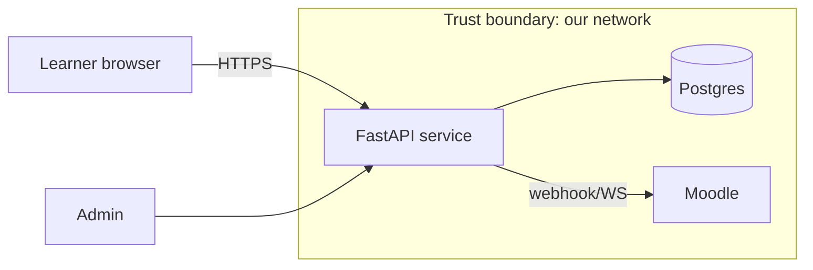

# Lesson 4.3: Security and Reliability

| Field | Value |
|---|---|
| Priority | P0 for injection, access control and secrets; P1 for the rest. Security defects in a first-month PR are the most expensive kind, and an unreviewed outbound call without a timeout is how outages start. |
| Mode | Retrieval: A. Challenges: 8.1 A, 8.2 B, 8.3 A. Project: B. Defensive work on your own code and your own throwaway environments only. |
| Time budget | 11-15 hours |
| Prerequisites | 2.1 (HTTP), 2.3 (SQL), 2.5 (AuthN/Z, secrets), 2.6 (retries, idempotency), 2.7 (observability, timeouts), 3.3 (Moodle capabilities), 4.1, 4.2 |
| Minimum versions | Python 3.12, PHP 8.2, SQLite 3.x (stdlib `sqlite3`) |
| Deliverable | A threat model, a hardened service slice with tests, a resilience layer with deterministic tests, a restore drill, and a blameless postmortem |

Attempt first. [Open the reference solutions](../solutions/4.3-security-and-reliability-solutions.md) only after a serious attempt

Scope rule: every exercise targets code and infrastructure you own (a local app, a throwaway container). Never probe a system you do not own or have written permission to test. This lesson shows attack *shapes* only to the depth needed to write the defense and its test.

---

## 1. Engineering problem

A grade-export endpoint ships on Friday. It works. By the following week: a student discovers that changing `grade_id=1` to `grade_id=2` in a URL shows another student's grade (broken access control); a support engineer pastes a log excerpt containing a bearer token into a ticket (secrets in logs); the Moodle server that the endpoint calls starts answering in 40 seconds instead of 400 ms, every worker blocks on it, and the entire API, including health checks, stops responding (no timeout, no failure boundary); the orchestrator restarts the pods, which all retry their queued work at once and re-crash the recovering Moodle (retry storm); and the weekly backup turns out to have been empty for six weeks because nobody ever restored one.

None of these needs a clever attacker or exotic bug. They are the ordinary failure modes of a system built by people who tested the happy path. The goals here: recognize each class from the defender's side, write the defense and the test that proves it, reason about threats systematically before code exists, and make a service fail in controlled, observable, recoverable ways.

## 2. Learning objectives

By the end you can:

1. For each of injection, XSS, CSRF, broken access control, SSRF and secret leakage, write a vulnerable-to-fixed pair on your own code, with a test that fails on the vulnerable version and passes on the fixed one.
2. Produce a STRIDE threat model for a small system from a data-flow diagram, listing for each trust boundary at least one threat, a mitigation, and its residual risk.
3. Apply least privilege to a database role, an API token scope, and a service account, and verify it with a negative test (the forbidden action fails).
4. Specify session security settings (cookie attributes, rotation, timeouts, logout semantics) and test the ones that can be tested.
5. Implement timeouts, retry with capped exponential backoff and jitter, and a circuit breaker with injectable clock and sleep, and write deterministic tests for each state transition.
6. Design a graceful-degradation behavior for one dependency outage and demonstrate it with a test.
7. Run a backup-and-restore drill that verifies integrity, row counts and a checksum, and document the recovery time you actually observed.
8. Lead an incident investigation from a timeline and write a blameless postmortem with contributing factors, detection and recovery analysis, and tracked action items.

## 3. First-principles explanation

### 3.1 The defender's frame

Security is making the system do only what you intend, even when inputs, callers and dependencies are hostile or merely broken. Four rules recur through every class below:

1. **Trust boundaries.** Data crossing from a less-trusted zone (browser, third-party API, file upload, another tenant) to a more-trusted one must be validated, authorized, or encoded *at the crossing*. Draw the boundaries first.
2. **Separate code from data.** Injection exists wherever data is concatenated into a language (SQL, HTML, shell, LDAP, template). The structural fix is an API that keeps them apart (bound parameters, auto-escaping templates, argument arrays), not filtering.
3. **Deny by default.** Authorization is allow-listed and enforced server-side on every request, on the object, not just on the route.
4. **Defense in depth, with honest layers.** Validate input, authorize, encode output, limit privileges, log safely, monitor. Any one layer will fail someday; none should be the only one.

The categories below map onto the OWASP Top 10. The current edition is 2025 (checked at top10.owasp.org): A01 Broken Access Control (which now also absorbs SSRF, CWE-918, and lists CSRF, CWE-352), A05 Injection (includes SQL injection and XSS), A03 Software Supply Chain Failures. In the 2021 edition SSRF was its own A10 and Injection was A03, so check the edition and numbering whenever you cite a number; cite the category name and year.

### 3.2 Injection (SQL, command, template)

**What:** attacker-controlled text changes the *structure* of a query or command. **Why it works:** string concatenation lets data be parsed as code. **Fix:** bound parameters; for identifiers that cannot be bound (column or table names, sort direction) use an allow-list; never build shell commands from strings (use argument lists and no shell); an ORM helps only if you do not drop to raw string SQL. **Does not fix it:** blacklisting quotes, escaping by hand, "the input is an int on the client".

```python
# Python 3.12 (verified) -- on a throwaway in-memory database you own
import sqlite3, html
db = sqlite3.connect(":memory:")
db.execute("CREATE TABLE users (id INTEGER PRIMARY KEY, name TEXT, role TEXT)")
db.executemany("INSERT INTO users (name, role) VALUES (?, ?)", [("ann", "student"), ("bob", "admin")])

def find_vulnerable(name: str):
    return db.execute(f"SELECT name, role FROM users WHERE name = '{name}'").fetchall()
def find_safe(name: str):
    return db.execute("SELECT name, role FROM users WHERE name = ?", (name,)).fetchall()

probe = "x' OR '1'='1"
print("vulnerable ->", find_vulnerable(probe))   # [('ann','student'), ('bob','admin')]: every row
print("safe       ->", find_safe(probe))         # []

SORTABLE = {"name", "role"}
def list_sorted(col: str):
    if col not in SORTABLE: raise ValueError("bad sort column")
    return db.execute(f"SELECT name FROM users ORDER BY {col}").fetchall()
```

PHP: PDO prepared statements with named placeholders; Moodle code uses the `$DB` API with `?` or `:named` placeholders and never string-built SQL (checked in Moodle core source: `get_records_sql($sql, ?array $params=null, $limitfrom=0, $limitnum=0)`; the two placeholder styles are `SQL_PARAMS_QM` (`?`) and `SQL_PARAMS_NAMED` (`:name`) and must not be mixed in one query; `$DB->get_in_or_equal()` builds `IN (...)` fragments). The same probe against `$pdo->prepare('... WHERE name = :n')` returns no rows (verified with PHP 8.4).

Test pattern: a parametrized test feeding a corpus of hostile strings (quote, comment markers, unicode, very long) through the function and asserting both "no extra rows" and "no exception except the documented one".

### 3.3 Cross-site scripting (XSS)

**What:** attacker-controlled text is interpreted as markup or script in another user's browser. **Why:** output built by concatenation into HTML/JS/URL contexts. **Fix:** context-aware output encoding by default (auto-escaping template engines; HTML-body, attribute, JavaScript and URL contexts differ); avoid `innerHTML` and `|safe`/`raw` filters on untrusted data; if you must allow rich text, sanitize with a maintained allow-list sanitizer (do not write your own) and add a Content-Security-Policy as a second layer. Python: `html.escape` turns `<script>` into `&lt;script&gt;` (verified); a bare `jinja2.Environment()` does NOT auto-escape (verified: `{{x}}` renders `<b>` unescaped), while Starlette's `Jinja2Templates`, which FastAPI uses, builds its environment with `select_autoescape()`, which escapes `.html`, `.htm` and `.xml` templates (checked in the Starlette source); templates loaded from strings or other extensions need explicit configuration. PHP: `htmlspecialchars($s, ENT_QUOTES | ENT_SUBSTITUTE, 'UTF-8')`. Moodle: use the output API and the sanctioned helpers (`s()`, `format_string()`, `format_text()`, mustache templates, where `{{x}}` escapes and `{{{x}}}` does not. Checked in core source: `s()` applies `htmlspecialchars` with `ENT_QUOTES`; `format_string()` escapes by default (`escape` option true); `format_text()` cleans HTML unless called with trusted/noclean options) rather than echoing raw values. Types: stored (persisted then shown to others), reflected (echoed from the request), DOM-based (client script reads untrusted data). Stored XSS in a course forum is the high-impact case.

### 3.4 CSRF

**What:** a malicious page makes the victim's browser send an authenticated request (cookies attached automatically) to your site. **Applies when** authentication is carried by something the browser sends on its own (cookies, HTTP auth). **Does not apply** to APIs that require an `Authorization` header set by script (a cross-site page cannot set it without your CORS permission), but if the same app also accepts cookies, it does apply. **Defenses (layered):** `SameSite` cookies (Lax is the common default in modern browsers; state `Strict`/`Lax` explicitly rather than relying on defaults; MDN says only "some browsers" default to Lax when `SameSite` is absent, with a more permissive variant for POSTs within two minutes of setting the cookie), anti-CSRF tokens tied to the session and verified on every state-changing request, checking `Origin`/`Referer` for unsafe methods, never changing state on GET. Moodle: state-changing actions must verify the session key (`require_sesskey()` / `confirm_sesskey()` and the form API's built-in token; usage checked against Moodle core source, see the PHP/Moodle slice).

```python
# Python 3.12 (verified) -- session-bound token, constant-time comparison
import hmac, hashlib, secrets
SERVER_KEY = secrets.token_bytes(32)          # in production: from the secret store, rotated
def csrf_token(session_id: str) -> str:
    return hmac.new(SERVER_KEY, session_id.encode(), hashlib.sha256).hexdigest()
def verify_csrf(session_id: str, supplied: str) -> bool:
    return hmac.compare_digest(csrf_token(session_id), supplied)
```

### 3.5 Broken access control

The top category in the OWASP 2021 and 2025 lists. Authentication says who you are; authorization says what you may do *to this object*. Failures: missing function-level checks (an admin route reachable by URL), **insecure direct object references (IDOR)** (changing an id returns someone else's data), over-broad token scopes, trusting client-supplied roles or tenant ids, and path traversal. Fix: a central, deny-by-default policy check on every request that takes the *object* and the actor; derive the actor from the session or token, never from a request field; scope queries by tenant/owner in the repository (`WHERE id = ? AND owner = ?`); return the same response for "not found" and "forbidden" when existence itself is sensitive.

```python
# Python 3.12 (verified)
GRADES = {1: {"owner": "ann", "grade": 71}, 2: {"owner": "bob", "grade": 55}}
class Forbidden(Exception): ...
def get_grade(user: str, grade_id: int, teachers=frozenset({"tina"})):
    g = GRADES.get(grade_id)
    if g is None or (g["owner"] != user and user not in teachers):
        raise Forbidden()          # same error for missing and forbidden
    return g
```

Moodle: the capability system (3.3) is the policy; call `require_login()` and then `require_capability(...)` in the right context for every entry point, including web service functions and AJAX handlers, which have separate entry points that are easy to forget. Test: for every protected endpoint, a table-driven test of (actor, object, expected outcome) including "other user's object", "anonymous", and "role removed".

### 3.6 SSRF

**What:** your server fetches a URL chosen by a user (webhook, import-from-URL, avatar fetch, link preview), and the attacker points it at things only your server can reach: cloud metadata endpoints (`169.254.169.254`), internal admin ports, `localhost`. **Fix, layered:** allow-list schemes (https only) and, where possible, destination hosts; resolve the hostname yourself and reject non-public addresses; **connect to the address you checked** (re-resolution between check and use enables DNS rebinding); disable or re-validate redirects; set a short timeout and response size cap; run the fetcher with no ambient credentials and, ideally, network egress rules that block internal ranges (network policy is the strongest layer). The check below is a first layer, not a complete defense.

```python
# Python 3.12 (verified with a fake resolver; no network used)
import ipaddress, socket
from urllib.parse import urlsplit

def is_public_ip(ip: str) -> bool:
    a = ipaddress.ip_address(ip)
    return a.is_global and not a.is_multicast

def check_url(url: str, resolve=socket.getaddrinfo) -> str:
    parts = urlsplit(url)
    if parts.scheme != "https" or not parts.hostname:
        raise ValueError("scheme/host not allowed")
    infos = resolve(parts.hostname, parts.port or 443, type=socket.SOCK_STREAM)
    ips = {i[4][0] for i in infos}
    if not ips or not all(is_public_ip(ip) for ip in ips):
        raise ValueError("resolves to a non-public address")
    return sorted(ips)[0]          # connect to THIS ip
```

Tested against injected resolutions to `127.0.0.1`, `10.0.0.5`, `169.254.169.254`, `::1`, `192.168.1.1` (all rejected), plus `http://`, `file:///` and a host-less URL (rejected). Caveat: `is_global` follows the `ipaddress` module's definition (Python `ipaddress` docs). Checked on Python 3.13: `::ffff:127.0.0.1` and `::ffff:10.0.0.5` report `is_global == False`, `::ffff:8.8.8.8` reports `True`; still, normalise with `.ipv4_mapped` before judging, because classification of mapped addresses has changed across Python releases.

### 3.7 Secrets and sensitive data in logs

Logs are copied to ticket systems, chat and third-party vendors; treat them as a data-egress channel. Rules: never log credentials, tokens, session ids, full card numbers, or request bodies of auth endpoints; log identifiers, not contents; avoid logging whole exception objects that embed request data; keep secrets out of URLs (query strings are logged by proxies); load secrets from the environment or a secret store, not source control; rotate on exposure, and *assume exposed once committed* (removing from git history does not un-leak it). Defense-in-depth: a redacting log filter, a pre-commit secret scanner (for example gitleaks or detect-secrets, both live on GitHub when checked; tune the rule set to your secrets and test it against a planted fake key), and a test that logs a canary secret and asserts it never reaches the handler.

```python
# Python 3.12 (verified)
import logging, re
PATTERNS = [
    (re.compile(r"(?i)(authorization:\s*bearer\s+)[A-Za-z0-9._~+/=-]+"), r"\1[REDACTED]"),
    (re.compile(r"(?i)\b(password|passwd|secret|token|api[_-]?key)\b(\s*[=:]\s*)[^\s,;&]+"), r"\1\2[REDACTED]"),
]
class RedactFilter(logging.Filter):
    def filter(self, record):
        msg = record.getMessage()
        for pat, repl in PATTERNS: msg = pat.sub(repl, msg)
        record.msg, record.args = msg, ()
        return True
```

Output after `log.info("login user=ann password=hunter2 ok")` is `login user=ann password=[REDACTED] ok` (verified). A regex filter catches known shapes only; the real defense is not putting secrets in log calls.

### 3.8 Dependency vulnerabilities

Your code includes thousands of other people's lines. Controls: pin versions with a lockfile; run an audit tool in CI (Python: `pip-audit`, whose `-r requirements.txt`, `--locked` and `-f` options exist in current releases; PHP: `composer audit`, with `--locked` and `--format` options, available since Composer 2.4; both checked with `--help`); subscribe to advisories for your framework and for Moodle security announcements; update on a cadence, with tests as the safety net (4.2); remove unused dependencies; review new dependencies (maintenance, license, transitive count). Judgment: a reported CVE is a *candidate*; assess reachability (do you call the vulnerable function with attacker-controlled data?) and record the decision either way.

### 3.9 Threat modeling with STRIDE

Method (in 30-60 minutes for a small system): (1) draw a data-flow diagram: external entities, processes, data stores, data flows, **trust boundaries**; (2) for each element and each flow crossing a boundary, ask the six STRIDE questions; (3) record threat, mitigation, owner, residual risk; (4) turn mitigations into tests and tickets; (5) revisit when the design changes.

| Letter | Threat | Violates | Typical mitigation |
|---|---|---|---|
| S | Spoofing identity | Authentication | strong authN, MFA, signed tokens, mutual TLS between services |
| T | Tampering with data | Integrity | authorization, input validation, signatures/MACs, constraints |
| R | Repudiation | Non-repudiation | audit logs (who, what, when), tamper-evident storage |
| I | Information disclosure | Confidentiality | access control, encryption, redaction, error hygiene |
| D | Denial of service | Availability | rate limits, timeouts, quotas, bulkheads, autoscaling limits |
| E | Elevation of privilege | Authorization | least privilege, deny-by-default, no client-trusted roles |



Every arrow crossing a boundary gets the STRIDE questions; "Learner browser -> API" gets S (stolen session), T (tampered request body), I (error messages leaking stack traces), E (IDOR). Honest outputs include "accepted risk" entries; a threat model with no accepted risks was not honest.

### 3.10 Least privilege

Give each component only the permissions it needs, for the shortest time. Examples: the API's database role has `SELECT, INSERT, UPDATE` on its own tables and no `DROP`/`CREATE`; a separate migration role has DDL rights and is used only in deployment; API tokens carry narrow scopes; the Moodle web-service user has a role with only the capabilities that service needs (3.3) rather than the admin; containers run as non-root with read-only filesystems where possible; cloud roles list actions and resources, not `*`. Verify with negative tests: connect as the app role and assert that `DROP TABLE` fails. Least privilege limits blast radius when (not if) another layer fails.

### 3.11 Session security

Cookie-based sessions: set `Secure` (HTTPS only), `HttpOnly` (not readable by script, limits XSS impact), `SameSite` (CSRF layer); use unpredictable ids from the platform's CSPRNG; **rotate the id at login** (prevents session fixation) and at privilege change; enforce idle and absolute timeouts server-side; logout must invalidate the session on the server (deleting only the cookie is not logout); bind sensitive actions to recent authentication (re-auth for password change); do not put session ids in URLs. Stateless tokens (JWTs; 2.5) cannot be revoked before expiry unless you keep a denylist or short lifetimes plus refresh tokens: that is a trade-off, record it in an ADR (4.1). Storing tokens in `localStorage` exposes them to XSS; cookies with `HttpOnly` expose you to CSRF: pick with eyes open.

### 3.12 Reliability fundamentals

Reliability is the probability that the system does the right thing, for users, over time, including when parts fail. Design assumption: **every remote call can hang, fail, fail slowly, succeed but lose its response, or succeed twice.**

**Timeouts.** Every outbound call needs an explicit timeout (connect and read separately where the library allows); default "no timeout" means a dependency's slowness becomes your outage by thread exhaustion. Budget them: if the user-facing request has a 2 s deadline, a downstream call cannot have a 30 s timeout. Propagate deadlines downward where you can.

**Retries.** Retry only failures that are *transient* (timeouts, connection resets, 429/503 with `Retry-After`) and operations that are *safe to repeat*: reads, or writes protected by an idempotency key (2.6). Use capped exponential backoff with jitter (so clients desynchronize), a small attempt limit, and a retry budget. Without these, retries multiply load on a struggling dependency: with up to 3 retries per layer and 3 layers, a single user request can become `(3+1)^3 = 64` calls at the bottom (arithmetic, verified in the failure lab).

**Circuit breaker.** After consecutive failures, stop calling (open) for a cool-down so the dependency can recover and callers fail fast; then allow a trial call (half-open); success closes it. It protects both sides.

```python
# Python 3.12 (verified) -- clock and sleep injected so tests are instant and deterministic
import random
from typing import Callable, TypeVar
T = TypeVar("T")
class Transient(Exception): ...
class Permanent(Exception): ...

def retry(fn: Callable[[], T], *, attempts=4, base=0.1, cap=2.0,
          sleep=lambda s: None, rng=random.Random(0)) -> T:
    for n in range(attempts):
        try:
            return fn()
        except Transient:
            if n == attempts - 1: raise
            sleep(rng.uniform(0, min(cap, base * 2 ** n)))     # "full jitter"
    raise AssertionError("unreachable")

class CircuitOpen(Exception): ...
class Breaker:
    def __init__(self, threshold=3, reset_after=30.0, now=lambda: 0.0):
        self.threshold, self.reset_after, self.now = threshold, reset_after, now
        self.fails, self.opened_at = 0, None
    def call(self, fn: Callable[[], T]) -> T:
        if self.opened_at is not None and self.now() - self.opened_at < self.reset_after:
            raise CircuitOpen()                                 # fail fast
        try:
            r = fn()
        except Transient:
            self.fails += 1
            if self.fails >= self.threshold or self.opened_at is not None:
                self.opened_at = self.now()                      # (re)open
            raise
        self.fails, self.opened_at = 0, None                     # success closes
        return r
```

Verified tests: a function failing twice succeeds on the third attempt with two jittered sleeps each in `[0, cap]`; a `Permanent` error is not retried; after two failures with threshold 2 the next call raises `CircuitOpen` without invoking the function; after the clock advances past `reset_after` a trial call succeeds and closes the breaker. Limits: this breaker is not thread-safe and is per-process; production libraries and service meshes exist (evaluate before adopting one, and follow the team's standards).

**Bulkheads and rate limits.** Isolate resources per dependency (separate connection pools/semaphores) so one slow dependency cannot consume everything; limit concurrent work and queue length; shed load deliberately (return 503/429 early) rather than collapse.

**Graceful degradation.** Decide in advance what the user sees when a dependency is down: serve stale cache with a "data may be out of date" marker, hide a non-essential widget, queue the work for later (with idempotency), or fail with a clear message. A degraded success is usually better than a total failure; make the degraded state visible in metrics so it is not mistaken for health.

**Health checks.** Liveness (process is alive) must not depend on downstream services, or an outage restarts everything; readiness may reflect critical dependencies (2.7).

### 3.13 Backups and restore drills

A backup that has never been restored is a hope, not a backup. Define **RPO** (how much data loss is tolerable, sets backup/replication frequency) and **RTO** (how long recovery may take). Follow 3-2-1 as a heuristic (three copies, two media types, one off-site; a convention, not a standard to cite as law), protect backups from the same credentials that can delete production (ransomware/accident), encrypt them, and **drill**: restore into a clean environment, check integrity, row counts and a checksum or business-level invariant, run the application against it, and record the elapsed time. The drill below uses SQLite's online backup API (stdlib) as a small stand-in for the pattern:

```python
# Python 3.12 (verified)
import sqlite3, hashlib, tempfile, pathlib
def checksum(conn) -> str:
    h = hashlib.sha256()
    for row in conn.execute("SELECT id, name FROM t ORDER BY id"): h.update(repr(row).encode())
    return h.hexdigest()

src = sqlite3.connect(":memory:")
src.execute("CREATE TABLE t (id INTEGER PRIMARY KEY, name TEXT)")
src.executemany("INSERT INTO t (name) VALUES (?)", [("a",), ("b",), ("c",)]); src.commit()
d = pathlib.Path(tempfile.mkdtemp()); backup_file = d / "backup.db"
with sqlite3.connect(backup_file) as dst: src.backup(dst)
dst.close()
restored = sqlite3.connect(backup_file)        # the drill: open the artifact as a NEW database
assert restored.execute("PRAGMA integrity_check").fetchone()[0] == "ok"
assert checksum(restored) == checksum(src)
assert restored.execute("SELECT count(*) FROM t").fetchone()[0] == 3
```

For PostgreSQL the analogous tools are logical dumps (`pg_dump`/`pg_restore`) and physical base backups with WAL archiving for point-in-time recovery; for MySQL/MariaDB (common under Moodle) `mysqldump` or physical tools. Moodle also needs `moodledata` (files) and config backed up consistently with the database (follow the admin backup documentation on docs.moodle.org for your version; I did not verify a specific procedure here). Flag: file backups and database backups taken at different instants can disagree; define how you reconcile.

### 3.14 Incident investigation and blameless postmortems

During an incident: **stabilize first, diagnose second** (roll back, disable the feature flag, shed load), communicate (one channel, one incident lead, timestamped notes), preserve evidence (logs, metrics, config at the time). Investigate with the method from 0.3: build a **timeline** from authoritative timestamps (deploys, alerts, config changes, traffic), state hypotheses, find evidence that discriminates between them, and change one thing at a time.

A **blameless postmortem** asks how the system allowed a reasonable person to make this mistake, not who made it. Blame hides information and teaches people to conceal. Structure: summary and impact (who, how long, how much; use numbers you measured); timeline; detection (how did we find out, how long after it started); response; **contributing factors** (several: rarely a single "root cause"); what went well; where we got lucky; action items, each with an owner, a due date and a way to verify (a test, an alert, a drill). Avoid: "human error" as a conclusion (ask why the system permitted it), action items like "be more careful", and unowned lists.

## 4. Worked example

Fix the Friday endpoint from section 1, in order of risk.

**Step 1: access control.** Naive:

```python
@router.get("/grades/{grade_id}")
def read_grade(grade_id: int, db: Session = Depends(get_db)):
    return db.get(Grade, grade_id)
```

Improved: derive the actor from the authenticated session, scope the query, return one error for missing and forbidden, and test the matrix.

```python
@router.get("/grades/{grade_id}")
def read_grade(grade_id: int, user: User = Depends(current_user), db: Session = Depends(get_db)):
    g = db.scalar(select(Grade).where(Grade.id == grade_id))
    if g is None or not policy.can_read_grade(user, g):
        raise HTTPException(status_code=404)
    return GradeOut.model_validate(g)
```

(Shape only; SQLAlchemy 2.x `select`/`scalar`, Pydantic v2 `model_validate`. Assemble with your project's models.) `policy.can_read_grade` is a pure function you unit test exhaustively (owner, teacher of that course, admin, other student, anonymous). Returning 404 for forbidden hides existence; the trade-off is slightly harder debugging, so log the real reason server-side with the actor and object id.

**Step 2: injection and logging.** Replace the f-string SQL with bound parameters (section 3.2), delete the `log.info("... %s", rows)` line, and add the redaction filter plus a canary test (section 3.7).

**Step 3: outbound call with a boundary.** Naive:

```python
resp = requests.get(f"{MOODLE}/webservice/rest/server.php", params=p)   # no timeout, shared by all
```

Improved: the adapter (4.1) takes a transport with an explicit timeout, wraps it in `retry` for idempotent reads only and in a `Breaker`, translates failures into domain errors, and the handler degrades.

```python
def fetch_completion(learner: str) -> Completion | None:
    try:
        return breaker.call(lambda: retry(lambda: moodle.get_completion(learner, timeout=(1.0, 3.0)),
                                          sleep=time.sleep))
    except (CircuitOpen, Transient):
        return None            # caller serves "completion status temporarily unavailable"
```

What changed and why: a bounded wait (worst case is small and computable: attempts times read timeout plus backoff), fail-fast when Moodle is down so workers are not consumed, and a visible degraded response instead of a hung request. Add a metric for breaker state and a log line (without secrets) on every open/close transition. The `(1.0, 3.0)` connect/read timeouts shown follow the `requests` tuple convention; the numbers are placeholders to be derived from your latency budget and measured Moodle p99 (4.4), not recommendations.

**Step 4: threat model** the whole flow (section 3.9) and write the three most important mitigations as tests. **Step 5: restore drill** on the database and write the observed duration in the runbook.

PHP/Moodle slice, as a checklist for any plugin entry point: `require_login()` first; `require_capability()` in the correct context; `required_param`/`optional_param` with a strict `PARAM_*` type; `require_sesskey()` on state changes; `$DB` placeholders; output via `s()`, `format_string()`, mustache; web service functions declare capabilities (the `capabilities` key in `db/services.php`) and validate input with `core_external\external_api::validate_parameters()` and `validate_context()`. Names and signatures checked against the Moodle core source (main branch, 2026): `s($var)`, `format_string($string, $striplinks = true, $options = null)`, `format_text($text, $format = FORMAT_MOODLE, $options = null, ...)`, `require_sesskey()` (throws `moodle_exception('invalidsesskey')` when `confirm_sesskey()` fails), `required_param($parname, $type)`, `optional_param($parname, $default, $type)`, `require_login(...)`, `require_capability($capability, context $context, ...)`. Older branches may differ (for example, the external API class lives in a different namespace on older releases); confirm for your target version.

## 5. Production perspective

- **Maintainability**: put authorization in one policy module, not scattered `if`s; centralize the HTTP client with timeouts, retries and breaker so no feature can forget them.
- **Correctness**: retries without idempotency double-apply work. Design the write first (2.6).
- **Performance**: backoff and breakers protect throughput under failure; measure with a fault-injection test (4.4 method).
- **Security**: error responses must not leak stack traces, SQL or internal hostnames; use generic client messages and detailed server logs.
- **Testing**: negative tests for every control; chaos-style tests that make a dependency slow or failing and assert the degraded behavior.
- **Observability**: metrics for retry counts, breaker state, rejected requests, authorization denials (a spike is a signal), and backup age with an alert on staleness.
- **Operations**: runbooks with the restore steps and measured timings; secret rotation procedure rehearsed; dependency update cadence; on-call knows how to disable features.

**What a senior engineer does differently.** Starts every review with "who is the actor and what object are they touching?". Asks "what happens when this call hangs for a minute?" before merging any outbound call. Treats the first restore drill as the real backup test. Writes the postmortem action items as tests, alerts or drills so they can be verified. Does not claim a system is "secure"; states which threats are mitigated, which are accepted and why.

**Common beginner mistakes and diagnosis.**

- Authentication mistaken for authorization: any logged-in user reaches any object. Diagnose with a two-user test.
- Validating on the client only. Diagnose by sending the request directly (your own tools, your own server).
- Blacklist filtering for injection. Diagnose by asking "what is the parser being protected?".
- `except Exception: pass` around remote calls, hiding failures. Diagnose with grep and with fault-injection.
- Retrying everything including non-idempotent POSTs and permanent errors (4xx). Diagnose by listing each retried operation and its idempotency story.
- Health check calling the database and the third party, so one outage restarts all pods.
- Secrets in `.env` committed "temporarily". Diagnose with a secret scanner over history; rotate regardless.
- Backups never restored; backup account can delete production. Diagnose with a drill.

## 6. Failure laboratory

A payment client calls `charge(100)` and, on timeout, retries up to three times. The server below has a quirk: its first response is lost (work done, answer dropped). Predict, before running: (a) what the list of charges is after the plain client call; (b) what it is if the client sends the same idempotency key on every attempt; (c) how many calls reach the bottom service if three layers each retry up to 3 extra times and the bottom is failing.

```python
class Timeout(Exception): ...
class Server:
    def __init__(self): self.charges = []; self.seen = {}; self.drop_first_response = True
    def charge(self, amount, key=None):
        if key is not None and key in self.seen:
            result = self.seen[key]
        else:
            self.charges.append(amount); result = len(self.charges)
            if key is not None: self.seen[key] = result
        if self.drop_first_response:
            self.drop_first_response = False
            raise Timeout()
        return result

def client(server, key=None):
    for _ in range(3):
        try: return server.charge(100, key)
        except Timeout: continue
```

### Reveal (read after predicting)

(a) `[100, 100]`: a double charge. The first attempt succeeded server-side; the client saw only a timeout and repeated. (b) `[100]`: the server recognizes the key and replays the stored result. (c) `(3+1)^3 = 64` worst-case calls (verified arithmetic), which is why retries must be budgeted and layered carefully: retry at one layer, not all.

Root cause: a timeout means "unknown outcome", not "failure". Retrying is only safe for operations that are idempotent or protected by an idempotency key (2.6). Diagnosis procedure for "duplicate side effects in production": (1) find the duplicate records and their timestamps; (2) look for client-side timeouts/retries in the same window (logs, traces); (3) check whether the operation has a stable key and whether the server enforces uniqueness in storage; (4) reproduce with a fault injector that drops the response after processing; (5) fix by key plus a database uniqueness constraint, then keep the injector as a regression test.

## 7. Retrieval practice

Answers are in the solutions file.

1. Why does parameterization prevent SQL injection when escaping quotes by hand often does not? State the principle in one sentence about code and data.
2. Which parts of a SQL statement can usually not be bound as parameters, and how do you handle them safely?
3. Explain stored, reflected and DOM-based XSS. Which context-specific encoding applies when inserting user text into an HTML attribute versus a JavaScript string?
4. When is CSRF not a threat for an API, and what can make it a threat again?
5. What is the difference between a 401 and a 403, and why might you return 404 for a forbidden object?
6. List four layers of SSRF defense in decreasing strength, and explain DNS rebinding in one paragraph.
7. Why is "I removed the secret from the repo history" not remediation?
8. For the data-flow diagram in 3.9, give one threat per STRIDE letter on the arrow "API -> Moodle".
9. Give an example of least privilege for (a) a database role, (b) a Moodle web service user, (c) a container.
10. What is session fixation, and what single action at login prevents it?
11. Describe closed, open and half-open breaker states and what a thundering herd on recovery looks like. How does jitter help?
12. Which operations may be safely retried, and which retry rules (attempts, backoff, budget) bound the damage?
13. Define RPO and RTO and say how a restore drill produces a measured RTO.
14. Write three bad and three good postmortem action items.

## 8. Independent implementation challenge

**8.1 (Mode A, 60 min). Access-control matrix.** Implement `can_read_grade(actor, grade)` and `can_edit_grade(actor, grade)` for roles student, teacher-of-course, admin, anonymous. Write a table-driven test with at least 20 rows including: student reading own, student reading another's, teacher of a different course, admin, anonymous, a revoked teacher, and an edit attempt by a student on their own grade (reading allowed, editing forbidden). The function must be pure (no I/O). Then write an HTTP-level test using FastAPI's `TestClient` (or a plain function call if FastAPI is not installed) proving the same matrix through the route and that forbidden and missing objects produce the same status.

**8.2 (Mode B, 90 min). Resilient client.** Using only the standard library, implement a `ResilientClient` that composes timeout, retry (full jitter, cap, attempts, retry only `Transient`), a circuit breaker, and a fallback value, with injected clock, sleep and RNG. Write deterministic tests for: success on third attempt; no retry on `Permanent`; sleep durations within bounds; breaker opens after N failures and fails fast without calling; half-open trial success closes; half-open trial failure re-opens; fallback returned when open. Add a *retry budget* (maximum retries per 10-second window across calls) and test that exceeding it stops retrying.

**8.3 (Mode A, 60 min). Threat model.** For the grade-export service (browser -> FastAPI -> Postgres, FastAPI -> Moodle web service, admin -> FastAPI), draw the DFD in Mermaid, mark trust boundaries, and produce a STRIDE table with at least 12 rows. For each of the top 5 by risk, name the mitigation, the test or monitoring that verifies it, and the residual risk. Include at least two "accepted" entries with a stated reason.

## 9. Project

**Project: "Harden and Prove" - a defended service slice, a resilience layer, and a recovery story.**

| Field | Specification |
|---|---|
| Problem statement | Take a small service you own that has a database, authenticated users with ownership of objects, one user-supplied-URL feature, and one outbound dependency. Threat-model it, fix identified weaknesses with tests that demonstrate each fix, add a resilience layer, run a restore drill, run a simulated incident, and write the postmortem. |
| Context | Start from a blank repository. Build (or reuse from earlier lessons) a FastAPI service with SQLite or PostgreSQL: `users`, `grades` (owner, course, value), `webhooks` (user-supplied URL to be called when a grade changes), and a stub "Moodle" dependency implemented as a local fake HTTP server or injected transport. A deliberately vulnerable first version is part of the work: you create it, commit it, and then fix it. The PHP part: a Moodle-style local plugin entry-point *design* showing where each Moodle control (login, capability, sesskey, params, `$DB` placeholders, output escaping) goes (pseudo-code acceptable; names must match the Moodle source or docs for the version you state). All testing targets your own code in your own environment. |
| Requirements | (1) Vulnerable v0 with at least: SQL string-built query, IDOR on grades, unescaped HTML in a teacher comment page, SSRF-prone webhook fetch, token logged. (2) Threat model (DFD, STRIDE table, residual risks). (3) v1 fixing each: bound parameters plus an allow-list for sort column; object-level authorization through a pure policy; output encoding; SSRF check that pins the address, disables redirects and enforces https/timeout/size cap; redaction filter and canary test; CSRF token or Authorization-header-only decision documented. (4) Each fix has a test that FAILS on v0 and PASSES on v1 (show both runs). (5) Least-privilege: separate DB roles/credentials for app and migrations (with SQLite, emulate via file permissions/read-only connection for a reporting role; for PostgreSQL use real roles) and a negative test. (6) Resilience: timeouts, retry for idempotent reads, breaker, bulkhead (a semaphore limiting concurrent Moodle calls), graceful degradation, and fault-injection tests (slow, failing, response-lost). (7) Backup/restore drill with integrity, count and checksum verification, and a timed, recorded result. (8) Simulated incident: inject a fault into your own service (for example, make the stub dependency hang) without telling yourself when (use a seeded random trigger or a peer), investigate from metrics/logs, and write the blameless postmortem. (9) A dependency audit step with the tool's real output and a written triage of findings (`pip-audit`, `composer audit`, or your stack's equivalent). |
| Constraints | Only your own code and environment; no scanning of third-party systems. Python 3.12, FastAPI, Pydantic v2; stdlib for the resilience primitives (no resilience library). Time budget for the incident drill: 90 minutes from first symptom to written timeline. Mid-way requirement change (at about 60%): the webhook feature must now also accept an internal-network URL for a specific allow-listed host (a customer's on-premises system); implement it without weakening the SSRF defense for any other host, and defend the design in an ADR. No measured numbers may be invented: all timings and counts in reports come from your runs. |
| Acceptance criteria | Every fix demonstrated failing then passing. Policy matrix test with at least 20 rows. SSRF tests include loopback, link-local, private ranges, IPv6 loopback, redirect to a private address (use a local test server you run), and `file://`. Canary secret never appears in captured logs under normal and error paths. Breaker, retry and degradation tests run without real sleeping (whole suite under 15 seconds). Restore drill output shows integrity check, row counts and checksum matching, plus elapsed time. Postmortem contains a timeline with real timestamps from your logs and action items with owners (you, a role name) and verification methods. |
| Edge cases | IDs that exist but belong to a revoked teacher; unicode and very long inputs; empty sort parameter; webhook hostnames resolving to both a public and a private address; redirects chains; response larger than the cap; Moodle stub returning 200 with malformed body; breaker half-open with concurrent callers (document your behavior even if single-threaded); backup taken during writes. |
| Quality requirements | Policy code has no I/O; errors to clients are generic, server logs detailed; every outbound call goes through one client module; typed public functions; each security test has a comment naming the threat class (not exploit code beyond what the test needs). |
| Deliverables | Repository with `v0` tag and `v1` tag; `THREAT-MODEL.md`; `ADR-001-webhook-allowlist.md`; `RUNBOOK.md` (restore steps, measured RTO, secret rotation steps, how to disable webhooks); `POSTMORTEM.md`; `AUDIT.md`; PHP/Moodle design note. |
| Difficulty | Advanced |
| Estimated effort | 12-18 hours including the incident drill |
| Progressive hints | L1: Write the failing test for each vulnerability before changing the code; v0 must be demonstrably vulnerable in the test, or you do not yet understand the threat. L2: For SSRF, split into `resolve`, `validate_all_addresses`, `connect_to_pinned_address`, and inject the resolver so tests need no network. L3: For the breaker, keep the state machine as pure data plus a `now()` function, and test transitions as a table of (state, event, time) to (state, action). L4: For the incident, have the fault toggled by a file or environment variable that a peer sets; collect evidence only from your own logs and metrics before reading the code. |
| Evaluation rubric (100) | Threat model quality and honest residual risk: 12; fix correctness with fail-then-pass evidence for each class: 25; policy matrix and access-control tests: 8; SSRF depth (pinning, redirects, caps, mid-way change): 10; secrets/log hygiene and canary: 5; least privilege with negative test: 5; resilience layer correctness and deterministic tests: 15; restore drill with verification and measured time: 7; postmortem quality (blameless, contributing factors, verifiable actions): 10; PHP/Moodle design note correctness, naming the Moodle version checked: 3. |
| Extension challenge | Add rate limiting (token bucket) per user on the export endpoint with a deterministic test, a 429 with `Retry-After`, and a note on what identifier you key on and what an attacker behind many IPs can still do. |
| Reflection questions | Which vulnerability was easiest for you to write and hardest to test, and why? Which control would have been missing if you had not drawn the trust boundary? Which timeout value did you choose and what evidence supports it? What did the incident drill show about your observability? Which action item in your postmortem is least likely to be completed and what would make it stick? |

## 10. Engineering review

Self-review checklist: every endpoint answers "who is the actor, what is the object, where is it checked?"; no f-string SQL or HTML; identifiers allow-listed; every user-supplied URL path goes through the single validated fetcher; no secret in code, logs, URLs or error messages (run your scanner over the history); error responses generic; DB roles minimal and negatively tested; every outbound call has timeout, bounded retry on idempotent operations only, breaker, and a defined degraded behavior; metrics exist for breaker state and denials; backups restored and timed; dependency audit output triaged; threat model updated for the mid-way change.

Explain in writing: why 404 versus 403 for your service; how you would detect that someone is enumerating IDs; what your retry budget protects and what it costs; what you would do in the first five minutes of the incident before knowing the cause; which accepted risk you are least comfortable with.

## 11. Mastery gate

Pass = at least 80/100 and no critical failure, with evidence: v0 and v1 test runs side by side, threat model, restore drill output, postmortem, and a closed-book (Mode A) 60-minute exercise: given a 40-line vulnerable handler of your own design (written by a peer), find and fix the access-control, injection and logging defects and add a timeout and bounded retry correctly.

Critical failures:

- Any object-level authorization missing on a route in the final version.
- SQL built from request data in the final version.
- A secret in logs, source, or committed history of your submission.
- Retry on a non-idempotent operation without a key, or an outbound call without a timeout.
- SSRF check that validates the hostname string only (no resolution, no pinning, or following redirects unchecked).
- Restore drill claimed without integrity and count verification.
- Reported timings, counts or audit results that were not measured.
- Any testing against a system you do not own.

If failed: remedial exercise on the weakest control, in isolation: for access control, redo 8.1 for a different domain (library loans) with a 25-row matrix; for resilience, redo 8.2 plus a fault-injection test with response loss; for postmortems, write a postmortem for the lab in section 6 from a timeline a peer fabricates, and have the peer find every action item that is unverifiable.

## 12. Reflection and accountability

- What I learned:
- What I initially misunderstood:
- What took the most effort:
- Bugs I hit and how I diagnosed them (symptom, hypothesis, evidence, fix):
- What I would change with hindsight:
- What remains unclear:

Ledger update: status -> Introduced / Practiced / Demonstrated / Mastered.

Failure log entry: one concrete mistake (for example, "I treated a timeout as a failure") with what I believed, what was true, how I found out, the rule I will apply next time.

## References

- OWASP Top 10 and Cheat Sheet Series (top10.owasp.org, 2025 edition; cheatsheetseries.owasp.org): category definitions and per-topic defensive cheat sheets (SQL injection prevention, XSS prevention, CSRF prevention, SSRF prevention, session management, logging, secrets).
- Microsoft, "STRIDE" and threat modeling guidance, and Adam Shostack, *Threat Modeling: Designing for Security*: method for section 3.9.
- Python `ipaddress`, `sqlite3`, `hmac`, `logging` docs (docs.python.org/3): exact semantics for `is_global`, the backup API, `compare_digest` and log filters.
- Google SRE Book and Workbook (sre.google/books): chapters on handling overload, cascading failures, and postmortem culture.
- Michael Nygard, *Release It!* (2nd ed.): timeouts, circuit breaker, bulkhead and the stability patterns.
- Moodle developer docs (moodledev.io), security and the DML/output/access APIs for your version.

## Further depth (optional)

- AWS Architecture Blog, "Exponential Backoff and Jitter": the analysis behind full jitter (aws.amazon.com/blogs/architecture/exponential-backoff-and-jitter/, URL checked).
- NIST SP 800-63B (authentication and session guidance) for session and authenticator lifecycle rules.
- Documented postmortems from public incident archives, read for contributing-factor analysis rather than for the technology.
- Property-based and fault-injection testing of retry logic (combine 4.2 and this lesson).
