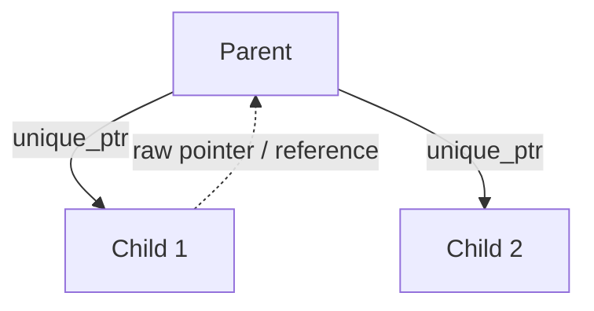

# Lesson 5.2: RAII, Copy/Move, Smart Pointers, Ownership

| Field | Value |
|---|---|
| Priority | P1 - resource ownership is the core of C++ correctness; every container, handle and thread API in later lessons depends on it. |
| Mode | Retrieval: A. Failure laboratory: A (predict), then B. Implementation challenge: A. Project: B (docs-only; cppreference allowed). |
| Time budget | 12-16 hours (reading 2h, worked example 2h, lab 1h, challenge 3h, project 5-7h). |
| Prerequisites | Lesson 5.1 (build, lifetime, const, sanitizers); Lesson 1.2 (context managers and exceptions in Python, as a contrast). |
| Minimum versions | C++20 (`-std=c++20`); `std::expected` is C++23 (`-std=c++23`, GCC 12+; flagged where used). Verified with GCC 14.2.0 and CMake 4.4.4. Clang 18 and clang-tidy 18 were used for the Clang-specific statements. |
| Deliverable | A resource-owning class pair (`Matrix` and a move-only `UniqueFd`) with a test suite that passes under ASan+UBSan, plus an ownership/exception-safety design note. |

Attempt first. [Open the reference solutions](../solutions/5.2-raii-copy-move-smart-pointers-solutions.md) only after a serious attempt

---

## 1. Engineering problem

A market-data handler allocates a buffer per message, opens a log file, and takes a lock around shared state. In Python, the garbage collector and `with` blocks hid the question "who releases this, and when?". In C++, if the answer is "whichever code path remembers to", then the first exception thrown between acquire and release leaks the resource; the first accidental copy of a class holding a raw pointer causes a double free; the first reallocation of a `std::vector` leaves a stale pointer that reads freed memory. These are the failures that cause crashes in production at 03:00 and security vulnerabilities in network-facing code.

C++'s answer is RAII (Resource Acquisition Is Initialization): tie a resource's lifetime to an object's lifetime. The constructor acquires, the destructor releases, and the language guarantees the destructor runs on every exit path, including exceptions. Almost everything in this lesson (copy, move, smart pointers, exception safety) is the machinery that makes RAII objects safe to pass around.

## 2. Learning objectives

By the end you can, without references:

1. Implement a resource-owning class that correctly follows the rule of five (or zero), and prove with tests under ASan+UBSan that copy, move, self-assignment and moved-from states are safe.
2. Predict, for a given snippet, which of copy constructor, move constructor, copy/move assignment or elision is selected, and explain why using value categories (lvalue, prvalue, xvalue).
3. Choose between `std::unique_ptr`, `std::shared_ptr`, `std::weak_ptr`, a reference and a raw non-owning pointer for a given ownership relationship, and draw the ownership graph.
4. Wrap a C-style resource (a `FILE*` or POSIX file descriptor) in an RAII type with a custom deleter or a move-only class.
5. Identify and fix iterator, pointer and reference invalidation bugs for `std::vector` and `std::erase_if`/`erase` use.
6. State the four exception-safety guarantees, classify a given function, and make a function provide the strong guarantee.
7. Choose between exceptions, error codes and `std::expected` (C++23) for a given failure mode and justify the choice.

## 3. First-principles explanation

### 3.1 Object lifetime hooks

A class controls its objects' lifetime through six special member functions: default constructor, destructor, copy constructor `T(const T&)`, copy assignment, move constructor `T(T&&)`, move assignment. If you declare none, the compiler generates them, with memberwise behavior. The move operations are generated only if you declare no copy operation, move operation or destructor.

"Memberwise copy" of a raw pointer copies the address, so two objects claim the same memory: the bug at the center of the failure laboratory.

Members are destroyed in reverse declaration order after the destructor body; stack objects in reverse construction order. Destructors are implicitly `noexcept`; an exception escaping one calls `std::terminate`. Virtual calls in constructors and destructors do not dispatch to derived classes.
### 3.2 The rules of zero, three and five

- Rule of zero: if every member manages itself (`std::string`, `std::vector`, `std::unique_ptr`), declare none of the six functions. The generated ones are correct. This is the goal for the great majority of classes.
- Rule of three (pre-C++11): if you need a custom destructor, copy constructor or copy assignment, you almost certainly need all three.
- Rule of five (C++11+): add move constructor and move assignment, so that transferring ownership is cheap and copying is not used as a silent fallback.

Declaring a destructor, copy operation or move operation suppresses the implicit move operations (language rule); the class then silently copies where you expected moves. This is why you write all five, or `= default`/`= delete` them explicitly, whenever you write one.

### 3.3 Copy vs move

Copy means: the new object is an independent duplicate; the source is unchanged. Move means: the new object takes over the source's resources; the source is left in a valid but unspecified state (language guarantee for standard library types; for your own types, you define it, and the minimum contract is "can be destroyed and assigned to").

```
copy:   a [ptr]-->[1 2 3]            move:   a [ptr]-->[1 2 3]   before
        b [ptr]-->[1 2 3] (new)              b [ nullptr ]
                                      after: a [nullptr]  b [ptr]-->[1 2 3]
```

A move constructor is typically a handful of pointer and integer copies plus nulling the source; it should be `noexcept`. This matters concretely: `std::vector` growth uses `std::move_if_noexcept`, so if your move constructor can throw and the type is copyable, the vector copies every element on reallocation instead. Verified in the worked example: with `noexcept` moves the vector log printed `move` during growth.

### 3.4 `std::move` and value categories (practical level)

`std::move(x)` does not move anything: it is a cast to an rvalue reference (`static_cast<T&&>`), which tells overload resolution "this object may be pilfered". The actual transfer happens in the move constructor or assignment that then gets selected.

Practical categories (the full taxonomy has five; this is the working subset):

- lvalue: has a name/identity and persists: `a`, `*p`, `v[0]`. Binds to `T&` and `const T&`.
- prvalue: a pure temporary value: `5`, `make()`, `a + b`. In C++17 and later a prvalue initializes its destination directly (guaranteed copy elision): `T t = make();` constructs `t` in place with no copy or move.
- xvalue: an expiring lvalue: `std::move(a)`, a function returning `T&&`. Binds to `T&&`.

Rules of thumb:

- A named variable of type `T&&` is itself an lvalue inside the function (it has a name). To pass it onward as an rvalue, write `std::move(x)` (or `std::forward<T>(x)` in templates, Lesson 5.3).
- Do not write `return std::move(local);`. A plain `return local;` can use copy elision or an implicit move; `std::move` inhibits elision and GCC warns with `-Wpessimizing-move` / `-Wredundant-move`.
- Do not use an object after moving from it except to assign to it or destroy it.
- `const` objects cannot be moved from (the move constructor takes a non-const `T&&`), so `std::move(const_obj)` silently copies.

### 3.5 RAII applied: memory, files, locks

Memory: `std::vector`, `std::string`, `std::unique_ptr<T[]>`. Raw `new`/`delete` should not appear in application code.

Files and other C handles: either `std::fstream` (RAII already) or a `std::unique_ptr` with a custom deleter:

```cpp
struct FileCloser { void operator()(std::FILE* f) const noexcept { if (f) std::fclose(f); } };
using File = std::unique_ptr<std::FILE, FileCloser>;
File f{std::fopen("/tmp/out.txt", "w")};
if (f) std::fputs("hi\n", f.get());      // closed automatically on every exit path
```

A caveat that production code must face: `fclose` and `close` can fail (a write error may only surface at close). A destructor cannot report that, so critical output paths call an explicit `close()`/flush that returns or throws an error, and the destructor is the safety net.

Locks: `std::lock_guard<std::mutex>` (C++11) or `std::scoped_lock` (C++17, can lock several mutexes deadlock-free). Never lock and unlock manually. Concurrency semantics are Lesson 5.6.

### 3.6 Smart pointers and when each

| Type | Ownership | Cost | Use when |
|---|---|---|---|
| `T` (value member) | the enclosing object | none | default; most objects |
| `std::unique_ptr<T>` | exclusive, movable not copyable | typically one pointer (plus deleter state if non-empty); no overhead beyond that in normal use | heap object with one owner; polymorphism; pimpl; factories returning ownership |
| `std::shared_ptr<T>` | shared by reference count | control block (atomic count operations), two pointers | genuinely shared lifetime with no single owner (graphs, caches, async callbacks) |
| `std::weak_ptr<T>` | none; observes a `shared_ptr` object | like shared | back-pointers, caches, breaking cycles; `lock()` yields a `shared_ptr` or empty |
| `T&` / `T*` / `std::span` / `std::string_view` | none (borrow) | none | parameters and short-lived access where the owner outlives the use |

Decision procedure: (1) Can it be a value? Do that. (2) Exactly one owner? `unique_ptr`. (3) Truly shared? `shared_ptr`, with a written reason; add `weak_ptr` for non-owning back-edges. (4) Borrowing for the duration of a call? reference or view.

Use `std::make_unique<T>(...)` and `std::make_shared<T>(...)`: they avoid a naked `new` and, for `make_shared`, allocate object and control block together. `shared_ptr` is not a default; its reference count is shared mutable state and hides lifetime reasoning. Cycles of `shared_ptr` leak (verified below).

Ownership diagram for a parent/child tree (arrows own, dashed observe):



If children genuinely outlive parents in some flows, use `shared_ptr` down and `weak_ptr` up:

```
 n1 --shared--> n2          n1.next = n2  (owns)
 n1 <--weak---- n2          n2.prev = weak observer (does not keep n1 alive)
```

### 3.7 Dangling references and iterator invalidation

A reference, pointer, iterator or view is valid only while its object is alive and not restructured. For `std::vector` (checked against the cppreference container page): insertion that changes capacity invalidates all iterators and references; insertion without a capacity change invalidates those at and after the insertion point; erasure invalidates those at or after the erased element. `std::unordered_map`: a rehash invalidates iterators, not references to elements. `std::map`: insertion invalidates nothing; erase invalidates only the erased element. Do not hold `&v[0]` across a `push_back`.
### 3.8 Exceptions and exception safety

An exception unwinds the stack; destructors of automatic objects run during unwinding. This is why RAII is the exception-safety mechanism: no `finally`.

Guarantee levels (standard terminology, Abrahams):

- No-throw (`noexcept`): never fails. Required for destructors, `swap`, move operations.
- Strong: if it throws, program state is unchanged ("commit or rollback").
- Basic: if it throws, invariants hold and nothing leaks, but state may have changed.
- None: neither; this is a bug.

Technique for the strong guarantee: do all the work that can throw on a temporary, then commit with noexcept operations (typically `swap`). Copy-and-swap assignment is the canonical example.

`noexcept` is a promise checked at run time: if a `noexcept` function lets an exception escape, `std::terminate` is called. Use it on moves, swaps and destructors; do not sprinkle it on functions that allocate.

### 3.9 Errors: exceptions vs error codes vs `std::expected`

- Exceptions: cannot be silently ignored; work through constructors; commonly no cost on the success path (an implementation property: measure, do not assume); non-local control flow, throwing is slow, some domains forbid them, signatures do not show what is thrown. Fit: rare, unexpected failures (out of memory, deep I/O failure, constructor failure).
- Error codes / `std::error_code`: explicit, no unwinding; easy to ignore (use `[[nodiscard]]`), clutter flow, unusable from constructors. Fit: C interop, hot paths with expected failures, system APIs.
- `std::expected<T, E>` (C++23, `<expected>`, needs `-std=c++23`): value-or-error in the type, composable (`and_then`, `transform`, `or_else`), forces handling; verbose without the helpers, no automatic propagation. Fit: expected failures at API boundaries (parsing, validation, lookup).

Convention, not law: exceptions for failures you cannot handle locally; `expected`/codes for failures the caller branches on, like bad input. Follow the team standard (Lesson 4.1); inconsistent mixing is worse than either choice. In C++20 projects, alternatives are `std::optional` (no error info), a hand-rolled result type, or a library such as `tl::expected` (CC0-1.0 per its GitHub README, targeting C++11/14/17; it has no tagged releases on GitHub, so pin a commit and check your team's dependency policy).
## 4. Worked example: an owning `Buffer`

We build `Buffer`, an owning array of `int`, deliberately with raw `new[]` so you see what `std::vector` does for you. (Real code: use `std::vector<int>`. The point is to learn the rules.)

### 4.1 Naive version and its failure

```cpp
class Buf {
public:
    explicit Buf(std::size_t n) : p_{new int[n]()}, n_{n} {}
    ~Buf() { delete[] p_; }
    int& operator[](std::size_t i) { return p_[i]; }
private:
    int* p_;
    std::size_t n_;
};
void consume(Buf b) { b[0] = 1; }
int main() { Buf a(4); consume(a); }   // copies the pointer; both destructors delete[] it
```

Verified: ASan reports `attempting double-free ... in operator delete[](void*)`. `-Weffc++` (GCC) warns `'class Buf' has pointer data members but does not declare 'Buf(const Buf&)' or 'operator=(const Buf&)'`. The implicit copy constructor copied the pointer, so two owners exist for one array.

### 4.2 Improved version

```cpp
#pragma once
#include <algorithm>
#include <cstddef>
#include <initializer_list>
#include <new>
#include <stdexcept>
#include <utility>

class Buffer {
public:
    Buffer() noexcept = default;

    explicit Buffer(std::size_t n) : data_{n ? new int[n]() : nullptr}, size_{n} {}

    Buffer(std::initializer_list<int> init) : Buffer(init.size()) {
        std::copy(init.begin(), init.end(), data_);
    }

    // copy: allocate first (the only step that can throw), then copy ints
    Buffer(const Buffer& other) : Buffer(other.size_) {
        std::copy(other.data_, other.data_ + size_, data_);
    }

    // move: steal, leave `other` valid and empty
    Buffer(Buffer&& other) noexcept
        : data_{std::exchange(other.data_, nullptr)}, size_{std::exchange(other.size_, 0)} {}

    // copy-and-swap: by-value parameter serves as both copy- and move-assignment
    Buffer& operator=(Buffer other) noexcept {
        swap(other);
        return *this;
    }

    ~Buffer() { delete[] data_; }

    void swap(Buffer& other) noexcept {
        std::swap(data_, other.data_);
        std::swap(size_, other.size_);
    }
    friend void swap(Buffer& a, Buffer& b) noexcept { a.swap(b); }

    [[nodiscard]] std::size_t size() const noexcept { return size_; }
    [[nodiscard]] bool empty() const noexcept { return size_ == 0; }

    int& operator[](std::size_t i) noexcept { return data_[i]; }
    const int& operator[](std::size_t i) const noexcept { return data_[i]; }

    int& at(std::size_t i) {
        if (i >= size_) throw std::out_of_range("Buffer::at");
        return data_[i];
    }
    const int& at(std::size_t i) const {
        if (i >= size_) throw std::out_of_range("Buffer::at");
        return data_[i];
    }

    int* begin() noexcept { return data_; }
    int* end() noexcept { return data_ + size_; }
    const int* begin() const noexcept { return data_; }
    const int* end() const noexcept { return data_ + size_; }

private:
    int* data_ = nullptr;
    std::size_t size_ = 0;
};
```

What changed and why:

- Invariant: `data_` is null iff `size_ == 0`, otherwise it points to exactly `size_` ints owned solely by this object. Every function preserves it.
- Delegating constructors reuse the allocating constructor; once it completes, the object counts as constructed and its destructor runs if later code throws. A constructor that calls `new` twice in its initializer list leaks the first allocation if the second throws: another reason to prefer `std::unique_ptr<int[]>` members and the rule of zero.
- `std::exchange(x, v)` returns the old value of `x` and assigns `v`: the idiom for "take and null out".
- `operator=(Buffer other)`: the parameter is constructed by copy (lvalue argument) or move (rvalue argument), then swapped. Strong guarantee (the only throwing step is the copy of the argument, before the function body runs) and self-assignment safe. Trade-off: a slightly redundant allocation in the copy-assign case when capacity would have sufficed; irrelevant for this class, relevant for a string-like class.
- Index access has two flavors: `operator[]` unchecked and `noexcept` (bad index is UB, like `std::vector`), `at` checked (throws `std::out_of_range`).
- `[[nodiscard]]` on queries, `const` overloads for const objects.
- The move constructor is declared `noexcept` and a test checks it with `std::is_nothrow_move_constructible_v`.

### 4.3 Tests

`g++ -std=c++20 -Wall -Wextra -Wpedantic -fsanitize=address,undefined -g test_buffer.cpp -o tb && ./tb` exited 0 with no sanitizer output. The tests (same `EXPECT` idea as Lesson 5.1) cover: a copy is independent (`b[0] = 99` leaves `a[0] == 1`); after `Buffer c = std::move(a)`, `a.empty()`; assigning into a moved-from object; self-assignment `a = a`; move-assign (`d = std::move(b)`); `at(3)` throws `std::out_of_range`; 100 `emplace_back(Buffer{i, i + 1})` into a `std::vector<Buffer>` (move on reallocation); `std::is_nothrow_move_constructible_v<Buffer>`. `a = a;` compiles on GCC without warning; Clang 18 warns with `-Wself-assign-overloaded` (part of `-Wall`; checked on a class with a by-value `operator=`). A test that never exercises copy, move, self-assignment and moved-from state does not test an owning class.
### 4.4 Observing special members

A `Noisy` type whose constructors, copy, move (`noexcept`) and destructor print their name, used as `Noisy a{"a"}; Noisy b = std::move(a);` and then `v.reserve(1); v.emplace_back("x"); v.emplace_back("y");` (write it yourself, Mode B), printed in order: `ctor a`, `move`, ..., `ctor x`, `ctor y`, `move`, `dtor ''`. The `move` after `ctor y` is the reallocation moving `x` (possible because the move is `noexcept`); `dtor ''` is the moved-from element being destroyed: moved-from objects are still destroyed. A moved-from `std::string` had size 0 on GCC 14.2, but the standard guarantees only "valid but unspecified".
### 4.5 Smart pointers (verified)

A `Node` with `std::shared_ptr<Node> next` and `std::weak_ptr<Node> prev`; `n1->next = n2; n2->prev = n1;` gives `use_count` 1 for `n1` and 2 for `n2`, and scope exit prints `~Node 1` then `~Node 2`. With `shared_ptr` for `prev` too (a cycle), LeakSanitizer reports `64 byte(s) leaked in 2 allocation(s)`. Pitfall observed in my runs: when LeakSanitizer reports at exit, the program's buffered stdout was not flushed when piped. Write diagnostics to `std::cerr` or flush explicitly.
### 4.6 Iterator invalidation and erase (verified)

```cpp
std::vector<int> v{1, 2, 3};
int* p = &v[0];
v.push_back(4);        // size would exceed capacity 3: must reallocate
std::cout << *p;       // UB: ASan heap-use-after-free
```

Correct removal while iterating, two idioms:

```cpp
for (auto it = v.begin(); it != v.end();) {
    if (*it % 2 == 0) it = v.erase(it); else ++it;     // erase returns the next valid iterator
}
std::erase_if(w, [](int x) { return x % 2 == 0; });     // C++20, <vector>
```

Both printed `135` for `{1..6}`. The tempting `for (...; ++it) if (...) v.erase(it);` is UB (the erased iterator is invalidated and then incremented).

### 4.7 Exception safety (verified)

```cpp
void append_all_basic(std::vector<Throws>& dst, const std::vector<Throws>& src) {
    for (const auto& x : src) dst.push_back(x);          // may throw midway: basic guarantee only
}
void append_all_strong(std::vector<Throws>& dst, const std::vector<Throws>& src) {
    std::vector<Throws> tmp = dst;                       // all throwing work on a copy
    for (const auto& x : src) tmp.push_back(x);
    dst.swap(tmp);                                       // noexcept commit
}
```

`Throws` has a copy constructor that throws after a static budget of copies runs out. With budget 3 and `src` of size 5, the basic version left `dst.size() == 2` (neither the original 1 nor the full result); the strong version left `dst.size() == 1`, unchanged. Separately, `int* p = new int[10]; if (fail) throw ...; delete[] p;` leaks on the throw path (LeakSanitizer: `Direct leak of 40 byte(s)`); `std::make_unique<int[]>(10)` does not.
### 4.8 `std::expected` (C++23, verified with `g++ -std=c++23`)

```cpp
// Requires C++23: #include <expected>; compile with -std=c++23 (GCC 12+)
enum class ParseError { empty, not_a_number, out_of_range };

std::expected<int, ParseError> parse_int(std::string_view s) {
    if (s.empty()) return std::unexpected(ParseError::empty);
    int value = 0;
    const auto [ptr, ec] = std::from_chars(s.data(), s.data() + s.size(), value);
    if (ec == std::errc::result_out_of_range) return std::unexpected(ParseError::out_of_range);
    if (ec != std::errc{} || ptr != s.data() + s.size()) return std::unexpected(ParseError::not_a_number);
    return value;
}
std::expected<int, ParseError> half(std::string_view s) {
    return parse_int(s).transform([](int v) { return v / 2; });   // C++23 monadic op
}
```

Output for inputs `"42"`, `""`, `"4x"`, `"99999999999"`: `21`, error 0 (`empty`), error 1, error 2. Compiling the same file with `-std=c++20` fails: `'expected' in namespace 'std' does not name a template type` (verified). Feature-test macro `__cpp_lib_expected` was `202211L` under `-std=c++23` on GCC 14.2.

## 5. Production perspective

Maintainability: aim for the rule of zero; when you must write the five, write all five together, with a test for each. Express ownership in types: `unique_ptr` member = owns, raw pointer = borrows, and any raw owning pointer needs a justifying comment.

Correctness: one owner per resource at a time, transfers by `std::move`, shared ownership justified in writing. Make types move-only (delete the copy operations) when copying is meaningless (descriptors, locks, threads).

Performance: moves make return-by-value cheap, so prefer it to out-parameters. `shared_ptr` copies do atomic increments; pass `T&` or `const std::shared_ptr<T>&` when you only use the object. Measure before changing anything, and never quote numbers you did not run (Lesson 4.4).

Security: use-after-free, double free and out-of-bounds are the classic exploitable errors; RAII, sized views, `at()` at trust boundaries and sanitizer CI remove most. Check size arithmetic on external input before allocating (the `Matrix` solution checks `rows * cols` overflow).

Failure handling and testing: destructors never throw; `swap` and moves are `noexcept`; run the suite under ASan+UBSan; inject a throwing copy to test the guarantee you claim; test moved-from objects (destructible and assignable) and self-assignment; use counting types to assert "N constructed, N destroyed".

What a senior engineer does differently: reaches for `std::vector`/`std::unique_ptr` first; treats a raw `new` in review as a question; reads the invalidation table before holding a reference across a mutation; asks "who is the owner?" of every `shared_ptr`.

Common mistakes:

| Mistake | Symptom | Diagnose |
|---|---|---|
| Raw owning pointer, default copy | double free at exit | ASan `double-free`; `-Weffc++` |
| `std::move` on const object / return value | silent copy; `-Wpessimizing-move` | warnings; counting type |
| Use after move | stale or empty values | review; clang-tidy `bugprone-use-after-move` (checked with clang-tidy 18: flags `x.size()` after `push_back(std::move(x))`) |
| `shared_ptr` cycle | leak report at exit | LSan; ownership graph |
| `&v[i]` held across `push_back` | garbage, intermittent crash | ASan; invalidation rules |
| Throwing destructor | `std::terminate` | catch inside; make cleanup non-throwing |
## 6. Failure laboratory

Predict first and write your prediction in your failure log. Then compile each with `g++ -std=c++20 -Wall -Wextra -Wpedantic -fsanitize=address,undefined -g`.

Program A:

```cpp
#include <iostream>
#include <memory>
#include <string>
#include <vector>

struct Account {
    std::string id;
    std::vector<std::shared_ptr<Account>> linked;
};

int main() {
    auto a = std::make_shared<Account>(Account{"A", {}});
    auto b = std::make_shared<Account>(Account{"B", {}});
    a->linked.push_back(b);
    b->linked.push_back(a);
    std::vector<int> v{1, 2, 3};
    const int& first = v.front();
    v.insert(v.begin(), 0);
    std::cout << first << '\n';
}
```

Program B:

```cpp
#include <iostream>
#include <string>
#include <utility>

class Name {
public:
    explicit Name(std::string s) : s_(std::move(s)) {}
    Name(const Name& o) = default;
    Name(Name&& o) = default;
    Name& operator=(const Name&) = default;
    const std::string& str() const { return s_; }
private:
    std::string s_;
};

int main() {
    Name a{"quant"};
    Name b = std::move(a);
    Name c{"dev"};
    c = std::move(b);
    std::cout << c.str() << ' ' << a.str().size() << '\n';
}
```

Questions: A) How many distinct defects are there, what kind, and which tool reports each? B) Does it compile? Which special member functions exist? Is `c = std::move(b)` a move or a copy, and how would you prove it without reading the source?

### Reveal (read after predicting)

Program A has two defects. (1) The `shared_ptr` cycle `a -> b -> a` leaks both `Account` objects (the same shape verified earlier: LeakSanitizer reports `64 byte(s) leaked in 2 allocation(s)` for two cyclic nodes). Fix: make one direction a `std::weak_ptr`. (2) `first` references `v[0]`; `insert` at the beginning on a full vector reallocates, so reading `first` is UB. Verified: ASan reported `heap-use-after-free ... located 0 bytes inside of 12-byte region`, at the `std::cout << first` line. ASan aborts at the first error, so the leak report never appeared in that run: the leak surfaced only after fixing the use-after-free. This is why you rerun after every fix. (The capacity of `{1,2,3}` is not fixed by the standard; here it was 3 elements.)

Program B compiles with no warnings. Because a copy assignment operator is user-declared (even as `= default`), the implicit move assignment is not generated (language rule), so `c = std::move(b)` selects the copy assignment (a `const Name&` binds to the rvalue). Verified output: `quant 0` (`c` holds `b`'s old value; `a`'s moved-from string had size 0 on GCC 14.2, which the standard does not guarantee). Proof without reading the source: the three traits printed `1 0 1` for `is_move_assignable`, `is_nothrow_move_assignable`, `is_nothrow_move_constructible`. `is_move_assignable` is true because copy assignment accepts rvalues; `is_nothrow_move_assignable` is false because the operation actually selected (copy assignment of a `std::string` member) is not `noexcept`. Fix: add `Name& operator=(Name&&) = default;`, or better apply the rule of zero and delete all four defaulted lines.

Systematic diagnosis procedure: (1) run under ASan+UBSan+LSan and read the first report fully; (2) draw the ownership graph for the objects named in the report; (3) for each edge write "owns" or "borrows" and check the owner outlives every borrower; (4) for copy/move surprises, instrument with a counting type or use `-Wall -Wextra -Wpessimizing-move -Wredundant-move`; (5) fix by changing the type that expresses ownership; (6) add a test that fails before the fix.

## 7. Retrieval practice

Answer without notes (Mode A); check in the solutions file.

1. What does RAII guarantee when an exception propagates through a scope, and why does Python's `with` not replace it?
2. A class has a raw `int*` member and no user-declared special members. Name two bugs when it is copied.
3. State the rules of zero, three and five. Which do you aim for?
4. What does `std::move` do? What do you get from `std::move` on a `const std::string`?
5. Is `return std::move(local);` good style? What does `return local;` do?
6. After `std::string b = std::move(a);`, what may you do with `a`?
7. Why should moves be `noexcept`? What does `std::vector` do on reallocation otherwise?
8. When is `unique_ptr` better than `shared_ptr`, and what does `shared_ptr` cost?
9. Draw the ownership graph of a doubly linked list of `shared_ptr` nodes. What leaks, and what is the fix?
10. Which vector operations invalidate `&v[0]`? Which `std::map` ones?
11. Classify the exception-safety level: `push_back` followed by a logging call that may throw; `swap`; a function assigning three members one by one where the second assignment may throw.
12. Predict printed lines for `Noisy a{"a"}; Noisy b = a; Noisy c = std::move(a);` (ctor/copy/move/dtor).
13. When choose `std::expected` over an exception? Which standard introduced it?
## 8. Independent implementation challenge

Mode A.

Implement `class Stack` of `std::string` stored in a raw `std::string*` array with capacity doubling (no `std::vector`, no `std::unique_ptr` for the array; use `new[]`/`delete[]` deliberately to practice). Public interface: `push(const std::string&)`, `push(std::string&&)`, `std::string pop()`, `const std::string& top() const`, `size()`, `empty()`, copy/move constructor and assignment, destructor.

Behavior and constraints: `pop` on empty throws `std::out_of_range`; `push` provides the strong guarantee (if a copy/move of an element throws during growth, the stack is unchanged and nothing leaks); move operations are `noexcept` and leave the source empty and usable; self-assignment safe; no memory leaks; tests under ASan+UBSan including a test element type whose copy constructor throws on demand (inject failure with a counter) and one counting constructions/destructions to assert they balance. Hint-free: do not look at the solutions until your own tests pass. Explain, for each of your five special members, which guarantee it provides.

Evidence: the code, the tests, sanitizer output (clean), and a table listing each public function with its exception-safety level.

## 9. Project: resource-owning class with sanitizer tests

| # | Field | Content |
|---|---|---|
| 1 | Problem statement | Build and test two resource-owning types: `Matrix` (a dense row-major matrix of `double` using a raw heap array) and `UniqueFd` (a move-only owner of a POSIX file descriptor), plus a design note stating ownership and exception-safety for every public function. |
| 2 | Context | Numerical and systems code constantly wraps raw resources. A quant library's matrix type must never double free, must survive being stored in `std::vector`, and must reject absurd sizes from untrusted configuration without undefined behavior. |
| 3 | Requirements | `Matrix(rows, cols)` zero-initialized, `at(r, c)` checked (throws `std::out_of_range`), `rows()`, `cols()`; copy constructor/assignment (deep, strong guarantee), move constructor/assignment (`noexcept`, source becomes 0x0), destructor; size overflow check (`rows * cols * sizeof(double)` must not overflow `std::size_t`; throw `std::length_error`). `UniqueFd`: constructs from an `int`, move-only, `get()`, `valid()`, `release()`, `reset(int = -1)`, closes in the destructor, move assignment closes the old descriptor first. POSIX only (Linux/macOS). |
| 4 | Constraints | C++20; GCC/Clang `-Wall -Wextra -Wpedantic` clean; no `std::vector`/`std::unique_ptr` inside `Matrix`'s storage (the point is the five); no global state; tests use only the standard library; `std::expected` not used (C++23). Mid-way change (at 60% of your time): add `Matrix::resize(rows, cols)` with the strong guarantee, preserving the overlapping region, and a `std::vector<Matrix>` growth test. |
| 5 | Acceptance criteria | All tests pass under `-fsanitize=address,undefined` with no reports; `static_assert` that `Matrix` is nothrow move constructible/assignable and `UniqueFd` is not copyable; a test proving a descriptor is closed after the owner's scope ends (check with `fcntl(fd, F_GETFD)`); a test that a throwing allocation (injected via a huge size, or `operator new` replacement in the test binary) leaves the target unchanged for copy assignment. |
| 6 | Edge cases | 0x0, 0xN and Nx0 matrices; self copy/move assignment; moved-from reuse; copy from a moved-from; assignment into a moved-from; `-1` descriptor; double `reset`; `release()` then destruction (must not close); overflow sizes; element access with `r == rows`; storing 1000 matrices in a vector. |
| 7 | Quality requirements | Class invariant written in a comment and preserved by every function; every special member present or `= delete`d/`= default`ed on purpose; const-correct; one-line contract comment per public function stating failure behavior. |
| 8 | Deliverables | `matrix.hpp`, `unique_fd.hpp`, tests, CMake with an ASan+UBSan option, `DESIGN.md` (ownership graph, guarantee table), failure log with at least one defect found by a sanitizer or test. |
| 9 | Difficulty | Intermediate |
| 10 | Estimated effort | 6-9 hours including debugging. |
| 11 | Progressive hints | 1: write the invariant first (data_ is null iff the element count is 0). 2: implement copy via delegating to the sizing constructor, then `std::copy`; implement assignment by copy-then-swap. 3: make the move constructor with `std::exchange` and mark it `noexcept`; test the move-then-reuse path. 4: if a vector test crashes, check that the move constructor is actually declared `noexcept` and that the source is left valid; run with `-fsanitize=address` and read the allocation/free stacks. |
| 12 | Evaluation rubric (100) | Rule-of-five correctness and invariants 25; tests incl. moved-from, self-assignment, throwing paths 20; sanitizer-clean 10; overflow and input validation 10; exception-safety classification accuracy 10; `UniqueFd` semantics 10; `DESIGN.md` quality 10; code clarity/const/warnings 5. |
| 13 | Extension challenge | Replace the raw array by `std::unique_ptr<double[]>`, delete the user-written special members (rule of zero) except what you must keep, and compare line count, behavior and test results; write down what you lost or gained. |
| 14 | Reflection questions | Which special member did you get wrong first? Which test would have caught it earlier? Did the sanitizer find anything the tests did not? Where is your strong guarantee weaker than you claimed? |

## 10. Engineering review

Checklist: invariant documented and preserved; each special member correct or deliberately deleted; moves `noexcept` and leaving the source valid; self-assignment tested; destructors never throw; every raw owning pointer justified; every `shared_ptr` justified and cycle-free; nothing held across a mutating call; each function classified for exception safety; external sizes checked before allocation; sanitizers and warnings clean.

Explain your design: why copy-and-swap, and what does it cost? What breaks in `std::vector` if the move constructor is not `noexcept`? Why is `UniqueFd` not copyable, and what would `dup()` change? Where can `close` fail and what do you do with that error?
## 11. Mastery gate

Pass = 80/100, no critical failure, plus evidence.

Critical failures: any sanitizer report in the final run; a double free, leak or use-after-free reachable from the public API; a move that is not `noexcept` or leaves the source invalid; a throwing destructor; a copy assignment that corrupts the target when copying throws; tests that skip copy, move, self-assignment or moved-from paths.

Evidence: sanitizer logs; `DESIGN.md`; failure log; a closed-book (Mode A) 30-minute re-implementation of `Buffer` with a self-assignment test under ASan.

If failed: take a class with a raw pointer and only a destructor, write five tests exposing five distinct defects (copy, assignment, move into vector, throwing constructor, self-assignment), watch each fail under ASan, then fix with the rule of five and again with the rule of zero. Redo `Matrix`.
## 12. Reflection and accountability

Template:

- What I learned:
- What I initially misunderstood:
- What took the most effort:
- Bugs and how I diagnosed them (symptom, hypothesis, evidence, root cause, fix, test):
- What I would change in the design:
- What remains unclear:

Ledger update: status -> Introduced / Practiced / Demonstrated (only after the gate evidence).

Failure log entry: record one ownership failure from the lab or project: the sanitizer message, the ownership graph before and after, the invariant that was violated, and the test that now guards it.

## References

- cppreference, "RAII": https://en.cppreference.com/w/cpp/language/raii; read for the definition and the standard-library examples.
- cppreference, "Rule of three/five/zero": https://en.cppreference.com/w/cpp/language/rule_of_three; read for the exact conditions under which the compiler generates special members.
- cppreference, "Memory management library" smart pointers: https://en.cppreference.com/w/cpp/memory; read for `unique_ptr`, `shared_ptr`, `weak_ptr`, `make_unique`, `make_shared`.
- cppreference, `std::expected` (C++23): https://en.cppreference.com/w/cpp/utility/expected; read for the interface and monadic operations.
- cppreference, "Containers library" (iterator invalidation): https://en.cppreference.com/w/cpp/container; read for per-container invalidation rules.
- C++ Core Guidelines, sections R (resource management), C.20-C.22, E (error handling): https://isocpp.github.io/CppCoreGuidelines/CppCoreGuidelines; read for rationale and rules on ownership and exceptions.


