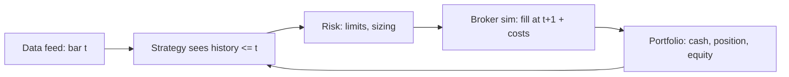

# Lesson 6.5: Backtesting, Bias, Costs, Order Books, Market Data

| Field | Value |
|---|---|
| Priority | P1 - the two things a quant developer builds most often are research/backtest infrastructure and market-data/order-book code; getting either subtly wrong is expensive and silent |
| Mode | Retrieval: A. Challenge (section 8): A. Project (section 9): B for the design and the order book, C allowed only for the CSV/report formatting code; the learner owns correctness |
| Time budget | 14-20 hours (reading 3 h, worked example 3 h, lab 1.5 h, project 8-12 h) |
| Prerequisites | 6.3 (statistics, Monte Carlo, time series), 6.4 (returns, Sharpe-related quantities, risk), 5.2-5.5 (RAII, STL, sanitizers), 5.4 (data structures with invariants), 1.4 (testing) |
| Minimum versions | C++20 (g++ 13+ or clang 16+; VERIFY with `g++ --version`); Python 3.12 standard library for the backtester |
| Deliverable | (1) A C++20 limit order book with tests, an invariant checker, a deterministic replay driver and a benchmark METHOD document (no numbers you did not measure); (2) a Python event-driven backtest engine whose report states its limitations |

Attempt first. Solutions: `../solutions/6.5-backtesting-orderbook-marketdata-solutions.md`

Every number below that comes from code was produced by running that code (g++ 14.2, Python 3.13.5; synthetic data, seeds stated). The synthetic price series are driftless random walks: **by construction no strategy has an edge on them**. Nothing in this lesson shows or implies that any strategy is profitable.

---

## 1. Engineering problem

A researcher hands you a notebook: a moving-average strategy with an annualised Sharpe ratio of 2.1 on five years of daily data, "ready to productionise". You rewrite it as an event-driven backtest and the Sharpe falls to 0.3. Later the live paper-trading account loses money. Where did 1.8 Sharpe points go?

Typical answers, each of which you must be able to demonstrate in code:

- the signal used the closing price to trade at that same close (**look-ahead**);
- the universe contained only companies that exist today (**survivorship**);
- 200 parameter combinations were tried and the best reported (**data snooping**);
- trades were free and instantaneous (**costs, slippage**);
- the Sharpe was computed on one path, whose uncertainty was never stated.

The second half of the lesson is the machine that sits underneath: the **limit order book**. A matching engine or a market-data handler that mishandles a cancel for an order that already traded, or that gives a different answer when the same feed is replayed, is a production incident. You will build the data structure with explicit invariants, a deterministic event loop, and a benchmark protocol that does not lie.

Posture for the whole lesson: a backtest is a program that tries to falsify your idea cheaply. It is never evidence of profit. The report your engine prints must say so.

## 2. Learning objectives

1. Implement an event-driven backtester in which strategy code can only see data up to the decision time, and prove it with tests that mutate the future and show past equity and the positions entering each bar are unchanged.
2. Cross-validate an event-driven engine against an independent vectorized P&L computation to numerical tolerance.
3. Demonstrate look-ahead bias, and data snooping by running code on driftless synthetic data and reporting the in-sample versus out-of-sample gap over at least 30 seeds.
4. Implement walk-forward evaluation and explain precisely what it does and does not protect against.
5. Model proportional fees and slippage, apply position limits, and compute Sharpe and maximum drawdown, stating their caveats.
6. Implement a price-time-priority limit order book in C++20 (add limit, add market, cancel, modify, match) with unit tests, a consistency checker, and AddressSanitizer/UBSan clean runs.
7. Process a market-data event stream deterministically, detect sequence gaps, and prove replay reproduces identical output via a checksum.
8. Write a benchmark method (what is measured, what is excluded, how many repetitions, what is reported) that another engineer can rerun, without quoting numbers you have not measured.

## 3. First-principles explanation

### 3.1 Backtest architecture: vectorized vs event-driven

**Vectorized**: compute signals for all bars as arrays, shift them, multiply by returns: `pnl[t] = pos[t-1] * ret[t]`. Fast to write and run; easy to get look-ahead wrong with one missing shift; awkward for path-dependent logic (stops, limits, cash constraints, partial fills).

**Event-driven**: a loop pushes events (bar, tick, order, fill) through components in time order: data feed -> strategy -> order manager/risk -> broker simulator -> portfolio. The strategy sees only events already delivered. Slower, more code, but structurally prevents most look-ahead and is the same shape as live trading code, so the strategy can be reused.



Use vectorized for quick research screens and as an **independent cross-check**; use event-driven when the logic depends on state. Writing both and requiring them to agree (zero costs) is one of the best bug detectors available.

**Timing convention** in this lesson: a decision at the close of bar t sees `closes[0..t]` and is filled at the close of bar t+1, plus slippage. That is a crude one-bar-delay model, not a claim about real execution.

### 3.2 Biases

- **Look-ahead**: using information not available at decision time (same-bar close for a trade at that close; restated fundamentals; full-sample normalisation). Defence: structural (the strategy sees only history up to t) plus tests that perturb the future.
- **Survivorship**: the dataset holds only assets that survived, biasing average returns upward. Defence: point-in-time universes including dead names; if the data lacks them, you can only document it.
- **Overfitting / data snooping**: with enough tries a noise strategy looks good; the best of m no-edge parameter sets has an upward-biased Sharpe growing with m. Defences: an untouched OOS set, walk-forward, reporting the number of trials, few parameters, economic rationale, multiple-testing corrections (the "deflated Sharpe ratio" of Bailey and Lopez de Prado; VERIFY the formula in the paper).
- **Other**: choosing the sample period after seeing results; ignoring corporate actions and data errors; unrealistic fills; reusing the holdout after a bad result (it is then spent).

### 3.3 Out-of-sample and walk-forward

**Hold-out**: choose parameters on the first part, evaluate once on the last. **Walk-forward**: repeat (train window, pick parameters, test on the next window) and stitch the test segments into one out-of-sample path. It protects against fitting noise *inside* a window. It does not protect against a regime that never repeats, a method chosen after peeking at all the data, window sizes tuned until it looks good, or many strategies tried with only the best reported. Every piece of information used to design the procedure is a degree of freedom.

### 3.4 Costs and slippage

Per trade: fee (commission, exchange fees, taxes) + spread crossing (half the spread if you take liquidity) + **market impact** (larger orders move the price; empirical, relative to liquidity; 6.4). Slippage is the gap between assumed and achieved price. A constant-bps cost is a placeholder, not a measurement; it cannot capture costs rising in stress, queue priority for passive orders, or your own impact. Check turnover and the break-even cost per trade: a high-turnover signal can be erased by costs.

### 3.5 Position sizing and risk controls

A strategy outputs a desire (direction/score); sizing converts it to a quantity: fixed units, fixed notional, volatility-scaled (size ~ 1/recent vol), fractional capital. Controls live **outside** the strategy so a strategy bug cannot bypass them: max position, max order size, daily loss limit, kill switch, price-sanity checks. Kelly-style sizing maximises long-run growth for a *known* edge and is dangerously aggressive when the edge is estimated.

### 3.6 Performance metrics and their caveats

```
Sharpe (annualised) = mean(r) / std(r) * sqrt(periods_per_year)      (risk-free rate subtracted if used; here rf = 0)
max drawdown        = max over t of (peak_to_t - equity_t) / peak_to_t
```

Caveats: Sharpe from one path has a large standard error (roughly proportional to 1/sqrt(years of data); the usual approximation is in Lo (2002), VERIFY the exact expression). Annualising by `sqrt(252)` assumes independent, equal-variance returns. Sharpe penalises upside and downside volatility equally, is blind to fat tails and skew (a strategy that sells insurance has a beautiful Sharpe until it does not), and is gameable by smoothing returns or by selecting the sample window. Drawdown depends on a single path and grows with sample length. Always report: number of trials tried, period length, turnover, costs assumed, and a distribution (or at least the dispersion across seeds/windows), not a single number.

### 3.7 The limit order book

A limit order: side, price, quantity, (id, timestamp). Rules of an exchange with **price-time priority**: better prices match first; at the same price, earlier orders match first (FIFO). An incoming order that crosses the opposite best price trades at the **resting (maker) order's price**; any unfilled remainder of a limit order rests; a market order takes whatever is available and its remainder is discarded (immediate-or-cancel behaviour; real venues also have other order types and rules: VERIFY the venue's specification).

Data structure:

```
bids (price descending)               asks (price ascending)
 100: [o7:30][o2:10][o9:5] -> FIFO     101: [o4:20][o8:15]
  99: [o3:50]                          102: [o5:10]
index: id -> (side, price, iterator into that level's list)
```

Operations and cost with `std::map<Price, Level>` per side and `std::list` per level, plus `unordered_map<id, locator>`:

| Op | Work | Complexity |
|---|---|---|
| add (resting) | find/insert level, push_back | O(log L) |
| match | pop FIFO front, erase empty level | O(1) per fill, O(log L) per level erased |
| cancel | hash lookup, list erase, maybe erase level | O(log L) average with O(1) list erase |
| best bid/ask | `begin()` | O(1) |
| modify | in place if quantity decreases at the same price; otherwise cancel + new (loses priority) | |

L = number of populated price levels. Price is a **signed 64-bit integer count of ticks**, never a floating-point number (equality on prices must be exact).

**Invariants (write them down; test them):**
1. No empty price level exists in either map.
2. Each `Level::total` equals the sum of its orders' quantities.
3. Every order in a level's list has an entry in `index_` pointing at it, and vice versa.
4. The book is never crossed after any operation: best bid < best ask.
5. Within a level, orders are in arrival order.
6. All resting quantities are > 0.

Why `std::list`: iterators and references stay valid when other elements are erased, so the locator remains valid until its own order is erased: O(1) cancel without scanning. Cost: each node is a separate allocation, poor cache locality. Alternatives, in increasing complexity: intrusive doubly-linked lists with a pool allocator; a contiguous array of levels indexed by `(price - base)` when the price range is bounded; a ring buffer per level. Choose after measuring (5.6). Do not start with the exotic structure.

How it fails: matching must be safe with iterator invalidation (erasing the level you are iterating); a cancel for an unknown or already filled id must be a safe no-op returning `false`; duplicate ids must be rejected; quantity must be validated (<= 0, overflow); a modify that crosses the book must trade, not rest crossed.

### 3.8 Market-data event processing

A feed delivers messages: add order (id, side, price, qty), reduce/cancel, delete, execute, replace (vocabulary resembling Nasdaq ITCH-style feeds; VERIFY any protocol against the venue's document). Handle: **sequence numbers** (detect gaps and duplicates; after a gap the book is unreliable until a snapshot); **snapshot + incremental** (apply only messages after the snapshot's sequence); **two clocks** (exchange vs receive time; never call `now()` in deterministic logic); **unknown ids** in cancel/execute (feed started mid-day, lost message); late or out-of-order data across venues.

### 3.9 Determinism and replay

Replay must give bit-identical output for identical input: it is the basis for debugging production incidents, regression tests and audit. Sources of non-determinism to remove: wall-clock time, unseeded or platform-dependent RNG (C++ `std::uniform_int_distribution` output is implementation-defined; raw `std::mt19937_64` output is specified by the standard), iteration over unordered containers where order affects output, thread interleavings (keep the book single-threaded and feed it one ordered stream), uninitialised memory, floating-point summation order, locale/formatting. Test: run twice, compare a hash of all outputs.

## 4. Worked example

### 4.1 Event-driven engine core (Python 3.12, standard library)

```python
def run_backtest(closes, strat, cfg):
    cash, shares = cfg.initial_cash, 0
    equity, pending, n_fills, costs = [cash], None, 0, 0.0
    for t in range(1, len(closes)):
        px = closes[t]
        if pending is not None:                       # decided at t-1, fills now
            target = max(-cfg.max_abs_units, min(cfg.max_abs_units, pending)) * cfg.unit
            dq = target - shares
            if dq != 0:
                fill_px = px * (1 + math.copysign(cfg.slip_bps / 1e4, dq))
                fee = abs(dq) * fill_px * cfg.fee_bps / 1e4
                cash -= dq * fill_px + fee
                costs += fee + abs(dq) * abs(fill_px - px)
                shares, n_fills = target, n_fills + 1
        equity.append(cash + shares * px)
        pending = strat(closes[: t + 1])              # history ends at t: no future visible
    return ...
```

Design reasoning:

- `strat(closes[:t+1])` hands the strategy a slice, so it cannot index beyond t. (One copy per bar makes the run O(n^2): fine for teaching, wrong for production, which passes a read-only view or incremental indicator state.)
- The risk limit is applied in the engine, not the strategy; fills happen at bar t+1's close, adverse by `slip_bps`, with proportional fees; costs are tracked separately so the report states them; equity is marked to the bar close.

### 4.2 Make the engine falsifiable: three tests that matter

1. **Future-mutation tests**: run on prices `c` and on `c2` identical before bar 150 and wildly different from bar 150 on. (a) `equity[:150]` must be equal: catches reading *later* bars. (b) The positions held entering bar 150 (`positions[:151]`: decided from data up to bar 149) must be equal: catches the subtler **same-bar** leak, where the position that earns bar t's move was decided using bar t's close. Test (a) alone does NOT catch a same-bar leak (equity before bar 150 never touches bar 150); I only noticed this while writing the lab below.
2. **Event vs vectorized cross-check** (zero costs): an independent function computes `sum held * unit * (c[t] - c[t-1])` where `held` is the signal decided two bars earlier. Equity differences must match to 1e-6 on 500 bars. Disagreement means one implementation has a timing bug.
3. **Costs monotonicity**: adding fees/slippage must lower final equity and report positive `costs_paid`.

### 4.3 What the machinery shows on noise (synthetic, driftless, seeds fixed)

Series: 1,000 bars, log-return std 0.01, mean 0, seed 11 (`synthetic_prices(1000, 11)`), strategy: long if SMA(5) > SMA(20) else short.

| Experiment | Result (code output) |
|---|---|
| Honest, zero cost, 1 unit | Sharpe -0.02, total return -0.22%, max drawdown 4.68%, 74 fills |
| Same, fee = slippage = 2 / 5 / 10 bps | Sharpe -0.12 / -0.26 / -0.50 (costs paid 7,011 / 17,528 / 35,055 on 1,000,000 initial cash) |
| Deliberately peeking strategy (reads the move it is about to earn) | Sharpe 19.2, return +94.5%, drawdown 0.00% |
| Grid search of 93 (fast, slow) pairs on first 500 bars, then evaluate the winner on bars 500-999; repeated over 40 seeds | mean in-sample best Sharpe +0.96; mean out-of-sample Sharpe of that winner -0.15 |
| Seed 11 only: best pair (10, 50) | in-sample +1.83, out-of-sample +0.48 |
| Fixed SMA 5/20 over 40 seeds | mean Sharpe -0.03, standard deviation 0.34, min -0.93, max +0.91 |
| Walk-forward (train 250, test 125, 93-pair grid, seed 11 only) | stitched OOS Sharpe +0.47 over 744 bars |

Read the last rows carefully. On a series with **no edge by construction**, a single seed shows an out-of-sample Sharpe of +0.48 and a walk-forward Sharpe of +0.47: noise, not signal. The spread across seeds (-0.93 to +0.91 for one fixed rule) tells you how large noise alone is for ~4 years of daily-like data. The in-sample winner's average of +0.96 is the selection bias made visible: you picked the best of 93 noise strategies. One run of anything proves nothing; this is why the report must state the number of trials and the dispersion.

### 4.4 The report must carry its limitations

```python
LIMITATIONS = ("LIMITATIONS: (1) Fills assume next-bar close plus fixed bps slippage; no order book, queue position, "
  "partial fills or market impact. (2) Costs are constant-bps guesses, not measured. (3) Sharpe is estimated from one "
  "path; its standard error is large and it assumes roughly i.i.d. returns. (4) Data is synthetic or user-supplied; "
  "no survivorship, corporate-action or data-quality handling. (5) If you tried several strategies or parameters, the "
  "best result is biased upward. (6) A positive backtest is NOT evidence of future profit.")
```

A test asserts the report string contains `LIMITATIONS` and `NOT evidence`; removing the disclaimer breaks the build. The report also prints `n_trials_considered`.

### 4.5 Order book: matching core (C++20)

```cpp
template <class BookSide>
Qty OrderBook::match(OrderId taker, BookSide& opp, bool buy, Price limit, bool has_limit,
                     Qty qty, std::vector<Trade>& out) {
    while (qty > 0 && !opp.empty()) {
        auto lvl_it = opp.begin();                       // best price on the opposite side
        Price p = lvl_it->first;
        if (has_limit && (buy ? p > limit : p < limit)) break;   // not crossing: stop
        Level& lvl = lvl_it->second;
        while (qty > 0 && !lvl.queue.empty()) {
            Order& maker = lvl.queue.front();            // FIFO: oldest first
            Qty fill = std::min(qty, maker.qty);
            out.push_back({taker, maker.id, p, fill});   // trade at the MAKER's price
            qty -= fill; maker.qty -= fill; lvl.total -= fill;
            if (maker.qty == 0) { index_.erase(maker.id); lvl.queue.pop_front(); }
        }
        if (lvl.queue.empty()) opp.erase(lvl_it);        // invariant 1: no empty levels
    }
    return qty;                                          // unfilled remainder
}
```

Choices: one template serves both sides (`bids_` uses `std::greater`, `asks_` uses `std::less`, so `begin()` is always the best price); the index entry is erased exactly when the maker leaves the list; `has_limit` lets limit and market orders share one matching loop. Cancel: look up the locator, subtract the order's remaining quantity from `Level::total`, erase the list node (O(1)), erase the level if empty, erase the index entry. Modify: same price and smaller quantity keeps priority (a convention; VERIFY per venue); anything else is cancel + new. Full class and tests are in the solutions file; build yours first.

### 4.6 Benchmark method (no numbers here on purpose)

1. **Workload**: explicit seed, raw `std::mt19937_64` output (not `<random>` distributions, whose output is implementation-defined) so the stream is identical everywhere: 60% add-limit within +-10 ticks of a mid, 30% cancel of a random earlier id (some stale), 10% market. State the mix.
2. **Generate before timing**; time only the replay loop.
3. **Defeat dead-code elimination and verify behaviour**: fold every trade into a checksum, print it, and check the book is never crossed.
4. **Build**: `-O2` (state flags), no sanitizers in the timed build; a separate `-fsanitize=address,undefined -O1 -g` build for correctness.
5. **Repetitions**: discard a warm-up, then at least 30 runs; report median and spread (min, p90, max). State CPU model, OS, compiler version, frequency governor; pin to a core if possible (VERIFY: `taskset`).
6. **Throughput and latency are different measurements**: per-event `steady_clock` calls add overhead, so time batches and state the clock resolution.
7. **Compare variants** (e.g. `std::list` vs a pool-allocated list) on one machine, interleaved; never compare numbers across machines. Never quote a result you did not measure.
8. **Reproducibility check**: for this lesson's reference driver, 100,000 events with seed 1 gave 62,824 trades, 3,990 resting orders and checksum 2605587585168703033 on every run, including under ASan/UBSan. Yours will differ unless generator and checksum match; it only has to be stable across runs.

## 5. Production perspective

**Correctness first.** The order book is a state machine: example tests for each rule, an invariant check after every operation in a randomised test, and a naive reference model (sorted vector, linear scan) compared on random event streams. The model is slow and obviously correct; the real book is fast and trusted only because they agree.

**Performance.** Know the complexity, then measure (5.5, 5.6). Usual wins: no per-node heap allocation (pool/arena), contiguous hot data, an indexed array instead of `unordered_map` when ids are dense, no allocation or exceptions on the matching path. Latency-critical systems care about tail latency.

**Failure, security, observability.** Cancel of an unknown id: return false, count it, log at a sampled rate. Sequence gap: stop applying, mark the book stale, request a snapshot, alert. Treat feed bytes as untrusted: bounds-check, reject impossible values (negative quantity, price outside a sanity band), cap memory. Export counters (messages by type, rejects, gaps, depth, p99 latency) and keep replay tooling that reproduces any day.

**Backtest habits.** Version data and code; store seed and config with every result; refuse to publish a result without its trial count; keep an untouched final holdout and log each use.

**What a senior engineer does differently:** writes the vectorized cross-check first; reports dispersion, not a point estimate; distrusts a daily-data Sharpe above ~2 until costs, bias and trial count are accounted for (a heuristic, not a law); asks "what would this look like on random data?" and runs it.

| Mistake | Symptom | Diagnosis |
|---|---|---|
| Signal and fill on same close | Too-good equity that vanishes with a one-bar delay | Mutation tests; delay sweep |
| Best of N parameter sets reported | In-sample far above OOS | Count trials; run on noise |
| Float prices as map keys | "Same" price in different levels | Integer ticks |
| Erasing a level while holding its iterator | Crash or ASan use-after-free | Sanitizers; erase after the loop |
| Cancel of a filled order corrupts state | Crossed book, negative totals | Randomised test with stale ids + invariant checker |
| `std::uniform_int_distribution` in benchmark | Different streams across compilers | Raw mt19937_64 output |

## 6. Failure laboratory

**The flawed backtest.** A researcher wrote this "vectorized" evaluation (Python):

```python
def flawed(closes, fast=5, slow=20):
    strat = sma_cross(fast, slow)          # long if SMA(fast) > SMA(slow) else short
    rets = []
    for t in range(1, len(closes)):
        pos = strat(closes[: t + 1])       # uses the close of bar t
        rets.append(pos * (closes[t] / closes[t - 1] - 1))   # ...to earn the move INTO bar t
    return rets
```

and a "fixed" one that differs only in `strat(closes[:t])`.

**Predict before running** (write it down):

1. On a driftless random walk with no edge, what is the expected annualised Sharpe of the honest version? Of the flawed version: zero, clearly positive, or enormous?
2. If you run the flawed version once on one 1,000-bar series, will you be able to tell it is flawed by looking at the equity curve or Sharpe?
3. Why would a 5/20 moving average leak much less than a signal like "today's return is positive"?
4. Which of the tests in 4.2 would catch it, and which would not?
5. How many random series would you need to detect the leak with a Sharpe average, and what do you compare against?

### Reveal (read after predicting)

Code output on synthetic driftless series (1,000 bars, log-return std 0.01):

| | seed 11 | mean over seeds 200-239 | min | max |
|---|---|---|---|---|
| Flawed Sharpe | +0.41 | +0.90 | -0.43 | +1.54 |
| Honest Sharpe | -0.33 | -0.04 | -1.14 | +0.59 |

Diagnosis:

- The honest version averages about 0 (-0.04), as it must on a driftless series: no strategy has an edge. The flawed version averages +0.90 across 40 seeds, a genuine leak.
- On one seed you cannot tell: +0.41 is well inside the honest version's own range (-1.14 to +0.59). The leak is large relative to the mean but small relative to single-path noise. That is exactly why subtle look-ahead survives code review and a single run.
- The 5/20 average leaks mildly because the newest close is only 1/5 of the fast average and 1/20 of the slow one, so the sign of the crossover correlates only weakly with the same-bar return; a signal like "today's return > 0" would leak almost completely (the peeking strategy of 4.3 gives Sharpe 19.2).
- Detection: test 4.2.1(b) catches it (changing bar t's close changes the position held during bar t's move); test 4.2.1(a) does not. The vectorized/event cross-check detects it only if the two implementations disagree about timing. None is guaranteed to catch every leak (e.g. full-sample normalisation of an indicator): hence the third defence, **run the strategy on random data many times and compare the mean Sharpe with zero**. This "null experiment" is the cheapest powerful test in quantitative research.
- Honest note from writing this lesson: my first version of the "peeking" strategy read `closes[t+1]` but filled at close t+1, earning t+1 -> t+2, so it was *not* peeking at the move it earned. It printed Sharpe 0.99 on noise, tempting and wrong in the other direction. A nonzero Sharpe on noise should always send you to the timing diagram first.

**Procedure for suspected look-ahead:** (1) draw the timeline: when is each input known, when is the order sent, when does it fill, which return does the position earn; (2) mutate the future and compare past outputs; (3) delay the signal one extra bar and see if performance collapses; (4) run on random-walk data for 30+ seeds; (5) cross-check with an independent implementation.

## 7. Retrieval practice

Answers in the solutions file.

1. Define look-ahead, survivorship and data-snooping bias, with one concrete example each.
2. A vectorized backtest computes `pnl = signal * returns` with no shift. What is wrong and what is the minimal fix?
3. You test 50 parameter sets on noise, and the best has in-sample Sharpe 1.4. Without running anything, is a Sharpe near 1.4 out-of-sample plausible? What would you expect, and what experiment checks it?
4. What does walk-forward evaluation protect against, and name two things it does not.
5. A strategy trades 4 times per day; costs are 3 bps per trade side. Roughly what annual cost drag in percent of capital at 1x gross exposure (252 days; say your assumptions)?
6. Why can Sharpe mislead for a strategy that sells deep out-of-the-money options?
7. List the order-book invariants. Which test would detect "empty price level left in the map"?
8. Sequence of events: add sell 101x5 (id1), add sell 101x5 (id2), add buy 101x7 (id3). Give the trades and resulting book.
9. Same book, now cancel id2 then add buy 101x10 (id4). Trades and book?
10. Why must a modify that increases quantity lose time priority, and a decrease may keep it?
11. Why is `std::list::iterator` stored in the id index valid after other orders are erased? What would break it?
12. Name four sources of non-determinism in a replay system and a test that detects them.

## 8. Independent implementation challenge

**Mode A (closed book, 90 minutes).** Implement in C++20, single header, no libraries beyond the standard library:

`class MiniBook` with `add_limit(id, side, price, qty) -> vector<Trade>`, `cancel(id) -> bool`, `best_bid()/best_ask() -> optional<Price>`, price-time priority, trades at maker price, remainder rests, duplicate or non-positive input rejected (your choice of how, documented).

Write at least 8 unit tests including: FIFO within a level; price priority across levels; partial fill with rest; cancel of unknown id; cancel then match skips the cancelled order; crossing limit order with multiple levels. Run them under `-fsanitize=address,undefined`. No `modify`, no market orders (those are in the project).

## 9. Project

**Order Book + Backtest Engine.**

| Field | Content |
|---|---|
| 1. Problem statement | Deliver (a) a C++20 limit order book library with tests, an invariant checker, a deterministic replay driver and a benchmark method document, and (b) a Python event-driven backtest engine with cost model, risk limits and a report that states its limitations. The two are independent components. |
| 2. Context | You are a quant developer. Research needs a harness that cannot flatter strategies; the trading-systems group needs an order book that is provable and replayable. |
| 3. Requirements | OB1 add limit, add market (IOC), cancel, modify, best bid/ask, depth at price, order count. OB2 integer ticks. OB3 `check_invariants()` for the section 3.7 invariants. OB4 replay driver reading a text event log with sequence numbers; outputs trades and a checksum; detects gaps and duplicates and stops with a clear error. OB5 benchmark driver and method document. BT1 engine per 4.1 with `Config` (cash, unit, fee_bps, slip_bps, position limit). BT2 vectorized cross-check. BT3 total return, Sharpe, max drawdown, turnover, costs. BT4 report with limitations and trial count. BT5 null-experiment script: a strategy on >= 30 driftless seeds, printing mean and dispersion of Sharpe. |
| 4. Constraints | Standard library only (C++20, Python 3.12). Synthetic data with recorded seeds. The demo strategy is one you do not claim has edge, and the report says what it is. Mid-project change (apply at hint level 2): the venue adds an atomic `replace(id, new_price, new_qty)`; decide whether it keeps priority, document and implement it. |
| 5. Acceptance criteria | A1 Unit tests pass, including the traces in retrieval questions 8-9. A2 Randomised comparison with a naive reference model on >= 10,000 events, invariants checked after every event, 20 seeds. A3 ASan+UBSan clean. A4 Replaying twice gives an identical checksum; changing one event changes it. A5 A sequence gap is detected. A6 Both future-mutation tests, event vs vectorized equality at zero cost, costs monotonicity, position limit, report contains the limitations. A7 Null-experiment output with your own numbers. A8 Benchmark document follows 4.6 and contains only numbers you measured, with machine details. |
| 6. Edge cases | Order larger than all depth; cancel of a filled order; duplicate ids; zero/negative qty; modify to same price with bigger qty; modify that crosses; market order on an empty side; many orders at one level; level emptied mid-match; notional overflow; series shorter than the slow window; strategy target out of range; constant prices (std 0: Sharpe is NaN, no division by zero). |
| 7. Quality requirements | RAII, no raw owning pointers, no UB, const-correct, no exceptions on the matching path; typed Python; deterministic; timing convention and units documented. |
| 8. Deliverables | Library, tests, replay driver; benchmark document and driver; backtester, tests, sample report; null-experiment output; a design note of at most 2 pages (structure choice, invariants, complexity, limitations). |
| 9. Difficulty | Advanced |
| 10. Estimated effort | 8-12 hours including debugging; the reference-model test typically finds 1-3 bugs. |
| 11. Progressive hints | L1: write the invariant checker and naive model before the fast book. L2: one templated match function for both sides; keep `Level::total` in sync in every path. L3: ASan use-after-free means you erased a level or order while holding its iterator: copy what you need, erase last. L4: a replay checksum that changes between runs points to unordered iteration, uninitialised fields or `<random>` distributions. |
| 12. Evaluation rubric (100) | Book correctness vs reference model 20; invariants and sanitizers 10; replay determinism and gap handling 10; benchmark method honesty 10; backtest structure and no-look-ahead proof 15; cross-check, costs and limits 10; report limitations and null experiment 10; design note and defence 10; code quality 5. |
| 13. Extension challenge | Replace `std::list`/`std::map` with a pool-allocated intrusive list and a price-indexed level array; show with your benchmark method whether it matters on your machine and for which workload it would not. Or add an L2 snapshot/incremental handler with gap recovery. |
| 14. Reflection questions | Which test would catch a stale-id cancel bug? What does your null experiment's dispersion say about how many years of data separate Sharpe 0.5 from 0? Which limitation in your report could flip a conclusion? |

## 10. Engineering review

- [ ] Timeline for every backtest input: known-at, used-at, fill-at; both future-mutation tests (4.2.1 a and b) present.
- [ ] Cross-check against an independent vectorized implementation; tolerance justified.
- [ ] Trial count and dispersion reported; report contains the limitations; nothing claims profitability.
- [ ] Costs and limits applied outside the strategy.
- [ ] Order book invariants enumerated, checked in tests after every operation, reference-model comparison, sanitizers clean.
- [ ] Prices are integers; no float equality on money; overflow considered.
- [ ] Unknown ids/duplicates/bad quantities handled without UB.
- [ ] Replay deterministic (checksum), no wall clock, no `<random>` distributions in the benchmark generator.
- [ ] Benchmark document: workload, exclusions, repetitions, machine, no unmeasured numbers.

Explain in writing: why your structure per side and per level; the complexity of each operation and what dominates in practice; what you chose for modify/replace priority and why; which biases your backtester cannot address; what you would do first if a result looked too good.

## 11. Mastery gate

Pass = 80/100 with no critical failure. Critical failures: (1) any claim, in code comments, report or document, that a toy strategy is or will be profitable; (2) a report without limitations or trial count; (3) a backtest with no look-ahead test; (4) an order book that can be left crossed or with empty levels, or UB found by sanitizers; (5) a benchmark document with any number not measured by you, or numbers compared across machines; (6) non-reproducible replay.

Evidence: passing test logs (normal and sanitizer builds), the null-experiment output, the replay checksum runs, and a 15-minute defence where you reconstruct the matching loop and the future-mutation test without the repository open (Mode A).

If failed: backtest side -> take a 2-line strategy of your choice, create the look-ahead variant, and show with 30 seeds that your tests and null experiment expose it; write the timeline. Order book side -> implement only `add_limit`, `cancel` and the naive reference model, then fuzz them against each other for 20 seeds until zero disagreements; then add modify.

## 12. Reflection and accountability

- What I learned:
- What I initially misunderstood:
- What took the most effort:
- Bugs and how I diagnosed them:
- What I would change:
- What remains unclear:

Ledger update: status -> (Introduced / Practised / Demonstrated / Mastered). "Demonstrated" requires the passing project and defence.

Failure log entry: one bug (symptom, first wrong hypothesis, root cause, the test that now guards it, time lost). Include at least one case where your *test* was wrong.

## References

- Bailey, D. and Lopez de Prado, M., "The Deflated Sharpe Ratio" (2014): multiple-testing correction for Sharpe; VERIFY the formula in the paper.
- Lo, A. (2002), "The Statistics of Sharpe Ratios", Financial Analysts Journal: sampling error of the Sharpe ratio.
- Harvey, C., Liu, Y. and Zhu, H. (2016), "...and the Cross-Section of Expected Returns", Review of Financial Studies: data snooping in published factors.
- en.cppreference.com: `std::map`, `std::list` iterator-invalidation rules, `std::mersenne_twister_engine` (output specified by the standard).
- Exchange ITCH-style protocol specifications (e.g. Nasdaq TotalView-ITCH, published by Nasdaq): real message vocabulary and sequencing; VERIFY the current spec.
- Google Benchmark user guide (github.com/google/benchmark): reference for repetition/aggregate reporting if you adopt the library (optional; not required here).

## Further depth (optional)

- Intrusive lists, pool allocators and price-indexed level arrays (5.6); lock-free single-producer/single-consumer queues for feed handling.
- Square-root market impact models and transaction cost analysis; queue-position modelling for passive fills.
- Purged and embargoed cross-validation for overlapping labels (Lopez de Prado).
