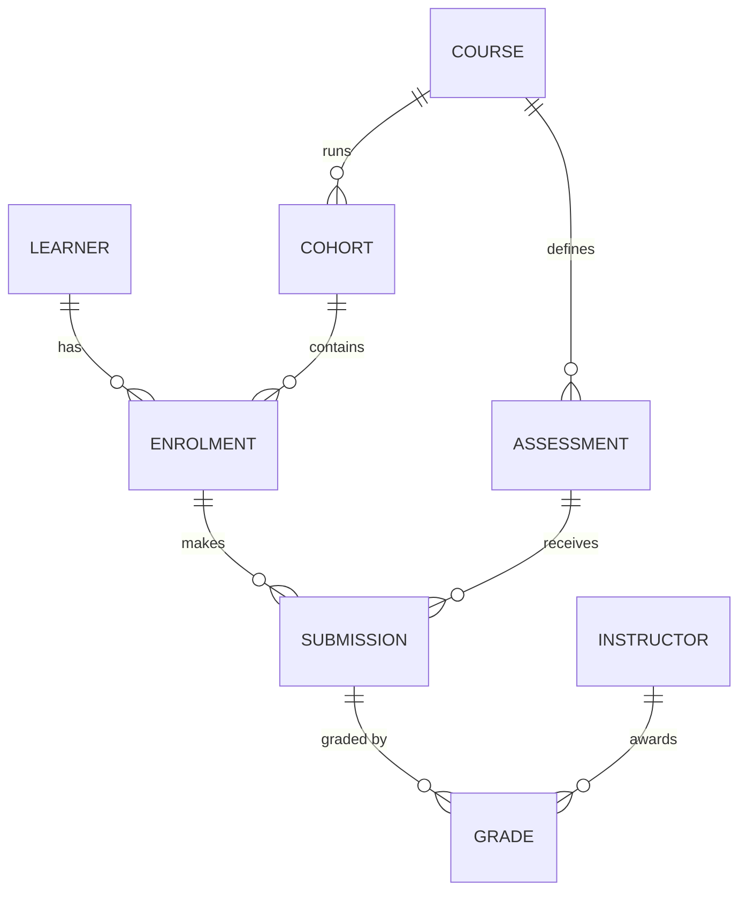

# Solutions: Lesson 2.3 SQL, Schema Design, Indexes and EXPLAIN

Attempt the lesson first. Queries below were run on PostgreSQL 18.6 against the lab data. Data is random (`random()`), so counts and timings differ per load; plan shapes are what to compare. Never copy a timing from here into your report.

## Section 7: Retrieval practice answers

1. The API is one writer among several (migrations, admin scripts, other services, bugs, concurrent requests). Constraints are enforced where every writer must pass, and some rules (uniqueness under concurrency, FK existence) cannot be checked reliably in application code without races.
2. It violates 2NF: `course_title` depends on `course_id` only, part of the key. Anomalies: renaming a course requires updating many rows (update anomaly); two rows can disagree; a course title cannot exist before an enrolment (insert anomaly).
3. The `WHERE e.status = 'completed'` discards null-extended rows, so the 3 course rows with no enrolments vanish (and any course with only non-completed enrolments): the count is the number of completed enrolments, an inner join in effect. With the condition in `ON`, every course appears at least once; `count(*)` then counts null-extended rows as 1, so use `count(e.learner_id)` to count real matches.
4. A NULL in the subquery: `x NOT IN (..., NULL)` is unknown for every non-matching x, so no rows qualify. Use `NOT EXISTS`, or filter `WHERE x IS NOT NULL` in the subquery.
5. `(course_id, submitted_at)`: equality column first, then range/sort column; the index yields rows for one course already ordered by time, so no sort and range is a contiguous slice. With `(submitted_at, course_id)` the range on the leading column spans all courses and the course filter becomes a per-entry filter; order for one course is not contiguous.
6. Selectivity: nearly every row matches, so visiting the index and then the heap for 99% of rows costs more than one sequential pass. The planner is right. (Observed: Seq Scan for `active`, Index Scan for 1% `completed`.)
7. A bad estimate: stale or missing statistics, or correlated predicates. First run `ANALYZE` on the tables and re-run; if still wrong, look at correlated columns (extended statistics) and parameter-dependent plans. Bad estimates cause wrong join order and join type.
8. `EXPLAIN ANALYZE` executes the statement and reports actual time, rows, loops. For `UPDATE/DELETE/INSERT` the change really happens, so wrap in `BEGIN; ... ROLLBACK;`.
9. `Index Only Scan` needs all referenced columns present in the index (key or `INCLUDE`) and the visibility map to be current for the pages (run `VACUUM`); otherwise it fetches heap tuples (`Heap Fetches` > 0). Observed `Heap Fetches: 0` after `VACUUM ANALYZE`.
10. Any three: InnoDB clustered PK (secondary indexes carry the PK); DDL not transactional in MySQL/MariaDB; default case-insensitive collations versus PostgreSQL case-sensitive; no partial indexes; sql_mode-dependent GROUP BY strictness; permissive implicit casts; FK columns auto-indexed in InnoDB.
11. `score - avg(score) OVER (PARTITION BY course_id)`. `GROUP BY` would collapse the rows; you would need a join back to a grouped subquery. Windows keep each row and add the aggregate beside it.
12. PostgreSQL does not index the referencing column of an FK. Deleting or updating a parent row requires finding children, and joins by that column scan the child table without an index. (The composite PK of `enrolment` covers `learner_id` as a prefix but not `course_id` alone.)

## Section 6: Failure lab scoring

Ten points: (1) 2, join-turned-inner mechanism named; (2) 2, leading-column logic and why `score` is irrelevant; (3) 3, all three indexes judged with write cost; (4) 2, predicate moved to `ON` plus `count(s.id)`; (5) 1, evidence checks. Common error: saying `LEFT JOIN` "keeps all courses" without noticing the WHERE. Point out that A and B are not just useless but have a recurring write cost.

## Section 8: Challenge reference

```sql
-- (a) learners in no course (lab data: expect 0 rows; check the generator)
SELECT l.id FROM learner l
WHERE NOT EXISTS (SELECT 1 FROM enrolment e WHERE e.learner_id = l.id);

-- (b) per course, distinct learners with a score > 90, zeros preserved (condition inside FILTER, join is LEFT)
SELECT c.code, count(DISTINCT s.learner_id) FILTER (WHERE s.score > 90) AS n
FROM course c LEFT JOIN submission s ON s.course_id = c.id
GROUP BY c.code ORDER BY c.code;

-- (c1) latest submission per (learner, course): window
SELECT learner_id, course_id, id FROM (
  SELECT learner_id, course_id, id,
         row_number() OVER (PARTITION BY learner_id, course_id
                            ORDER BY submitted_at DESC, id DESC) AS rn
  FROM submission) t WHERE rn = 1;

-- (c2) same, PostgreSQL DISTINCT ON
SELECT DISTINCT ON (learner_id, course_id) learner_id, course_id, id
FROM submission ORDER BY learner_id, course_id, submitted_at DESC, id DESC;

-- (d) daily counts with running total for course 7
SELECT d::date AS day, n, sum(n) OVER (ORDER BY d) AS running
FROM (SELECT date_trunc('day', submitted_at) AS d, count(*) AS n
      FROM submission WHERE course_id = 7 GROUP BY 1) x ORDER BY d;
```

Equality check for (c1) versus (c2), run in both directions (observed 0 and 0 rows):

```sql
WITH w AS (SELECT learner_id, course_id, id FROM (SELECT learner_id, course_id, id,
      row_number() OVER (PARTITION BY learner_id, course_id ORDER BY submitted_at DESC, id DESC) rn
      FROM submission) t WHERE rn = 1),
 d AS (SELECT DISTINCT ON (learner_id, course_id) learner_id, course_id, id FROM submission
       ORDER BY learner_id, course_id, submitted_at DESC, id DESC)
SELECT (SELECT count(*) FROM (SELECT * FROM w EXCEPT SELECT * FROM d) a) AS w_minus_d,
       (SELECT count(*) FROM (SELECT * FROM d EXCEPT SELECT * FROM w) b) AS d_minus_w;
```

Both need the `id DESC` tiebreaker or ties on `submitted_at` make the result nondeterministic and the comparison flaky.

Plan notes (observed): `DISTINCT ON` over all 300,000 submissions used an `Index Scan` on `submission_learner_idx` feeding an `Incremental Sort` (presorted key `learner_id`) and `Unique`. It reads every row because the question needs every group; no index avoids touching all 300,000 rows except a covering index in the exact sort order, and its benefit (sorted input, fewer sorts) must be measured against its write cost. A defensible answer: add at most `(learner_id, course_id, submitted_at DESC, id DESC)` and show the `Incremental Sort` disappear, or reject it with the numbers. Another defensible answer is "no new index for (c): a full-table report that runs nightly does not justify one".

For (b), the index `(course_id, submitted_at)` from the lesson already gives an efficient join side; adding `(course_id) INCLUDE (learner_id, score)` could permit an index-only scan. Reject unless the plan shows heap fetch cost dominates.

Alternative formulations to discuss: lateral join (`LEFT JOIN LATERAL ... ORDER BY submitted_at DESC LIMIT 1`) wins when few groups and a good index exist, loses on many groups; the window approach is portable to MySQL 8 and MariaDB 10.2+, `DISTINCT ON` is PostgreSQL-only.

Scoring: 25 correctness (zero preserved in b, tiebreaker in c, running total ordering in d), 25 plan evidence, 25 index discipline (at most two, each justified or rejected with evidence), 15 equality proof, 10 `indexes.sql` hygiene.

## Section 9: Project reference approach

**Schema sketch** (Mermaid):



Key decisions: `enrolment` unique `(learner_id, cohort_id)` ("once per cohort"); `submission` unique `(enrolment_id, assessment_id, attempt_no)`; `grade` unique `(submission_id, instructor_id)`, which is exactly what the mid-way double-marking change needs. Starting with `grade.submission_id UNIQUE` and relaxing it is the "schema diff, not rewrite" path; starting with a score column on `submission` forces a rewrite, which is the lesson. Final grade derived by view (`avg(score)` over grades), not stored, unless a measured read problem justifies a materialized column with a reconciliation query. `ON DELETE`: instructor deletion should `RESTRICT` (grades are history; deactivate instead); enrolment to submission `RESTRICT`; learner deletion is a privacy/erasure policy question, answer explicitly (anonymize rather than cascade is common; this is a design decision, not a fact).

**Skewed seed**: draw course choice from a Zipf-like weight in Python or with `power(random(), 3)` in SQL; state the distribution in REPORT.md, since plan choices depend on it.

**Typical index set** (max six; each needs evidence): `submission (enrolment_id, assessment_id, attempt_no)` is the unique constraint itself; `grade (instructor_id) WHERE score IS NULL` partial index for the ungraded-workload query; `enrolment (cohort_id)` for FK joins; `submission (submitted_at)` for month-over-month only if the plan shows scanning dominating. Expect to reject at least two intuitive indexes.

**Wrong LEFT JOIN query**: show with row counts, e.g. 50 courses versus fewer; report both counts.

**Port notes model entries**: window-function queries port to MySQL 8.0+/MariaDB 10.2+; `DISTINCT ON`, `FILTER (WHERE ...)` and partial indexes do not exist in MySQL (use `CASE` inside aggregates, generated columns, or filter in the query); `timestamptz` has no direct equivalent (MySQL `TIMESTAMP` is UTC-converted, `DATETIME` is not); DDL not transactional.

Rubric notes: award measurement points only when estimated versus actual rows is discussed for specific nodes; deduct 5 for any timing quoted without stating cold/warm cache; critical failure if an index appears in `indexes.sql` with no plan.

## Mastery gate notes

Ask the learner to re-run one query live and explain the top three plan nodes without notes. Check that the failure-log entry contains a hypothesis that turned out wrong.
