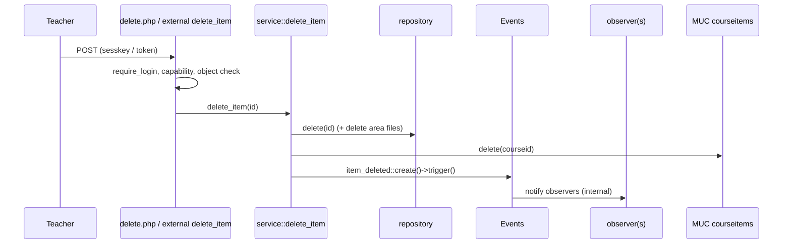

# Solutions: Lesson 3.5 (Events, Tasks, Web Services, MUC, Files, Privacy)

Docs basis: main/5.3 as read 2026-10-26; Names and signatures checked against Moodle 5.3 source (`MOODLE_503_STABLE`).

## Retrieval practice answers

1. An event is a record of something that already happened; observers are a one-way channel (documented). This forces producers not to depend on observer results and prevents observers from vetoing or rewriting history, so the log stays trustworthy.
2. `internal => true` (default): observer runs immediately, inside the producer's transaction; if it throws, the producer's transaction may roll back. `internal => false`: the observer runs after the transaction commits successfully. Use false for side effects that must not happen if the producer rolls back (emails, external calls) and where observer failure must not undo the user's action.
3. Idempotent (running twice has the same effect as once); resumable (progress persisted in the database, not memory); bounded (per-run work limited; large work split into adhoc tasks). Also: not dependent on a web session or a particular `$USER`.
4. `['classname' => 'local_readinglist\task\send_reminders', 'minute' => '0', 'hour' => '3', 'day' => '*', 'month' => '*', 'dayofweek' => '*']`. Then bump `version.php` and run the upgrade (documented step), and ensure the lang string used by `get_name()` exists.
5. `validate_parameters` cleans/validates input to the declared structure and rejects malformed input (needed because `execute()` can be called from PHP). `validate_context` applies login/course visibility/maintenance rules for the context. `require_capability` authorises the operation. You must not omit any: omitting the third allows any logged-in service user to act; omitting the first allows type confusion; omitting the second skips visibility and enrolment checks.
6. `contextid`, `component`, `filearea`, `itemid`, `filepath`, `filename`.
7. URLs are guessable and the callback is the only gate. A user with the capability in the context could request a file belonging to an item they should not see (another user's private item, an item from another course if the itemid is not checked against the course). Check the object exists, belongs to the context's course and is visible to this user.
8. It returns `false` on a miss (documented). If `false` is a legitimate value to cache, you cannot distinguish miss from hit. Cache arrays or wrap values; never cache a bare `false`. An empty array is a hit.
9. Permissions vary by user, role overrides and time. A shared entry keyed by course id would return the first user's decision to everybody (privilege escalation). Cache data, check capabilities on each request.
10. `get_contexts_for_userid`, `export_user_data`, `delete_data_for_all_users_in_context`, `delete_data_for_user`. `core_userlist_provider` adds `get_users_in_context` and `delete_data_for_users`.
11. Only if the plugin has no external links, stores no user data in tables (including IP addresses) and has no user preferences.
12. Add the new parameter as optional with a default (optional only inside nested structures: top-level `VALUE_OPTIONAL` is not allowed per the docs, so for top-level changes create a new function name), keep accepting the old parameter, document the deprecation, mark with the documented deprecation mechanism, release, wait the documented period, then remove in a major version.
13. The foreign key in install.xml is declarative for tooling; Moodle does not rely on engine-level enforcement across supported databases. Nothing deletes child rows automatically, so you must clean up via an observer (or the plugin's own deletion callbacks).

## Failure laboratory notes

See the Reveal in the lesson. Scoring: 2 points per scenario item identified correctly (10 total), plus 2 points for the diagnosis procedure. Note on observer safety: the missing `WHERE` clause is also a reason to unit-test with two courses.

## Challenge reference approach

Events: `classes/event/link_created.php` and `link_deleted.php`; `crud` 'c' and 'd'; `edulevel` `LEVEL_TEACHING`; `objecttable` `local_shortlinks_link`; `other` contains `code` only (small, JSON-safe).

Observer plugin `local_linkaudit`: `db/events.php` registering `\local_shortlinks\event\link_deleted` with callback `\local_linkaudit\observer::link_deleted`; the observer increments a counter row with `UPDATE ... SET counter = counter + 1` (atomic). Declare in `version.php` `$plugin->dependencies = ['local_shortlinks' => <minimum version>]` (documented field) so it cannot install without the producer; this is the correct coupling: event name is the public contract.

Test: `$this->redirectEvents()` exists in `advanced_testcase` (it returns an event sink); alternatively assert on the observer's effect: delete once, assert counter equals 1.

Tasks: scheduled task `find_stale_courses` (runs nightly) selects `DISTINCT courseid` having stale links (index on `(courseid, timecreated, hits)` if measured to be needed) and queues one adhoc `purge_stale_links` per course with duplicate detection `queue_adhoc_task($task, true)`. The adhoc task reads the age from `get_config('local_shortlinks', 'maxage')`, executes `DELETE FROM {local_shortlinks_link} WHERE courseid = :c AND hits = 0 AND timecreated < :t` through `$DB->execute` with placeholders; naturally idempotent because the delete is a set-based condition. Emit one `link_deleted` event per deleted link only if the audit requirement demands it (collect ids first, delete, then trigger; trade-off: N events versus one summarising event).

External function: as in the lesson; for `get_link` return `target` and `hits`; a test as a non-enrolled user asserts `\require_login_exception` or `\required_capability_exception` depending on what `validate_context` throws (`validate_context` calls `require_login`, so a non-enrolled user gets `require_login_exception`; a user lacking the capability gets `required_capability_exception`).

MUC: definition `courselinks`, mode application, `simplekeys` true (courseid ints), `simpledata` false; invalidation on create/delete in the single service class. Test: read (fills), create link, read again, assert includes the new link; comment out invalidation, confirm red.

Privacy: as in the lesson with table `local_shortlinks_link` and `userid` column (add it if you did not have it in 3.4 via upgrade step).

Alternatives: instead of an observer plugin use an observer in the same plugin (simpler, but then you do not prove the cross-plugin contract). For purge, an alternative to a task per course is a single scheduled task with a `LIMIT`-bounded delete loop; trade-off: less parallel, simpler, and a long run blocks other scheduled tasks.

## Project reference notes: `local_readinglist` v2

Architecture (Mermaid for the delete flow deliverable):

Acceptance verification:
- A1: PHPUnit with event sink or observer side effect: one event per path.
- A2: two-course test; assert other course intact and `cache->get($otherid)` still valid, deleted course's entry gone.
- A3: call `execute()` twice; assert second run sends zero reminders (counter or `reminded` timestamps unchanged).
- A4: external tests with three users; read allowed for student, delete denied with `required_capability_exception`.
- A5: instrument with a counter in a test-only decorator or compare query counts via `$DB->perf_get_reads()` (`perf_get_reads()` exists in `lib/dml/moodle_database.php`); do not claim speedups without measurement.
- A6: request the pluginfile URL as an unrelated user (a test can call the callback function directly, expecting `false` or a `require_login_exception`).
- A7: provider tests.
- A8: upgrade from v1 snapshot.

Contract table (public, do not change without deprecation): events `\local_readinglist\event\item_created|item_updated|item_deleted`; services `local_readinglist_list_items`, `local_readinglist_delete_item`; capabilities `local/readinglist:view`, `local/readinglist:manage`; file area `attachment`; cache definition `courseitems`; invalidation event string `local_readinglist_items_changed`; task class names (changing a scheduled task class name orphans its admin customisation).

Rubric notes: 18 points for services: 4 each for `validate_parameters`, `validate_context`, capability, returns structure; 2 for transaction on write. Privacy 16: 4 metadata (every field described), 4 export correctness, 4 deletion isolation, 4 userlist methods. Cap at 60 if a critical failure exists.

Extension reference (rename `status` to `readstate` in API): add the new key to `execute_returns` and populate both; keep `status` documented as deprecated; do not remove it in the same release; test both keys equal; note that renaming a returned field is a breaking change, so this approach is additive. In the DB, rename the column only with `rename_field` guarded by `field_exists`, and update install.xml; code must tolerate either name only during the single upgrade.

## Engineering review: model answers

- Events in the service layer: one emission point regardless of entry point.
- Task per course: bounded unit of retry, parallelisable, small failure blast radius; downside: many queue rows; mitigated by duplicate detection.
- Observer throwing: wrap non-essential work in try/catch with `debugging()`/log, or queue a task; never let an audit observer break the user's save.
- `capabilities` key in services.php: informational and used by tooling to describe required capabilities; it does not enforce anything inside your function.

## Remedial exercise

Pick the failed critical item (for example an unscoped observer). Write the two-course failing test first, show it red, fix, show green, and explain which documented behaviour (observer, transaction, scope) you relied on.
